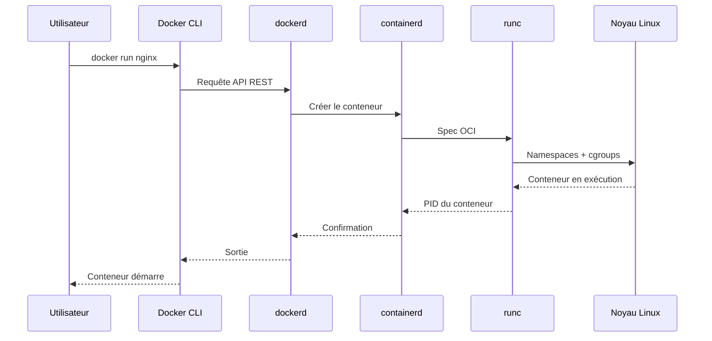
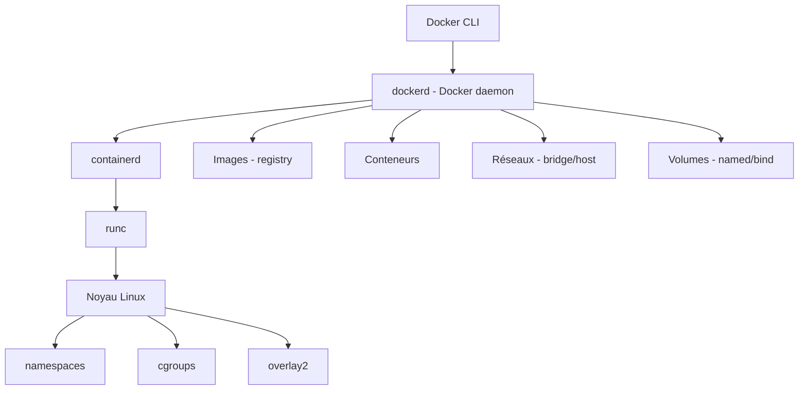
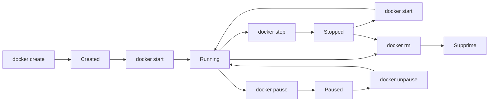

# Docker pour Linux — Mise en œuvre et déploiement de conteneurs virtuels — JOUR 1

## Introduction, Installation et Création de Conteneurs (28/09/2026)

**Fil conducteur :** Ce premier jour pose les fondations de la formation. Nous étudierons la *kill chain* des conteneurs — c'est-à-dire l'ensemble des étapes par lesquelles un conteneur est créé, configuré, exécuté et potentiellement exploité — afin de construire une démarche de déploiement sécurisé qui sera développée tout au long de la formation.

---

## Objectifs du Jour

- Comprendre les concepts fondamentaux de la conteneurisation : différence entre conteneur et machine virtuelle, rôle des images, du Docker Engine et des namespaces Linux.
- Installer et configurer Docker Engine sur Ubuntu LTS avec les bonnes pratiques (dépôt officiel, daemon, groupe docker, stockage).
- Créer, démarrer, stopper et inspecter des conteneurs à l'aide des commandes CLI essentielles.
- Construire des images personnalisées à l'aide d'un Dockerfile.
- Apprécier les enjeux de sécurité liés au déploiement de conteneurs (mapping ATT&CK / CIS Docker Benchmark).

---

## Planning du Jour

| Séquence | Horaires            | Thème                                                              | Durée   |
|-----------|---------------------|--------------------------------------------------------------------|---------|
| S1        | 9h00-10h30          | Introduction à Docker et aux conteneurs + Installation              | 1h30    |
| S1        | 10h30-12h00         | Installation et configuration de Docker sur Ubuntu                  | 1h30    |
| —       | 12h00-13h00         | Pause déjeuner                                                     | 1h      |
| S2        | 13h00-14h30         | Création de conteneurs Docker (commandes de base)                   | 1h30    |
| S2        | 14h30-16h00         | Gestion des images et personnalisation d'environnements             | 1h30    |

---

## S1 — Introduction à Docker et aux conteneurs + Installation et configuration (9h00-12h00)

### Objectifs

- Comprendre l'histoire et les concepts de base de Docker et de la conteneurisation sous Linux.
- Installer et configurer Docker Engine sur Ubuntu LTS (dépôt officiel, daemon, groupe docker, stockage).
- Vérifier le bon fonctionnement de l'installation à l'aide de commandes de diagnostic.

### Contenu Théorique

#### 1. Historique et contexte de la conteneurisation

La conteneurisation trouve ses racines dans les mécanismes d'isolation du noyau Linux. En 2003, le projet **VServer** propose une isolation de namespaces. En 2008, les *control groups* (cgroups) sont intégrés au noyau ; la même année, **LXC** (Linux Containers) fournit un runtime complet pour exécuter des conteneurs. Cependant, c'est le lancement de **Docker** en 2013 par Solomon Hykes qui démocratise la conteneurisation en offrant une interface simple, un écosystème d'images et un outillage riche.

| Année | Événement | Impact |
|-------|-----------|--------|
| 2000 | FreeBSD Jails | Premier mécanisme d'isolation de système de fichiers |
| 2008 | cgroups (noyau Linux 2.6.24) | Limitation et comptabilisation des ressources |
| 2008 | LXC | Conteneurs Linux complets (système de fichiers + processus) |
| 2013 | Docker 0.1 | Abstraction simple, Dockerfile, Hub public |
| 2015 | OCI (Open Container Initiative) | Standardisation des formats de conteneurs et images |
| 2017 | containerd | Runtime de conteneurs léger, intégré à Docker puis Kubernetes |

> **Concept clé** — Un **conteneur** est une instance légère et isolée d'un système d'exploitation, exécutant un ou plusieurs processus. Contrairement à une machine virtuelle, un conteneur ne contient pas de noyau propre : il partage le noyau de l'hôte grâce aux **namespaces** (isolation des processus, réseaux, système de fichiers) et aux **cgroups** (limitation des ressources CPU, mémoire, E/S).

> **Bon à savoir** — L'**OCI** (Open Container Initiative) est un standard fondé en 2015 par Docker et CoreOS sous l'égide de la Linux Foundation. Il définit deux spécifications : *runtime-spec* (comment exécuter un conteneur) et *image-spec* (comment construire et distribuer une image). Cette standardisation permet l'interopérabilité entre les différents runtimes (Docker, Podman, containerd, CRI-O).

#### 2. Conteneurs vs machines virtuelles

| Critère | Conteneur (Docker) | Machine virtuelle (KVM, VMware) |
|---------|---------------------|----------------------------------|
| **Noyau** | Partage le noyau de l'hôte | Chaque VM a son propre noyau |
| **Taille** | Méga-octets (images légères) | Giga-octets (image disque complet) |
| **Démarrage** | Secondes | Minutes |
| **Isolation** | Namespace + cgroups (isolation logicielle) | Hyperviseur (isolation matérielle) |
| **Performance** | Presque natif (pas de couche d'emulation) | Surcharge de l'hyperviseur |
| **Portabilité** | Identique sur tout système supportant Docker | Dépendant de la plateforme d'hyperviseur |
| **Utilisation typique** | Micro-services, CI/CD, développement | Serveurs legacy, OS hétérogènes |

> **Pourquoi Docker et pas une VM ?** — Docker est particulièrement pertinent dans les environnements Linux car il exploite directement les primitives du noyau (namespaces, cgroups, overlayfs). Cela permet de créer des environnements de développement reproductibles, d'isoler les applications les unes des autres, et d'intégrer le déploiement conteneurisé dans des pipelines CI/CD avec une agilité supérieure aux machines virtuelles.

#### 3. Architecture de Docker Engine

Le Docker Engine se compose de trois composants principaux :

| Composant | Rôle |
|-----------|------|
| **Docker CLI** (`docker`) | Client en ligne de commande qui envoie des requêtes au daemon |
| **Docker daemon** (`dockerd`) | Service principal qui gère les images, conteneurs, réseaux et volumes |
| **containerd** | Runtime de bas niveau qui gère le cycle de vie des conteneurs |
| **runc** | Outil OCI qui crée et exécute les conteneurs à partir de spécifications |

Le flux d'exécution est le suivant : l'utilisateur tape une commande `docker` → le CLI envoie une requête HTTP au daemon → le daemon délègue à containerd → containerd utilise runc pour créer le conteneur avec les namespaces et cgroups du noyau.



**Fig 1** — Séquence d'interaction entre les composants de Docker Engine lors du lancement d'un conteneur

#### 4. Cas d'usage pour les environnements Linux

| Cas d'usage | Description | Exemple concret |
|-------------|-------------|-----------------|
| **Développement local** | Environnements reproductibles pour les équipes | Docker Compose pour une stack LEMP |
| **CI/CD** | Build et test automatisés dans des conteneurs | GitLab CI avec images Docker |
| **Déploiement en production** | Micro-services orchestrés | Docker Swarm, Kubernetes |
| **Isolation applicative** | Séparation des applications sur un même hôte | Serveur web + base de données isolés |
| **Migration legacy** | Conteneurisation d'applications existantes | Application PHP dans un conteneur Ubuntu |
| **Sécurité** | Isolation et réduction de la surface d'attaque | Conteneur rootless avec cap-drop |

#### 5. Cas d'usage dans un environnement sensible

Dans un environnement de production soumis à des exigences de traçabilité, Docker offre des avantages stratégiques :

- **Reproductibilité** : un environnement d'analyse conteneurisé peut être reproduit à l'identique sur différents postes.
- **Isolation** : les outils d'analyse peuvent être isolés les uns des autres pour éviter les conflits.
- **Audit** : chaque modification est traçable via le Dockerfile et l'historique des images.
- **Sécurité** : les conteneurs rootless réduisent la surface d'attaque.

#### 6. Installation de Docker Engine sur Ubuntu

L'installation de Docker sur Ubuntu suit un processus standardisé utilisant le dépôt officiel de Docker.

> **Piège (version)** — N'installez jamais Docker via le paquet `docker.io` du dépôt Ubuntu. Ce paquet est souvent en retard par rapport à la version officielle de Docker et peut comporter des incompatibilités. Utilisez toujours le dépôt officiel de Docker pour disposer de la dernière version stable.

**Étape 1 : Mise à jour du système et installation des dépendances**

```bash
# Mise à jour de la liste des paquets
sudo apt update
# Installation des prérequis pour utiliser un dépôt APT via HTTPS
sudo apt install -y ca-certificates curl gnupg
# Ajout de la clé GPG officielle de Docker
sudo install -m 0755 -d /etc/apt/keyrings
curl -fsSL https://download.docker.com/linux/ubuntu/gpg | sudo gpg --dearmor -o /etc/apt/keyrings/docker.gpg
# --dearmor : convertit la clé ASCII en format binaire pour APT
# -o : spécifie le fichier de sortie
sudo chmod a+r /etc/apt/keyrings/docker.gpg
# chmod a+r : donne les droits de lecture à tous les utilisateurs
```

**Étape 2 : Configuration du dépôt APT**

```bash
# Ajout du dépôt Docker aux sources APT
echo \
  "deb [arch=$(dpkg --print-architecture) signed-by=/etc/apt/keyrings/docker.gpg] https://download.docker.com/linux/ubuntu \
  $(. /etc/os-release && echo "$VERSION_CODENAME") stable" | \
  sudo tee /etc/apt/sources.list.d/docker.list > /dev/null
# dpkg --print-architecture : détecte l'architecture du processeur (amd64, arm64...)
# VERSION_CODENAME : détecte le nom de la release Ubuntu (jammy, noble...)
# signed-by : utilise la clé GPG pour vérifier l'authenticité des paquets
```

**Étape 3 : Installation de Docker Engine**

```bash
# Mise à jour de la liste des paquets avec le nouveau dépôt
sudo apt update
# Installation de Docker Engine, containerd et Docker Compose
sudo apt install -y docker-ce docker-ce-cli containerd.io docker-buildx-plugin docker-compose-plugin
# docker-ce : Docker Community Edition (daemon)
# docker-ce-cli : client en ligne de commande
# containerd.io : runtime de conteneurs
# docker-buildx-plugin : extension pour le build multi-plateforme
# docker-compose-plugin : Docker Compose intégré en tant que plugin docker
```

**Étape 4 : Configuration du groupe docker**

```bash
# Ajout de l'utilisateur courant au groupe docker
sudo usermod -aG docker $USER
# -a : ajoute (ne remplace pas les groupes existants)
# -G : spécifie le groupe
# $USER : l'utilisateur courant
# Pourquoi ? Éviter d'utiliser sudo pour chaque commande docker (risque de sécurité en production)

# Application du changement de groupe (reconnexion nécessaire)
newgrp docker
# newgrp : ouvre un nouveau shell avec le groupe docker actif
```

> **Bonnes pratiques** — L'ajout de l'utilisateur au groupe `docker` est une configuration de développement uniquement. En production, envisagez l'utilisation de Docker en mode rootless ou l'exécution des commandes via un orchestrateur (Docker Swarm, Kubernetes) avec des rôles RBAC (Role-Based Access Control) stricts.

**Étape 5 : Démarrage et activation du service Docker**

```bash
# Démarrage du service Docker
sudo systemctl start docker
# Activation au démarrage du système
sudo systemctl enable docker
# Vérification du statut du service
sudo systemctl status docker
```

> **Bon à savoir** — Le service Docker est géré par **systemd**, le système d'initialisation d'Ubuntu. La commande `systemctl enable` crée un lien symbolique dans le répertoire `/etc/systemd/system/multi-user.target.wants/` pour que le service démarre automatiquement au boot.

**Étape 6 : Vérification de l'installation**

```bash
# Vérification de la version de Docker
docker --version
# Sortie attendue : Docker version 29.x.x, build xxxxxxx (version stable au moment de la formation)

# Exécution du conteneur d'hello-world (test de connectivité)
docker run hello-world
# docker run sans sudo : l'utilisateur a été ajouté au groupe docker à l'étape 4
# (newgrp docker rend le groupe effectif dans le shell courant)
# téléchargement de l'image hello-world depuis Docker Hub
# exécution d'un conteneur qui affiche un message de confirmation

# Vérification des détails du système Docker
docker info
# Affiche des informations sur le noyau, le nombre de conteneurs,
# le driver de stockage, le système de fichiers, etc.
```

#### 7. Configuration du daemon Docker (`/etc/docker/daemon.json`)

Le fichier `/etc/docker/daemon.json` permet de configurer le comportement global du Docker daemon.

```json
{
  "log-driver": "json-file",
  "log-opts": {
    "max-size": "10m",
    "max-file": "3"
  },
  "storage-driver": "overlay2",
  "dns": ["8.8.8.8", "8.8.4.4"],
  "live-restore": true,
  "userland-proxy": false
}
```

| Paramètre | Description |
|-----------|-------------|
| `log-driver` | Pilote de journalisation (json-file, syslog, journald) |
| `log-opts.max-size` | Taille maximale de chaque fichier de journal (10 Mo) |
| `log-opts.max-file` | Nombre maximum de fichiers de journal (rotation) |
| `storage-driver` | Pilote de stockage (overlay2 recommandé pour Ubuntu) |
| `dns` | Serveurs DNS utilisés par les conteneurs |
| `live-restore` | Maintient les conteneurs actifs lors du redémarrage du daemon |
| `userland-proxy` | Désactive le proxy utilisateur (réduit la consommation de ressources) |



**Fig 2** — Architecture du Docker Engine : composants et leur interaction avec le noyau Linux

#### 8. Proxy et stockage

**Configuration du proxy (si nécessaire) :**

```bash
# Création du répertoire de configuration Docker
sudo mkdir -p /etc/systemd/system/docker.service.d

# Création du fichier de configuration proxy
cat <<EOF | sudo tee /etc/systemd/system/docker.service.d/http-proxy.conf
[Service]
Environment="HTTP_PROXY=http://proxy.demo.example:8080"
Environment="HTTPS_PROXY=http://proxy.demo.example:8080"
Environment="NO_PROXY=localhost,127.0.0.1,10.0.0.0/8"
EOF

# Rechargement de systemd et redémarrage de Docker
sudo systemctl daemon-reload
sudo systemctl restart docker
```

**Vérification du stockage :**

```bash
# Vérification du pilote de stockage utilisé
docker info | grep "Storage Driver"
# Sortie attendue : Storage Driver: overlay2 (Docker ≤ 26) ou overlayfs (Docker 27+)

# Vérification de l'espace disque Docker
docker system df
# Affiche l'espace occupé par les images, les conteneurs et les volumes
```

> **Piège (version)** — Depuis Docker Engine 27, `docker info` affiche `overlayfs` au lieu d'`overlay2` pour le pilote de stockage. Le pilote sous-jacent est le même (overlay2) ; seul l'intitulé affiché change. Ne pas considérer `overlayfs` comme une erreur sur les versions récentes d'Ubuntu.

> **Concept clé** — Le pilote **overlay2** est le pilote de stockage recommandé pour Ubuntu. Il utilise le système de fichiers overlay du noyau Linux pour gérer les *layers* (couches) des images Docker. Chaque image est composée de couches empilées, ce qui optimise l'espace disque (les couches partagées ne sont stockées qu'une seule fois) et le téléchargement (seules les couches manquantes sont récupérées).

### Mapping Sécurité

| Référence | ID | Description |
|-----------|----|-------------|
| Container and Resource Discovery | [T1518](https://attack.mitre.org/techniques/T1518) | Un attaquant peut découvrir les conteneurs et les ressources disponibles sur l'hôte |
| Deploy Container | [T1610](https://attack.mitre.org/techniques/T1610) | Déploiement d'un conteneur pour exécuter du code malveillant |
| Command and Scripting Interpreter | [T1059](https://attack.mitre.org/techniques/T1059) | Exécution de commandes dans le conteneur via Docker CLI |
| CIS Docker Benchmark | CIS 2.1 | Restreindre l'accès aux ports du daemon Docker |
| CIS Docker Benchmark | CIS 2.8 | Configurer la journalisation des événements du daemon Docker |

> **Pourquoi mapper la sécurité dès le premier jour ?** — Comprendre les vecteurs d'attaque dès le début permet d'intégrer la sécurité dans chaque décision technique. Un conteneur lancé sans restrictions peut être utilisé comme point d'entrée pour compromettre l'hôte entier (technique [T1610](https://attack.mitre.org/techniques/T1610)). Les bonnes pratiques de sécurité seront développées tout au long de la formation.

---

### Lab 1 — Installation et vérification de Docker sur Ubuntu

#### Environnement

| Élément | Valeur |
|---------|--------|
| Hôte (démonstration/lab) | **Ubuntu 22.04 LTS ou 24.04 LTS** — Docker Engine + Docker Compose (100 % Linux) |
| Réseau | 172.17.0.0/16 (bridge par défaut) |
| Utilisateur | Compte utilisateur standard avec droits sudo |
| Espace disque minimal | 20 Go |

#### Exercices (les exercices s'enchaînent pour former un lab complet)

**Exercice 1.1 — Préparation du système**

Avant d'installer Docker, il est nécessaire de préparer le système en installant les dépendances et en configurant le dépôt officiel.

```bash
# Mise à jour de la liste des paquets
sudo apt update && sudo apt upgrade -y
# apt update : met à jour la base de données des paquets
# apt upgrade : installe les mises à jour de sécurité et de stabilité
# && : chaîne les commandes (la deuxième s'exécute uniquement si la première réussit)

# Installation des prérequis
sudo apt install -y ca-certificates curl gnupg
# ca-certificates : certificats CA pour les connexions HTTPS
# curl : outil de transfert de fichiers via URL
# gnupg : gestion des clés de chiffrement
```

- [ ] Système mis à jour
- [ ] Dépendances installées

**Exercice 1.2 — Ajout du dépôt officiel Docker**

```bash
# Création du répertoire pour les clés GPG
sudo install -m 0755 -d /etc/apt/keyrings
# install -m 0755 : crée un répertoire avec les permissions rwxr-xr-x
# -d : crée le répertoire s'il n'existe pas

# Téléchargement et conversion de la clé GPG de Docker
curl -fsSL https://download.docker.com/linux/ubuntu/gpg | sudo gpg --dearmor -o /etc/apt/keyrings/docker.gpg
# -f : silencieux en cas d'erreur
# -s : mode silencieux
# -S : affiche les erreurs
# -L : suit les redirections HTTP
# gpg --dearmor : convertit la clé ASCII en format binaire

# Attribution des droits de lecture
sudo chmod a+r /etc/apt/keyrings/docker.gpg

# Ajout du dépôt Docker
echo \
  "deb [arch=$(dpkg --print-architecture) signed-by=/etc/apt/keyrings/docker.gpg] https://download.docker.com/linux/ubuntu \
  $(. /etc/os-release && echo "$VERSION_CODENAME") stable" | \
  sudo tee /etc/apt/sources.list.d/docker.list > /dev/null
```

- [ ] Clé GPG Docker ajoutée
- [ ] Dépôt Docker configuré

**Exercice 1.3 — Installation de Docker Engine**

```bash
# Mise à jour avec le nouveau dépôt
sudo apt update

# Installation des composants Docker
sudo apt install -y docker-ce docker-ce-cli containerd.io docker-buildx-plugin docker-compose-plugin
# docker-ce : Docker Community Edition
# docker-ce-cli : client docker
# containerd.io : runtime de conteneurs
# docker-buildx-plugin : extension de build
# docker-compose-plugin : Docker Compose v2 intégré

# Vérification de l'installation
docker --version
# Sortie attendue : Docker version 29.x.x, build xxxxxxx (version stable au moment de la formation)
```

- [ ] Docker Engine installé
- [ ] Version vérifiée

**Exercice 1.4 — Configuration du groupe docker et première exécution**

```bash
# Ajout de l'utilisateur au groupe docker
sudo usermod -aG docker $USER
# -a : mode ajout (ne remplace pas les groupes existants)
# -G : groupe cible

# Application immédiate (ou reconnexion)
newgrp docker

# Test avec le conteneur hello-world
docker run hello-world
# Téléchargement de l'image hello-world depuis Docker Hub
# Exécution d'un conteneur qui affiche un message de confirmation
# Sortie attendue : "Hello from Docker! This message shows that your installation appears to be working correctly."

# Vérification du statut Docker
sudo systemctl status docker
# Sortie attendue : active (running)

# Vérification du stockage
docker system df
# Affiche l'espace utilisé par les images, conteneurs, volumes et caches
```

- [ ] Groupe docker configuré
- [ ] Conteneur hello-world exécuté avec succès
- [ ] Service Docker actif

<details>
<summary>Solution détaillée du Lab 1</summary>

**Exercice 1.1 — Préparation du système**

La mise à jour initiale est indispensable pour s'assurer que le système dispose des derniers correctifs de sécurité et que les dépendances nécessaires à Docker sont disponibles.

```bash
sudo apt update && sudo apt upgrade -y
sudo apt install -y ca-certificates curl gnupg
```

Les paquets `ca-certificates`, `curl` et `gnupg` sont requis respectivement pour les connexions HTTPS sécurisées, le téléchargement de fichiers depuis Internet, et la vérification des signatures des paquets.

**Exercice 1.2 — Dépôt officiel Docker**

Le dépôt officiel de Docker est hébergé sur `download.docker.com`. Il est signé numériquement avec une clé GPG pour garantir l'authenticité des paquets. La commande `gpg --dearmor` convertit la clé ASCII en format binaire, ce qui est requis par APT.

La ligne `deb [...]` ajoute le dépôt aux sources APT en spécifiant l'architecture, la clé de vérification et le nom de la distribution Ubuntu.

**Exercice 1.3 — Installation Docker**

L'installation de `docker-ce` installe le daemon Docker, `containerd.io` fournit le runtime de conteneurs, et `docker-compose-plugin` installe Docker Compose v2 en tant que plugin du CLI docker (utilisable via `docker compose`).

**Exercice 1.4 — Configuration et test**

L'ajout au groupe `docker` est nécessaire pour pouvoir exécuter des commandes Docker sans `sudo`. Le conteneur `hello-world` est un test minimaliste qui vérifie que Docker peut télécharger des images, créer des conteneurs et les exécuter.

</details>

### Bonnes pratiques / Contre-mesure

| Contrôle | Référence | Description |
|----------|-----------|-------------|
| Dépôt officiel | CIS 2.1 | Utiliser le dépôt officiel Docker plutôt que des dépôts tiers |
| Version à jour | CIS 2.1 | Maintenir Docker Engine à jour pour les correctifs de sécurité |
| Groupe docker | CIS 4.1 | Limiter l'accès au groupe docker aux utilisateurs autorisés |
| Journalisation | CIS 2.8 | Configurer la journalisation du daemon Docker |

> **Bonnes pratiques** — En environnement de production, préférer l'utilisation de Docker en mode rootless (`dockerd-rootless-setuptool.sh`) pour réduire la surface d'attaque. Le mode rootless utilise des namespaces d'utilisateur pour isoler le daemon Docker, empêchant ainsi une escalade de privilèges vers l'hôte.

### Ce qu'on a retenu

> - Docker s'appuie sur les primitives du noyau Linux (namespaces, cgroups, overlay2) pour offrir des conteneurs légers et performants
> - L'installation sur Ubuntu doit impérativement passer par le dépôt officiel de Docker, jamais par le paquet `docker.io` du système
> - L'ajout de l'utilisateur au groupe `docker` est une étape de configuration qui doit être gérée avec précaution en production
> - La configuration du daemon (`/etc/docker/daemon.json`) permet de gérer les journaux, le stockage et les réseaux de manière globale
> - Les enjeux de sécurité (ATT&CK T1518, T1610, T1059) sont intégrables dès le premier jour de formation

---

## S2 — Création de conteneurs Docker (13h00-16h00)

### Objectifs

- Maîtriser les commandes CLI fondamentales de Docker (`run`, `start`, `stop`, `exec`, `logs`, `rm`)
- Comprendre la gestion des images Docker (`pull`, `build`, `tag`, `push`, `history`, `inspect`)
- Personnaliser un environnement conteneurisé à l'aide d'un Dockerfile.
- Appliquer les premières mesures de sécurité (exécution non-root, limites de ressources)

### Contenu Théorique

#### 1. Le cycle de vie d'un conteneur

Un conteneur Docker traverse plusieurs états durant son cycle de vie :



**Fig 3** — Cycle de vie d'un conteneur Docker : états et transitions

| État | Description | Commande de transition |
|------|-------------|------------------------|
| **Created** | Conteneur créé mais non démarré | `docker create` ou `docker run` |
| **Running** | Conteneur en cours d'exécution | `docker start` |
| **Paused** | Conteneur en pause (processus suspendus) | `docker pause` |
| **Stopped** | Conteneur arrêté (processus terminés) | `docker stop` ou `docker kill` |
| **Supprimé** | Conteneur supprimé du système | `docker rm` |

> **Concept clé** — La différence entre `docker create` et `docker run` est importante : `docker create` crée le conteneur et alloue les ressources sans le démarrer, tandis que `docker run` est équivalent à `docker create` + `docker start`. En pratique, `docker run` est la commande la plus utilisée car elle combine les deux opérations.

#### 2. Commandes de base pour créer et gérer les conteneurs

**Création et démarrage (`docker run`)**

La commande `docker run` est la plus polyvalente de Docker. Elle crée un conteneur à partir d'une image et le démarre.

```bash
# Lancement simple d'un conteneur nginx en mode interactif
docker run --rm -it nginx:alpine sh
# --rm : supprime le conteneur à l'arrêt (évite l'accumulation de conteneurs orphelins)
# -i : interactif (maintient STDIN ouverte)
# -t : alloue un pseudo-TTY (terminal)
# nginx:alpine : image de base (nginx officiel, distribution Alpine légère)
# sh : commande à exécuter dans le conteneur

# Lancement d'un conteneur nginx en arrière-plan avec mapping de port
docker run -d --name webserver -p 8080:80 nginx:alpine
# -d : détaché (exécution en arrière-plan)
# --name webserver : nom unique du conteneur
# -p 8080:80 : mappe le port 8080 de l'hôte vers le port 80 du conteneur
# nginx:alpine : image de base
```

> **Pourquoi --rm ?** — Sans l'option `--rm`, les conteneurs arrêtés restent dans le système avec l'état `Exited`. Accumuler des dizaines de conteneurs arrêtés consomme de l'espace disque et rend le suivi difficile. En lab, toujours utiliser `--rm` pour un nettoyage automatique.

**Limitation des ressources**

```bash
# Conteneur avec limites de ressources
docker run -d --name limited-nginx \
  --memory=256m \
  --cpus=0.5 \
  --rm nginx:alpine
# --memory=256m : limite la mémoire à 256 Mo
# --cpus=0.5 : limite à 0.5 cœur CPU
# Pourquoi ? Éviter qu'un conteneur ne monopolise les ressources de l'hôte (denial of service)
```

**Gestion des conteneurs en cours d'exécution**

```bash
# Liste des conteneurs en cours d'exécution
docker ps
# Affiche : ID, Image, Commande, Création, Statut, Ports, Noms

# Liste de TOUS les conteneurs (y compris arrêtés)
docker ps -a
# -a : affiche tous les conteneurs

# Arrêt gracieux d'un conteneur (SIGTERM puis SIGKILL après 10s)
docker stop webserver
# envoie SIGTERM (signal de terminaison) puis SIGKILL après un délai

# Arrêt immédiat d'un conteneur
docker kill webserver
# envoie SIGKILL immédiatement (pas de nettoyage propre)

# Démarrage d'un conteneur existant
docker start webserver
```

**Interaction avec un conteneur en cours d'exécution**

```bash
# Exécution d'une commande dans un conteneur actif
docker exec webserver cat /etc/nginx/nginx.conf
# exec : exécute une commande dans un conteneur actif
# Affiche le fichier de configuration nginx

# Shell interactif dans un conteneur actif
docker exec -it webserver sh
# -it : mode interactif avec terminal
# Permet d'explorer le conteneur en temps réel
```

**Consultation des journaux**

```bash
# Affichage des journaux d'un conteneur
docker logs webserver
# Affiche stdout et stderr du conteneur

# Suivi en temps réel des journaux
docker logs -f webserver
# -f : follow (suit les nouveaux journaux en temps réel)

# Affichage des 50 dernières lignes
docker logs --tail 50 webserver
# --tail 50 : affiche uniquement les 50 dernières lignes

# Affichage avec horodatage
docker logs -t webserver
# -t : ajoute un horodatage à chaque ligne
```

**Suppression de conteneurs**

```bash
# Suppression d'un conteneur arrêté
docker rm webserver
# rm : supprime un conteneur (doit être arrêté)

# Suppression forcée d'un conteneur en cours d'exécution
docker rm -f webserver
# -f : force la suppression (envoie SIGKILL)

# Nettoyage de tous les conteneurs arrêtés
docker container prune
# Supprime tous les conteneurs en état Exited
```

#### 3. Gestion des images Docker

Une **image Docker** est un modèle en lecture seule contenant tout ce qui est nécessaire pour exécuter un conteneur : le système de fichiers, les dépendances, la configuration et les commandes à exécuter. Les images sont composées de **layers** (couches) empilées, chaque couche correspondant à une instruction du Dockerfile.

**Téléchargement et gestion des images**

```bash
# Téléchargement d'une image depuis Docker Hub
docker pull ubuntu:22.04
# pull : télécharge l'image depuis le registry (Docker Hub par défaut)
# ubuntu:22.04 : le tag précise la version (sans tag, c'est 'latest')

# Liste des images locales
docker images
# Affiche : Repository, Tag, Image ID, Date de création, Taille

# Recherche d'images sur Docker Hub
docker search nginx
# Affiche les images disponibles sur Docker Hub correspondant au mot-clé
```

**Analyse et inspection des images**

```bash
# Historique des couches d'une image
docker history nginx:alpine
# history : affiche les instructions du Dockerfile qui ont créé chaque couche
# Permet de comprendre la composition d'une image

# Inspection détaillée d'une image
docker inspect nginx:alpine
# Affiche les métadonnées complètes : variables d'environnement,
# points de montage, configuration réseau, etc.
# Retourne un JSON avec toutes les informations
```

**Tagging et poussée d'images**

```bash
# Création d'un tag pour une image existante
docker tag nginx:alpine registry.demo.example/demo-nginx:v1.0
# tag : crée un nouveau nom (alias) pour l'image
# registry.demo.example : adresse du registry privé (exemple fictif)
# demo-nginx : nom de l'image
# v1.0 : version de l'image
# Correction : le tag doit inclure l'adresse du registry cible, sinon
# docker push enverrait l'image vers Docker Hub (namespace monregistry)
# au lieu du registry privé utilisé par docker login.

# Connexion à un container registry
docker login registry.demo.example
# Demande les identifiants (username/password)
# Attention : registry.demo.example est un exemple fictif ; en lab isolé,
# remplacez-le par l'adresse réelle de votre registry (ou de Docker Hub).
# La commande login/push nécessite un registry accessible pour être exécutée.

# Poussée d'une image vers un registry
docker push registry.demo.example/demo-nginx:v1.0
# push : télécharge l'image vers le registry spécifié
# Les couches uniquement présentes en local sont envoyées
```

#### 4. Le Dockerfile : construction d'images personnalisées

Un **Dockerfile** est un fichier texte contenant un ensemble d'instructions qui, exécutées dans l'ordre, construisent une image Docker. C'est l'équivalent d'un script d'installation automatisée pour un conteneur.

| Instruction | Rôle |
|-------------|------|
| `FROM` | Définit l'image de base (obligatoire, doit être la première instruction) |
| `RUN` | Exécute une commande lors de la construction de l'image |
| `COPY` | Copie des fichiers de l'hôte vers l'image |
| `ADD` | Copie avec extraction automatique des archives (à éviter, préférer COPY) |
| `WORKDIR` | Définit le répertoire de travail dans l'image |
| `EXPOSE` | Documente les ports que le conteneur utilisera (informatif uniquement) |
| `ENV` | Définit des variables d'environnement |
| `ARG` | Définit des arguments de construction (disponibles uniquement pendant le build) |
| `CMD` | Commande par défaut exécutée au lancement du conteneur |
| `ENTRYPOINT` | Point d'entrée fixe du conteneur (combiné avec CMD) |
| `USER` | Définit l'utilisateur sous lequel le conteneur s'exécute |
| `LABEL` | Ajoute des métadonnées à l'image |
| `VOLUME` | Déclare un point de montage comme volume |
| `HEALTHCHECK` | Définit une commande de vérification de santé |

**Exemple de Dockerfile pour une application web simple**

```dockerfile
# Image de base : Ubuntu 22.04 minimaliste
FROM ubuntu:22.04

# Métadonnées de l'image
LABEL maintainer="demo@demo.example"
LABEL description="Application web de démonstration pour la formation Docker"

# Mise à jour du système et installation de nginx
RUN apt-get update && \
    apt-get install -y --no-install-recommends nginx curl && \
    apt-get clean && \
    rm -rf /var/lib/apt/lists/*
# apt-get update : met à jour la liste des paquets
# --no-install-recommends : installe uniquement les dépendances strictes
# apt-get clean : nettoie le cache des paquets
# rm -rf /var/lib/apt/lists/* : supprime les listes de paquets (réduit la taille de l'image)
# Pourquoi le chaînement dans un seul RUN ? Pour réduire le nombre de couches (layers)

# Copie du fichier de configuration nginx
COPY nginx.conf /etc/nginx/nginx.conf

# Copie du contenu web
COPY --chown=www-data:www-data ./html /usr/share/nginx/html
# --chown : définit le propriétaire des fichiers copiés

# Répertoire de travail
WORKDIR /usr/share/nginx/html

# Port exposé
EXPOSE 80
# EXPOSE est purement informatif : il ne publie pas le port
# Le port doit être publié avec -p lors du docker run

# Utilisateur non-root
USER www-data
# Pourquoi ? Réduire la surface d'attaque en cas de compromission du conteneur

# Commande par défaut
CMD ["nginx", "-g", "daemon off;"]
# CMD en format exec (JSON) : plus efficient que le format shell
# daemon off : nginx reste au premier plan (nécessaire pour Docker)
```

> **Piège (version)** — L'instruction `CMD` est écrasée si l'utilisateur spécifie une commande après `docker run`. Par exemple, `docker run monimage bash` ignorera le `CMD` et exécutera `bash`. Pour une commande qui ne doit jamais être écrasée, utilisez `ENTRYPOINT`.

> **Piège (exécution non-root)** — Avec `USER www-data`, nginx doit pouvoir écrire son fichier PID (`/var/run/nginx.pid`) et ses répertoires temporaires (`/var/cache/nginx`). Dans l'image `ubuntu:22.04`, ces répertoires appartiennent à `root` : un conteneur lancé avec ce Dockerfile peut échouer au démarrage avec une erreur de permission. Pour un fonctionnement non-root garanti, préférez l'image `nginxinc/nginx-unprivileged`, ou montez des `tmpfs` sur `/var/run` et `/var/cache/nginx` au lancement (`--tmpfs`). Cet exemple pédagogique illustre la démarche de durcissement ; sa mise en œuvre opérationnelle exige ces ajustements.

**Commandes de build**

```bash
# Construction d'une image depuis un Dockerfile
docker build -t demo-web:v1.0 .
# -t : nom et tag de l'image (demo-web:v1.0)
# . : contexte de build (le répertoire courant)
# Le Dockerfile doit être dans le répertoire spécifié

# Construction avec un Dockerfile nommé
docker build -f Dockerfile.prod -t demo-web:prod .
# -f : spécifie le chemin vers le Dockerfile

# Construction sans cache (utile pour les débogages)
docker build --no-cache -t demo-web:v1.0 .
# --no-cache : désactive le cache pour toutes les étapes
```



```mermaid
flowchart LR
    A[Dockerfile] --> B[docker build]
    B --> C[Layer 1: FROM ubuntu]
    C --> D[Layer 2: RUN apt-get]
    D --> E[Layer 3: COPY nginx.conf]
    E --> F[Layer 4: COPY html]
    F --> G[Layer 5: CMD nginx]
    G --> H[Image: demo-web]
    H --> I[docker run]
    I --> J[Conteneur: webserver]
```

**Fig 4** — Pipeline de construction d'image Docker : du Dockerfile au conteneur fonctionnel

#### 5. Concepts avancés pour Jour 1

**Le contexte de build (Build Context)**

Lors de la construction d'une image, Docker télécharge le contenu du répertoire spécifié (le "contexte de build") au daemon. C'est pourquoi il est essentiel d'utiliser un fichier `.dockerignore` pour exclure les fichiers inutiles (node_modules, .git, etc.) et réduire le contexte.

```text
# Fichier .dockerignore (exemple)
# Tous les fichiers .git
.git
# Tous les fichiers node_modules
node_modules
# Fichiers temporaires
*.tmp
*.log
# Fichiers de configuration Docker
docker-compose*.yml
Dockerfile*
```

**La différence entre CMD et ENTRYPOINT**

| Aspect | CMD | ENTRYPOINT |
|--------|-----|------------|
| Rôle | Définit la commande par défaut | Définit le point d'entrée fixe |
| Écrasable | Oui (par la commande `docker run`) | Non (sauf avec `--entrypoint`) |
| Usage typique | Application secondaire | Script d'initialisation |
| Combinaison | Définit les arguments par défaut | Définit la commande principale |

**Le principe des couches (layers)**

Chaque instruction du Dockerfile crée une nouvelle couche (layer). Docker utilise un système de cache pour accélérer les reconstructions : si une couche et ses dépendances n'ont pas changé, Docker réutilise la couche précédemment construite.

```bash
# Exemple d'historique de couches
docker history ubuntu:22.04
# IMAGE        CREATED      CREATED BY                                      SIZE
# ce1f4...     2 weeks ago  /bin/sh -c #(nop)  CMD ["/bin/bash"]           0B
# <missing>    2 weeks ago  /bin/sh -c #(nop)  ADD file:abc123... in /      29.7MB
# Les tailles ne sont pas cumulatives : elles représentent uniquement l'incrément de chaque couche
# <missing> : avec BuildKit, les couches intermédiaires d'un même Dockerfile
# n'ont pas d'identifiant propre et sont affichées comme "<missing>"
```

> **Bonnes pratiques** — Pour réduire la taille des images, combinez les commandes `RUN` en une seule instruction, supprimez les caches avec `apt-get clean`, et utilisez des images de base minimalistes (Alpine Linux au lieu de Ubuntu). Chaque instruction RUN superflue crée une couche supplémentaire.

#### 6. Personnalisation d'un environnement conteneurisé

**Variables d'environnement et configuration dynamique**

```bash
# Passer des variables d'environnement à un conteneur
docker run -d --name app \
  -e APP_ENV=production \
  -e DB_HOST=172.17.0.2 \
  -e DB_PORT=5432 \
  demo-web:v1.0
# -e : définit une variable d'environnement
# Plusieurs -e pour plusieurs variables
```

**Points de montage (bind mounts et volumes)**

```bash
# Bind mount : monter un répertoire de l'hôte dans le conteneur
docker run -d --name web-dev \
  -v $(pwd)/html:/usr/share/nginx/html:ro \
  -p 8080:80 \
  nginx:alpine
# -v $(pwd)/html:/usr/share/nginx/html : monte le répertoire local html dans le conteneur
# :ro : mode lecture seule (le conteneur ne peut pas modifier les fichiers)
# Pourquoi en dev ? Les modifications locales sont immédiatement visibles dans le conteneur
```

**Mapping de ports**

```bash
# Publication de plusieurs ports
docker run -d --name multiport \
  -p 8080:80 \
  -p 8443:443 \
  -p 9090:9090 \
  nginx:alpine
# Chaque -p mappe un port de l'hôte vers un port du conteneur
# Format : -p hôte:conteneur ou -p hôte:conteneur/protocol
```

### Mapping Sécurité

| Référence | ID | Description |
|-----------|----|-------------|
| Deploy Container | [T1610](https://attack.mitre.org/techniques/T1610) | Un conteneur mal configuré peut être utilisé pour exécuter du code malveillant |
| Command and Scripting Interpreter | [T1059](https://attack.mitre.org/techniques/T1059) | Docker CLI utilisé pour exécuter des commandes dans les conteneurs |
| Container and Resource Discovery | [T1518](https://attack.mitre.org/techniques/T1518) | Exploration des conteneurs et images disponibles via docker ps, docker images |
| CIS Docker Benchmark | CIS 4.1 | Créer des utilisateurs spécifiques aux conteneurs |
| CIS Docker Benchmark | CIS 5.1 | Retirer les capabilities non nécessaires (--cap-drop=ALL) |
| CIS Docker Benchmark | CIS 5.3 | Ne pas monter de volumes système sensibles en lecture-écriture |
| CIS Docker Benchmark | CIS 5.22 | Limiter les ressources des conteneurs (mémoire, CPU) |

> **Pourquoi la sécurité est-elle importante dès le premier jour ?** — Chaque commande `docker run` est une opportunité d'intégrer des bonnes pratiques. Un conteneur lancé avec `--privileged` ou sans limitation de ressources constitue une porte d'entrée potentielle pour un attaquant (technique [T1610](https://attack.mitre.org/techniques/T1610)). Intégrer dès le début les bonnes pratiques (exécution non-root, cap-drop, limites de ressources) permet d'éviter de devoir corriger les habitudes plus tard.

---

### Lab 2 — Création et personnalisation d'un conteneur Docker

#### Environnement

| Élément | Valeur |
|---------|--------|
| Hôte (démonstration/lab) | **Ubuntu 22.04 LTS ou 24.04 LTS** — Docker Engine + Docker Compose (100 % Linux) |
| Réseau | 172.17.0.0/16 (bridge par défaut) |
| Image de base | ubuntu:22.04, nginx:alpine, alpine:3.19 |
| Répertoire de travail | ~/docker-lab (à créer) |

#### Exercices (les exercices s'enchaînent pour former un lab complet)

**Exercice 2.1 — Exploration des images et des conteneurs**

```bash
# Création du répertoire de travail
mkdir -p ~/docker-lab && cd ~/docker-lab
# -p : crée le répertoire et ses parents s'ils n'existent pas

# Téléchargement des images nécessaires
docker pull ubuntu:22.04
docker pull nginx:alpine
docker pull alpine:3.19
# pull : télécharge l'image depuis Docker Hub
# Chaque image est composée de plusieurs couches cachées

# Liste des images téléchargées
docker images
# Affiche : Repository, Tag, Image ID, Created, Size

# Inspection de l'image nginx:alpine
docker inspect nginx:alpine
# Affiche les métadonnées : variables d'environnement, ports, cmd, etc.

# Historique des couches de nginx:alpine
docker history nginx:alpine
# Affiche les instructions du Dockerfile et la taille de chaque couche
```

- [ ] Répertoire de travail créé
- [ ] Images téléchargées et listées
- [ ] Inspection et historique effectués

**Exercice 2.2 — Création et gestion de conteneurs**

```bash
# Création d'un conteneur nginx (sans démarrage)
docker create --name test-create nginx:alpine
# create : crée le conteneur sans le démarrer
# Vérification : docker ps -a montre le conteneur en état Created

# Démarrage du conteneur
docker start test-create
# Démarre le conteneur préalablement créé
# Vérification : docker ps montre le conteneur en état Up

# Inspection du conteneur en cours d'exécution
docker ps
# Affiche l'ID, l'image, le statut et les ports

# Arrêt du conteneur
docker stop test-create
# Arrêt gracieux (SIGTERM puis SIGKILL après 10 secondes)

# Vérification de l'arrêt
docker ps -a
# Le conteneur est en état Exited

# Démarrage du conteneur arrêté
docker start test-create
# Le conteneur redémarre

# Arrêt et suppression du conteneur
docker stop test-create && docker rm test-create
# Supprime le conteneur après l'avoir arrêté
```

- [ ] Conteneur créé, démarré, arrêté, redémarré et supprimé
- [ ] Cycle de vie observé à chaque étape

**Exercice 2.3 — Exécution interactive et consultation des journaux**

```bash
# Lancement d'un conteneur nginx en arrière-plan
docker run -d --name webserver -p 8080:80 nginx:alpine
# -d : mode détaché
# --name webserver : nom du conteneur
# -p 8080:80 : port 8080 de l'hôte vers port 80 du conteneur

# Vérification que le conteneur répond
curl http://localhost:8080
# Sortie attendue : le code HTML de la page par défaut nginx

# Consultation des journaux du conteneur
docker logs webserver
# Affiche les journaux de nginx (accès, erreurs)

# Suivi des journaux en temps réel
docker logs -f webserver
# -f : follow (CTRL+C pour quitter)

# Exécution d'une commande dans le conteneur actif
docker exec webserver cat /etc/nginx/nginx.conf
# Affiche le fichier de configuration nginx depuis le conteneur

# Shell interactif dans le conteneur
docker exec -it webserver sh
# -it : interactif avec terminal
# Exploration du conteneur, puis exit pour quitter

# Nettoyage (important pour la reproductibilité du lab)
docker stop webserver && docker rm webserver
# Arrête puis supprime le conteneur pour libérer le port 8080 et le nom webserver
```

- [ ] Conteneur nginx démarré et accessible via curl
- [ ] Journaux consultés
- [ ] Commande exécutée dans le conteneur actif
- [ ] Shell interactif testé
- [ ] Conteneur nettoyé (stop + rm)

**Exercice 2.4 — Construction d'une image personnalisée (Dockerfile)**

Cet exercice consiste à créer une image Docker personnalisée contenant une page web simple.

```bash
# Création de la structure du projet
mkdir -p ~/docker-lab/mon-site/html
cd ~/docker-lab/mon-site
```

Création du fichier `index.html` :

```bash
cat <<EOF > html/index.html
<!DOCTYPE html>
<html lang="fr">
<head>
    <meta charset="UTF-8">
    <title>Formation Docker - Démo</title>
</head>
<body>
    <h1>Bienvenue à la formation Docker</h1>
    <p>Ce site est hébergé dans un conteneur Docker personnalisé.</p>
</body>
</html>
EOF
```

Création du fichier `Dockerfile` :

```dockerfile
# Image de base : nginx sur Alpine Linux (image minimaliste)
FROM nginx:alpine

# Métadonnées de l'image
LABEL maintainer="demo@demo.example"
LABEL description="Site web de démonstration - Formation Docker"

# Copie du contenu web dans le conteneur
COPY html/ /usr/share/nginx/html/
# Copie le répertoire html/ de l'hôte vers le répertoire nginx du conteneur

# Déclaration du port
EXPOSE 80
# Port informatif uniquement (doit être publié avec -p)

# Commande par défaut
CMD ["nginx", "-g", "daemon off;"]
# nginx au premier plan pour Docker
```

```bash
# Construction de l'image
docker build -t demo-web:v1.0 .
# -t demo-web:v1.0 : nom et tag de l'image
# . : contexte de build (répertoire courant contenant le Dockerfile)

# Vérification de l'image
docker images | grep demo-web
# Affiche l'image construite avec sa taille

# Lancement du conteneur
docker run -d --name mon-site -p 8081:80 demo-web:v1.0
# -p 8081:80 : port 8081 de l'hôte vers port 80 du conteneur

# Vérification
curl http://localhost:8081
# Sortie attendue : "Bienvenue à la formation Docker"

# Nettoyage
docker stop mon-site && docker rm mon-site
```

- [ ] Structure du projet créée
- [ ] Fichier index.html généré
- [ ] Dockerfile rédigé
- [ ] Image construite avec succès
- [ ] Conteneur lancé et page accessible via curl

**Exercice 2.5 — Sécurisation du conteneur**

Cet exercice applique les premières mesures de sécurité aux conteneurs.

```bash
# Lancement d'un conteneur durci
docker run -d --name secure-web \
  --rm \
  --read-only \
  --tmpfs /var/cache/nginx \
  --tmpfs /var/run \
  --cap-drop=ALL \
  --cap-add=NET_BIND_SERVICE \
  --cap-add=SETUID \
  --cap-add=SETGID \
  --cap-add=CHOWN \
  --memory=128m \
  --cpus=0.25 \
  --pids-limit=50 \
  -p 8082:80 \
  demo-web:v1.0
# --rm : suppression automatique à l'arrêt
# --read-only : système de fichiers racine en lecture seule
# --tmpfs /var/cache/nginx : répertoire de cache en mémoire (écriture autorisée)
# --tmpfs /var/run : répertoire du fichier PID en mémoire
# --cap-drop=ALL : retire toutes les capabilities Linux
# --cap-add=NET_BIND_SERVICE : permet de se lier au port 80 (<1024)
# --cap-add=SETUID, --cap-add=SETGID : permettent au master nginx de lancer les workers en non-root
# --cap-add=CHOWN : autorise le master nginx (root) à changer le propriétaire (chown)
#   des répertoires temporaires vers l'utilisateur nginx (UID 101) au démarrage
# --memory=128m : limite la mémoire à 128 Mo
# --cpus=0.25 : limite à 0.25 de cœur CPU
# --pids-limit=50 : limite le nombre de processus à 50
# Pourquoi --tmpfs et --cap-add ? nginx écrit dans /var/cache/nginx et /var/run/nginx.pid,
# et le master (en root) doit pouvoir changer d'UID/GID pour lancer ses workers non-root.
# La capability CHOWN est réintégrée car, sans elle, nginx ne peut pas exécuter le chown()
# initial vers l'UID 101 et le conteneur refuse de démarrer (chaîne bloquante).
# Sans ces options, le conteneur durci refuserait de démarrer (attaque T1610 découragée).

# Vérification que le conteneur fonctionne
curl http://localhost:8082
# Sortie attendue : le même contenu que l'exercice précédent

# Inspection des limites appliquées
docker inspect secure-web --format 'Mémoire: {{.HostConfig.Memory}} | CPU: {{.HostConfig.NanoCpus}} | PIDs: {{.HostConfig.PidsLimit}}'
# --format : affiche uniquement les champs demandés (plus lisible qu'un grep sur le JSON brut)
# HostConfig.Memory : limite mémoire en octets (134217728 = 128 Mo)
# HostConfig.NanoCpus : limite CPU en nanocœurs (250000000 = 0.25)
# HostConfig.PidsLimit : nombre maximal de processus (50)

# Nettoyage (le flag --rm supprime le conteneur à l'arrêt)
docker stop secure-web
# Arrête le conteneur, qui est alors automatiquement supprimé grâce à --rm
```

- [ ] Conteneur sécurisé lancé
- [ ] Conteneur accessible et fonctionnel
- [ ] Limites de ressources vérifiées
- [ ] Conteneur arrêté et supprimé automatiquement (--rm)

<details>
<summary>Solution détaillée du Lab 2</summary>

**Exercice 2.1 — Exploration**

Les commandes `docker images`, `docker inspect` et `docker history` permettent d'explorer les images disponibles. `docker inspect` retourne un JSON complet avec toutes les métadonnées (variables d'environnement, point d'entrée, etc.). `docker history` montre la composition en couches de l'image, ce qui est utile pour comprendre la taille et l'optimisation d'une image.

**Exercice 2.2 — Cycle de vie**

Cet exercice illustre les transitions entre les états d'un conteneur. `docker create` alloue les ressources sans démarrer, `docker start` lance le processus, `docker stop` arrête gracieusement et `docker rm` supprime la structure du conteneur. La combinaison `docker stop && docker rm` est la manière propre de supprimer un conteneur.

**Exercice 2.3 — Interaction**

La commande `docker run -d` lance un conteneur en arrière-plan. `curl` vérifie que le service est accessible. `docker exec` permet d'exécuter des commandes dans un conteneur actif, ce qui est essentiel pour le diagnostic et la maintenance. `docker logs -f` permet un suivi en temps réel.

**Exercice 2.4 — Dockerfile**

Le Dockerfile suit un enchaînement logique : image de base (`FROM`), métadonnées (`LABEL`), installation (`RUN` si nécessaire), copie des fichiers (`COPY`), port (`EXPOSE`) et commande par défaut (`CMD`). Le build crée des couches cachées. La commande `docker build -t tag .` construit l'image depuis le répertoire courant.

**Exercice 2.5 — Sécurisation**

Les options de sécurité `--cap-drop=ALL`, `--read-only`, `--memory` et `--cpus` réduisent drastiquement la surface d'attaque du conteneur. `--cap-drop=ALL` retire toutes les capabilities Linux, puis `--cap-add` réintègre uniquement celles strictement nécessaires au fonctionnement de nginx : `NET_BIND_SERVICE` (se lier au port 80), `SETUID`/`SETGID` (changement d'UID/GID vers les workers non-root) et `CHOWN` (changement du propriétaire des répertoires temporaires vers l'utilisateur nginx). `--read-only` empêche l'écriture dans le système de fichiers du conteneur. Ces mesures sont conformes aux recommandations du CIS Docker Benchmark (sections 4.x et 5.x).

</details>

### Bonnes pratiques / Contre-mesure

| Contrôle | Référence | Description |
|----------|-----------|-------------|
| Exécution non-root | CIS 4.1 | Ne pas lancer les conteneurs en root (utiliser USER dans Dockerfile) |
| Capabilities | CIS 5.1 | Retirer les capabilities non nécessaires (`--cap-drop=ALL`) |
| Système de fichiers | CIS 5.3 | Utiliser `--read-only` quand possible |
| Limites de ressources | CIS 5.22 | Définir des limites mémoire (`--memory`) et CPU (`--cpus`) |
| Processus | CIS 5.22 | Limiter le nombre de processus (`--pids-limit`) |
| Nettoyage | — | Utiliser `--rm` pour les conteneurs temporaires |

> **Bonnes pratiques** — Le conteneur exemplaire de l'exercice 2.5 applique six contrôles de sécurité simultanés : exécution des workers en non-root (le master nginx reste en root), cap-drop=ALL, système de fichiers en lecture seule, limitation mémoire, limitation CPU et limitation de processus. Ce niveau de durcissement est le minimum attendu en environnement de production.

### Ce qu'on a retenu

> - La commande `docker run` est le point d'entrée principal pour créer et exécuter des conteneurs, avec de nombreuses options de sécurité et de configuration
> - Le cycle de vie d'un conteneur suit des états définis (Created, Running, Paused, Stopped, Supprimé) avec des commandes spécifiques pour chaque transition
> - Un Dockerfile définit la construction d'une image couche par couche ; chaque instruction crée une couche (layer) qui est cachée pour optimiser les reconstructions
> - Les premières mesures de sécurité (--cap-drop=ALL, --read-only, limites de ressources) sont simples à appliquer et réduisent significativement la surface d'attaque
> - La combinaison de `docker inspect`, `docker logs` et `docker exec` constitue l'outil de diagnostic de base pour tout administrateur Docker

---

## Synthèse

### Couverture Jour 1

| Séquence | Thème | Modules |
|-----------|-------|---------|
| S1 | Introduction à Docker et aux conteneurs + Installation et configuration | M1 |
| S2 | Création de conteneurs Docker | M2 |

### Mémo — Commandes Essentielles

```bash
# Installation et configuration
sudo apt install docker-ce docker-ce-cli containerd.io  # Installation Docker Engine
sudo usermod -aG docker $USER                            # Ajout au groupe docker
sudo systemctl start docker                              # Démarrage du service
sudo systemctl enable docker                             # Activation au démarrage

# Gestion des conteneurs
docker run -d --name nom -p 8080:80 image                # Lancer un conteneur
docker ps                                                 # Conteneurs en cours d'exécution
docker ps -a                                              # Tous les conteneurs
docker stop nom                                           # Arrêter gracieusement
docker start nom                                          # Redémarrer
docker rm nom                                             # Supprimer un conteneur
docker exec -it nom sh                                    # Shell interactif dans un conteneur
docker logs nom                                           # Consulter les journaux
docker logs -f nom                                        # Suivi en temps réel des journaux

# Gestion des images
docker pull image:tag                                     # Télécharger une image
docker images                                             # Lister les images locales
docker rmi image                                          # Supprimer une image
docker build -t nom:tag .                                 # Construire depuis un Dockerfile
docker history image                                      # Historique des couches
docker inspect image                                      # Métadonnées détaillées
docker tag source cible                                   # Renommer/taguer une image

# Sécurité et ressources
docker run --rm --read-only --cap-drop=ALL image          # Conteneur durci
docker run --memory=256m --cpus=0.5 image                 # Limites de ressources
docker system df                                          # Espace disque utilisé
docker system prune                                       # Nettoyage global (attention : destructeur)
docker system prune -a --volumes                          # Nettoyage total (images, conteneurs, volumes, caches)
```

---

## Ressources Complémentaires

### Outils Utilisés

| Outil | Version | Usage |
|-------|---------|-------|
| Docker Engine | 29.x (Community Edition) | Moteur de conteneurs (client, daemon, containerd) |
| Docker CLI | 29.x | Client en ligne de commande |
| containerd | 2.x | Runtime de bas niveau |
| Docker Compose | v2.x (plugin) | Orchestration multi-conteneurs |
| Docker Buildx | latest | Extension de build multi-plateforme |
| Ubuntu LTS | 22.04 / 24.04 | Système d'exploitation hôte |

### Références

| Document | Lien |
|----------|------|
| Documentation officielle Docker | https://docs.docker.com/ |
| Docker Hub (images officielles) | https://hub.docker.com/ |
| CIS Docker Benchmark | https://www.cisecurity.org/benchmark/docker |
| MITRE ATT&CK — Container Techniques | https://attack.mitre.org/matrices/enterprise/containers/ |
| Spécifications OCI | https://opencontainers.org/ |
| Documentation Docker — Dockerfile | https://docs.docker.com/reference/dockerfile/ |
| Documentation Docker — Bonnes pratiques de sécurité | https://docs.docker.com/engine/security/ |
| Documentation Docker — Installation sur Ubuntu | https://docs.docker.com/engine/install/ubuntu/ |
