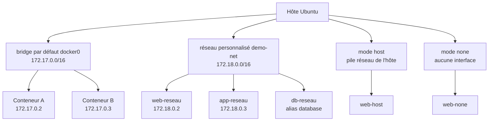
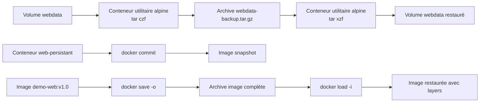
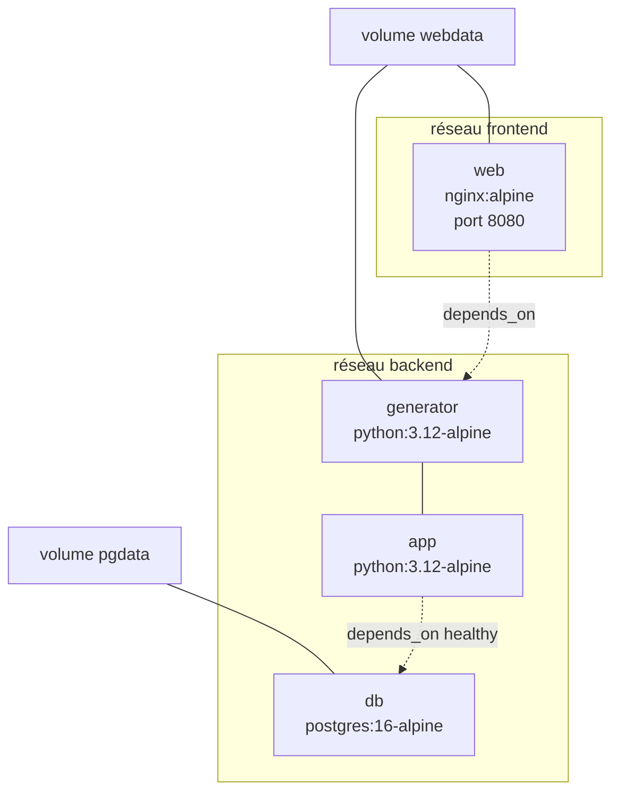
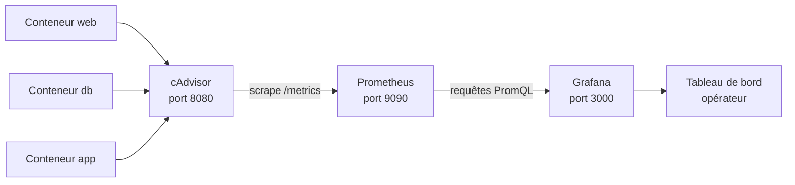

# Docker pour Linux — Mise en œuvre et déploiement de conteneurs virtuels — JOUR 2

## Gestion Avancée, Surveillance et Maintenance (29/09/2026)

**Fil conducteur :** Ce deuxième jour approfondit la *kill chain* des conteneurs en abordant la persistance des données, la mise en réseau, la sauvegarde et la supervision. Nous verrons comment ces mécanismes, mal configurés, deviennent des vecteurs d'attaque — volumes montés en écriture, réseaux trop permissifs, images non surveillées, journaux non maîtrisés — et comment les contrôles du CIS Docker Benchmark permettent de construire un déploiement sécurisé. La démarche initiée au Jour 1 (comprendre la chaîne d'attaque pour durcir chaque maillon) se poursuit ici à l'échelle des données et des communications inter-conteneurs.

---

## Objectifs du Jour

- Maîtriser la persistance des données : volumes nommés, bind mounts, tmpfs, sauvegarde et restauration des volumes.
- Configurer des réseaux Docker personnalisés et comprendre le modèle réseau (bridge, host, none, overlay).
- Sauvegarder et restaurer des conteneurs et des images (commit, export/import, save/load).
- Déployer une application multi-conteneurs avec Docker Compose (services, volumes, réseaux, healthchecks).
- Surveiller les ressources des conteneurs, mettre à jour et nettoyer le système Docker, et diagnostiquer les problèmes (stats, logs, events, healthchecks).

---

## Planning du Jour

| Séquence | Horaires            | Thème                                                                  | Durée   |
|----------|---------------------|------------------------------------------------------------------------|---------|
| S3       | 9h00-10h30          | Gestion avancée des conteneurs : volumes, réseaux, sauvegarde           | 1h30    |
| S3       | 10h30-12h00         | Docker Compose : déploiement multi-conteneurs déclaratif                | 1h30    |
| —        | 12h00-13h00         | Pause déjeuner                                                         | 1h      |
| S4       | 13h00-14h30         | Surveillance des conteneurs (stats, top, cAdvisor, Prometheus/Grafana)  | 1h30    |
| S4       | 14h30-16h00         | Mise à jour, nettoyage et diagnostic des problèmes                      | 1h30    |

---

## S3 — Gestion avancée des conteneurs (9h00-12h00)

### Objectifs

- Comprendre et mettre en œuvre la persistance des données : volumes nommés, volumes anonymes, bind mounts et tmpfs.
- Configurer des réseaux Docker personnalisés et maîtriser la communication inter-conteneurs.
- Sauvegarder et restaurer des volumes, des conteneurs et des images avec les outils appropriés.
- Déployer une application multi-conteneurs complète avec Docker Compose.

### Contenu Théorique

#### 1. La persistance des données : volumes, bind mounts et tmpfs

**Le problème de l'éphémérité des conteneurs**

Un conteneur est, par conception, une instance éphémère : son système de fichiers est constitué de la couche d'écriture du conteneur, superposée aux couches en lecture seule de l'image. Lorsque le conteneur est supprimé avec `docker rm`, cette couche d'écriture est détruite avec lui. Toute donnée produite par l'application — base de données, fichiers téléversés, journaux applicatifs — est donc perdue si elle n'est pas stockée ailleurs.

> **Concept clé** — La **couche d'écriture du conteneur** est une couche temporaire, créée au démarrage du conteneur et détruite à sa suppression. Elle est liée au cycle de vie du conteneur. Pour persister des données au-delà de ce cycle de vie, Docker propose quatre mécanismes : les **volumes nommés**, les **volumes anonymes**, les **bind mounts** et les **tmpfs**.

| Mécanisme | Emplacement du stockage | Persistance | Usage typique |
|-----------|-------------------------|-------------|---------------|
| **Volume nommé** | `/var/lib/docker/volumes/<nom>/_data` (géré par Docker) | Oui, indépendant du conteneur | Données applicatives (bases de données, fichiers) |
| **Volume anonyme** | `/var/lib/docker/volumes/<hash>/_data` (géré par Docker) | Oui, mais difficile à identifier | Données temporaires d'un conteneur |
| **Bind mount** | Répertoire ou fichier de l'hôte, choisi par l'administrateur | Oui, lié au chemin hôte | Partage de configuration, développement |
| **tmpfs** | Mémoire vive de l'hôte | Non (volatile) | Fichiers temporaires, caches, `/run` |

**Les volumes nommés**

Un volume nommé est un répertoire créé et géré par Docker, stocké sous `/var/lib/docker/volumes/`. Il est indépendant du cycle de vie des conteneurs : on peut le monter dans un conteneur, supprimer le conteneur, puis monter le même volume dans un nouveau conteneur — les données sont conservées.

```bash
# Création explicite d'un volume nommé
docker volume create webdata
# volume create : crée un volume nommé géré par Docker
# webdata : nom du volume (doit être unique sur l'hôte)

# Liste des volumes présents sur l'hôte
docker volume ls
# Affiche : DRIVER (local) et VOLUME NAME (webdata)

# Inspection détaillée d'un volume
docker volume inspect webdata
# Affiche un JSON : Name, Driver, Mountpoint (/var/lib/docker/volumes/webdata/_data),
# Labels, Options, Scope
```

Le volume est ensuite monté dans un conteneur lors du `docker run` :

```bash
# Lancement d'un conteneur nginx avec le volume webdata monté sur le répertoire web
docker run -d --name web-persistant -p 8080:80 -v webdata:/usr/share/nginx/html nginx:alpine
# -d : détaché (exécution en arrière-plan)
# --name web-persistant : nom du conteneur
# -p 8080:80 : mappe le port 8080 de l'hôte vers le port 80 du conteneur
# -v webdata:/usr/share/nginx/html : monte le volume nommé webdata sur le répertoire
#   /usr/share/nginx/html du conteneur (le contenu servi par nginx)
# nginx:alpine : image de base (nginx officiel, distribution Alpine)
```

> **Pourquoi monter un volume sur /usr/share/nginx/html ?** — Ce répertoire contient les fichiers servis par nginx. En y montant un volume, le contenu web survit à la suppression du conteneur : on peut remplacer le conteneur (mise à jour de l'image, changement de configuration) sans perdre les données. C'est le principe fondamental de la séparation entre le calcul (le conteneur) et les données (le volume).

**Les volumes anonymes**

Un volume anonyme est créé automatiquement lorsqu'on utilise `-v /chemin` sans spécifier de nom, ou lorsqu'un Dockerfile déclare une instruction `VOLUME`. Docker lui attribue un identifiant aléatoire. Il est utile pour des données temporaires, mais difficile à retrouver et à réutiliser : on lui préfère systématiquement un volume nommé pour des données durables.

```bash
# Création d'un volume anonyme (aucun nom spécifié)
docker run -d --name web-anonyme -v /usr/share/nginx/html nginx:alpine
# -v /usr/share/nginx/html : sans nom avant le deux-points, Docker crée un volume anonyme
# Le volume reçoit un identifiant hexadécimal aléatoire (visible via docker volume ls)
```

**Les bind mounts**

Un bind mount monte un répertoire ou un fichier de l'hôte directement dans le conteneur. Contrairement au volume nommé, le chemin hôte est choisi par l'administrateur et le contenu est partagé en direct : toute modification d'un côté est immédiatement visible de l'autre. C'est l'outil idéal du développement (le code source modifié sur l'hôte est servi sans reconstruire l'image) et du partage de configuration.

```bash
# Bind mount : montage du répertoire courant de l'hôte dans le conteneur
docker run -d --name web-dev \
  -v "$(pwd)/html:/usr/share/nginx/html:ro" \
  -p 8081:80 \
  nginx:alpine
# -v "$(pwd)/html:/usr/share/nginx/html:ro" : monte le répertoire html de l'hôte
#   (chemin absolu, d'où $(pwd)) sur /usr/share/nginx/html du conteneur
# :ro : lecture seule (read-only) — le conteneur ne peut pas modifier les fichiers hôte
# Pourquoi :ro ? Un conteneur compromis ne peut pas altérer les fichiers de l'hôte
#   (contrôle CIS 5.3 : ne pas monter de volumes sensibles en lecture-écriture)
```

| Option de montage | Effet |
|-------------------|-------|
| `:ro` | Lecture seule : le conteneur ne peut pas écrire dans le montage |
| `:rw` | Lecture-écriture (comportement par défaut) |
| `:Z` | Re-étiquetage SELinux du contenu pour le partage entre conteneurs (contexte spécifique) |

> **Piège (bind mount vs volume)** — Un bind mount et un volume nommé ne sont pas interchangeables. Le bind mount expose un chemin de l'hôte (dépendant du système de fichiers hôte) et convient au développement ; le volume nommé est géré par Docker, portable et recommandé en production. De plus, si le chemin hôte d'un bind mount n'existe pas, Docker le crée automatiquement en tant que répertoire — ce qui peut masquer une erreur de frappe et monter un répertoire vide.

**Les tmpfs**

Un montage `tmpfs` stocke les données en mémoire vive de l'hôte, et non sur disque. Il est volatil : les données disparaissent à l'arrêt du conteneur. Il est parfait pour les fichiers temporaires, les caches et les répertoires d'exécution (`/run`, `/var/cache`) qui n'ont pas besoin d'être persistés, tout en offrant une vitesse maximale et en réduisant l'usure des disques.

```bash
# Conteneur nginx avec répertoires temporaires en mémoire
docker run -d --name web-tmpfs \
  --tmpfs /var/cache/nginx \
  --tmpfs /var/run \
  nginx:alpine
# --tmpfs /var/cache/nginx : monte un tmpfs sur le répertoire de cache de nginx
# --tmpfs /var/run : monte un tmpfs sur le répertoire des fichiers d'exécution (PID)
# Pourquoi ? nginx écrit des fichiers temporaires ; les stocker en mémoire
#   évite l'écriture sur disque et permet un système de fichiers racine en lecture seule
```

> **Bonnes pratiques** — La combinaison `--read-only` (système de fichiers racine en lecture seule) avec des `--tmpfs` sur les répertoires d'écriture obligatoires constitue un durcissement puissant : le conteneur ne peut plus modifier son propre système de fichiers, ce qui neutralise une large classe d'attaques par écriture de fichiers malveillants (contrôle CIS 5.3).

**Gestion des volumes**

```bash
# Suppression d'un volume nommé (uniquement s'il n'est monté par aucun conteneur)
docker volume rm webdata
# volume rm : supprime le volume et son contenu — opération irréversible

# Suppression de tous les volumes non utilisés
docker volume prune
# prune : supprime les volumes non montés par au moins un conteneur
# Avertissement : Docker demande une confirmation car l'opération est destructive
# Pourquoi la confirmation ? Un volume orphelin peut contenir des données précieuses ;
#   la confirmation évite une perte accidentelle (contrôle CIS 1.13 : surveiller le stockage)
```

**Sauvegarde et restauration d'un volume par conteneur utilitaire**

La méthode de référence pour sauvegarder un volume consiste à lancer un conteneur utilitaire à partir d'une image minimale (Alpine), à monter le volume à sauvegarder et un répertoire de destination, puis à archiver le contenu avec `tar`.

```bash
# Sauvegarde du volume webdata dans une archive tar sur l'hôte
docker run --rm \
  -v webdata:/data:ro \
  -v "$(pwd):/backup" \
  alpine:3.19 \
  tar czf /backup/webdata-backup.tar.gz -C /data .
# --rm : supprime le conteneur utilitaire à la fin de l'opération
# -v webdata:/data:ro : monte le volume à sauvegarder en lecture seule
# -v "$(pwd):/backup" : monte le répertoire hôte courant pour y déposer l'archive
# alpine:3.19 : image minimale contenant tar et gzip
# tar czf /backup/webdata-backup.tar.gz : crée une archive gzip compressée
# -C /data . : archive le contenu du répertoire /data (le volume) depuis ce répertoire
```

```bash
# Restauration du volume depuis l'archive
docker run --rm \
  -v webdata:/data \
  -v "$(pwd):/backup" \
  alpine:3.19 \
  tar xzf /backup/webdata-backup.tar.gz -C /data
# tar xzf : extrait l'archive gzip
# -C /data : extrait dans le répertoire /data (le volume)
# Le volume est monté en lecture-écriture (pas de :ro) pour permettre l'écriture
```

> **Bon à savoir** — La sauvegarde par conteneur utilitaire présente deux avantages majeurs : elle ne nécessite aucun agent installé sur l'hôte (le conteneur Alpine apporte `tar`), et elle est reproductible sur n'importe quel hôte Docker. En production, cette opération doit être planifiée (cron, pipeline CI/CD) et l'archive chiffrée avant transfert hors de l'hôte.

#### 2. Le modèle réseau de Docker

**Les drivers réseau**

Docker propose cinq drivers réseau, chacun répondant à un besoin d'isolation et de connectivité :

| Driver | Isolation | Connectivité externe | Usage typique |
|--------|-----------|----------------------|---------------|
| **bridge** | Chaque conteneur reçoit une IP privée sur un réseau virtuel | Via les ports publiés (`-p`) | Réseau par défaut, réseaux personnalisés |
| **host** | Aucune : le conteneur partage la pile réseau de l'hôte | Directe, sans NAT | Applications exigeant de hautes performances réseau |
| **none** | Totale : aucun accès réseau | Aucune | Traitement hors ligne, isolation maximale |
| **overlay** | Réseau distribué entre plusieurs hôtes (cluster Swarm) | Via les services Swarm | Orchestration multi-hôtes |
| **macvlan** | Chaque conteneur reçoit une adresse MAC et IP du réseau physique | Directe | Intégration dans un réseau LAN existant |

> **Concept clé** — Le **bridge par défaut** (`docker0`) est un pont virtuel créé par Docker à l'installation, sur le sous-réseau **172.17.0.0/16**. Chaque conteneur lancé sans option `--network` y est connecté et reçoit une adresse IP de ce sous-réseau (172.17.0.2, 172.17.0.3, etc.). Ce réseau est créé automatiquement et ne doit pas être confondu avec les réseaux personnalisés, qui reçoivent généralement des sous-réseaux 172.18.0.0/16 et suivants.

> **Piège (adressage IP)** — Le bridge par défaut est **toujours** 172.17.0.0/16. Le sous-réseau 172.18.0.0/16 correspond à un **réseau bridge personnalisé**, créé par l'administrateur ou automatiquement par Docker Compose. Une confusion entre ces deux réseaux conduit à des erreurs de diagnostic : vérifiez toujours avec `docker network inspect` le sous-réseau réel d'un réseau avant de raisonner sur les adresses IP.

**Le bridge par défaut et ses limites**

Le bridge par défaut présente deux limitations importantes pour les déploiements multi-conteneurs :

1. **Pas de résolution DNS par nom de conteneur** : deux conteneurs du bridge par défaut ne peuvent communiquer que par adresse IP, ce qui est fragile (les adresses changent à chaque recréation).
2. **Pas d'isolation** : tous les conteneurs du bridge par défaut peuvent communiquer entre eux, sans segmentation possible.

**Les réseaux personnalisés**

Un réseau bridge personnalisé corrige ces deux limitations : il offre la résolution DNS intégrée par nom de conteneur et permet de segmenter les communications.

```bash
# Création d'un réseau bridge personnalisé
docker network create --driver bridge --subnet 172.18.0.0/16 demo-net
# network create : crée un réseau Docker
# --driver bridge : utilise le pilote bridge (défaut)
# --subnet 172.18.0.0/16 : sous-réseau attribué au réseau personnalisé
# demo-net : nom du réseau
# Pourquoi un sous-réseau explicite ? Pour maîtriser l'adressage et éviter les collisions ;
#   sans --subnet, Docker choisit automatiquement le prochain sous-réseau libre (172.18.0.0/16
#   si le bridge par défaut 172.17.0.0/16 est déjà utilisé)

# Liste des réseaux Docker
docker network ls
# Affiche : NETWORK ID, NAME, DRIVER, SCOPE
# Les réseaux bridge, host et none sont créés par défaut à l'installation

# Inspection détaillée d'un réseau
docker network inspect demo-net
# Affiche le JSON : Name, Driver, Subnet, Gateway, et la liste des conteneurs connectés
```

**Lancement d'un conteneur sur un réseau personnalisé**

```bash
# Lancement d'un conteneur sur le réseau personnalisé
docker run -d --name web-reseau --network demo-net -p 8082:80 nginx:alpine
# --network demo-net : connecte le conteneur au réseau personnalisé
# -p 8082:80 : publie le port 80 du conteneur sur le port 8082 de l'hôte
# La publication de port reste nécessaire pour accéder au conteneur depuis l'hôte

# Lancement d'un second conteneur sur le même réseau
docker run -d --name app-reseau --network demo-net alpine:3.19 sleep 3600
# sleep 3600 : maintient le conteneur actif pendant une heure (processus de garde)

# Test de résolution DNS par nom de conteneur
docker exec app-reseau ping -c 2 web-reseau
# exec : exécute une commande dans le conteneur actif
# ping -c 2 web-reseau : le nom web-reseau est résolu par le DNS intégré du réseau
# Pourquoi ? Sur un réseau personnalisé, Docker maintient un serveur DNS interne
#   qui résout les noms de conteneurs — la communication ne dépend plus des adresses IP
```

**Connexion et déconnexion dynamiques**

```bash
# Connexion d'un conteneur existant à un réseau
docker network connect demo-net web-persistant
# network connect : ajoute le conteneur web-persistant au réseau demo-net
# Le conteneur reçoit alors une seconde interface réseau (et une seconde IP)

# Déconnexion d'un conteneur d'un réseau
docker network disconnect demo-net web-persistant
# network disconnect : retire le conteneur du réseau
# Attention : le conteneur doit être déconnecté de tous les réseaux sauf un
```

**Les modes host et none**

```bash
# Mode host : le conteneur partage la pile réseau de l'hôte
docker run -d --name web-host --network host nginx:alpine
# --network host : aucune isolation réseau — le conteneur écoute directement
#   sur les interfaces de l'hôte (le port 80 du conteneur est le port 80 de l'hôte)
# Pourquoi l'éviter ? Aucune isolation réseau : un conteneur compromis a un accès
#   réseau identique à celui de l'hôte (contrôle CIS 4.6 : ne pas utiliser le mode host)

# Mode none : aucune interface réseau
docker run -d --name web-none --network none alpine:3.19 sleep 3600
# --network none : le conteneur ne possède aucune interface réseau
# Usage : traitement de données sensibles sans aucune connectivité sortante
```

**Les alias réseau**

```bash
# Lancement d'un conteneur avec un alias réseau
docker run -d --name db-reseau --network demo-net --network-alias database alpine:3.19 sleep 3600
# --network-alias database : le conteneur est joignable sous le nom database
#   en plus de son nom db-reseau
# Usage : un alias stable permet aux applications de viser un nom logique
#   indépendant du nom du conteneur (utile lors des remplacements de conteneurs)
```



**Fig 1** — Topologie des réseaux Docker : bridge par défaut, réseau personnalisé, modes host et none

#### 3. Sauvegarde et restauration des conteneurs et des images

Docker propose trois familles d'outils pour sauvegarder et restaurer des conteneurs et des images. Le choix dépend de ce que l'on souhaite préserver : l'état d'un conteneur, son système de fichiers, ou l'image complète avec son historique.

| Outil | Objet sauvegardé | Historique des layers | Métadonnées (ports, ENV, CMD) | Usage recommandé |
|-------|------------------|-----------------------|-------------------------------|------------------|
| `docker commit` | Un conteneur en cours d'exécution → image | Non (état figé) | Oui (héritées du conteneur) | Snapshot ponctuel, débogage |
| `docker export` / `docker import` | Le système de fichiers d'un conteneur → archive tar | Non | Non | Transfert de fichiers, migration |
| `docker save` / `docker load` | Une image complète → archive tar | Oui (toutes les couches) | Oui | Distribution et archivage d'images |

**`docker commit` : créer une image à partir d'un conteneur**

```bash
# Création d'une image à partir d'un conteneur modifié
docker commit web-persistant demo-web:snapshot-20260929
# commit : fige l'état actuel du conteneur dans une nouvelle image
# web-persistant : conteneur source
# demo-web:snapshot-20260929 : nom et tag de l'image créée
# Limites : l'image contient l'état exact du conteneur (y compris fichiers temporaires,
#   processus figés, secrets éventuels) ; elle n'est pas reproductible
```

> **Pourquoi éviter docker commit en production ?** — Un `docker commit` produit une image non reproductible : personne ne peut reconstruire à l'identique cette image à partir d'un Dockerfile. Elle peut contenir des données sensibles (historique de shell, clés, caches). La bonne pratique consiste à décrire l'image dans un Dockerfile versionné et à reconstruire systématiquement (contrôle CIS 4.1 : traçabilité des images).

**`docker export` et `docker import` : le système de fichiers nu**

```bash
# Export du système de fichiers d'un conteneur vers une archive
docker export web-persistant > web-filesystem.tar
# export : sérialise le système de fichiers du conteneur (sans les layers,
#   sans les métadonnées d'image) dans un flux tar
# > web-filesystem.tar : redirige la sortie standard vers un fichier

# Import de l'archive en tant qu'image
docker import web-filesystem.tar demo-web:imported
# import : crée une image à partir de l'archive tar
# demo-web:imported : nom et tag de l'image importée
# L'image importée ne contient ni historique, ni configuration d'origine
#   (CMD, ENV, EXPOSE sont perdus — à redéfinir au lancement)
```

**`docker save` et `docker load` : les images complètes**

```bash
# Sauvegarde d'une image complète (toutes les couches) dans une archive
docker save -o demo-web-v1.0.tar demo-web:v1.0
# save : exporte l'image avec l'intégralité de ses layers et métadonnées
# -o demo-web-v1.0.tar : écrit l'archive dans le fichier spécifié
# Usage : archivage, transfert vers un autre hôte sans registry

# Chargement d'une image depuis une archive
docker load -i demo-web-v1.0.tar
# load : importe l'image et ses layers dans le stockage local
# -i : lit l'archive depuis le fichier spécifié
# Après le chargement, l'image est listée par docker images avec son tag d'origine
```



**Fig 2** — Pipeline de sauvegarde et restauration : volumes (tar), conteneurs (commit) et images (save/load)

#### 4. Docker Compose : l'orchestration multi-conteneurs déclarative

**Principe et rôle**

Docker Compose est l'outil officiel de Docker pour définir et exécuter des applications multi-conteneurs. Au lieu d'enchaîner manuellement des dizaines de `docker run`, l'administrateur décrit l'ensemble de l'application — services, images, ports, volumes, réseaux, variables d'environnement, dépendances — dans un fichier YAML déclaratif nommé `compose.yaml` (ou `docker-compose.yml`). Une seule commande `docker compose up -d` crée et démarre toute la stack.

> **Concept clé** — Un **service** est la définition d'un conteneur dans Compose : image ou build, configuration réseau, volumes, environnement. Compose transforme chaque service en un conteneur, crée les réseaux et volumes déclarés, et gère le cycle de vie de l'ensemble. Le fichier Compose est versionnable : l'infrastructure est décrite comme du code (*Infrastructure as Code*).

> **Piège (version)** — Depuis Docker Compose v2, la commande s'écrit `docker compose` (avec un espace) : Compose est intégré au CLI Docker en tant que plugin. L'ancien binaire autonome `docker-compose` (avec un tiret) est obsolète et ne doit plus être utilisé. De même, le fichier n'a plus besoin de déclarer une clé `version:` : la spécification Compose actuelle s'applique par défaut.

**Structure d'un fichier compose.yaml**

| Clé | Rôle | Exemple |
|-----|------|---------|
| `name` | Nom du projet (préfixe des ressources créées) | `name: demo-stack` |
| `services` | Définition des conteneurs de l'application | `web:`, `db:` |
| `services.<nom>.image` | Image à utiliser | `nginx:alpine` |
| `services.<nom>.build` | Chemin du Dockerfile à construire | `./app` |
| `services.<nom>.ports` | Publication des ports (`hôte:conteneur`) | `"8080:80"` |
| `services.<nom>.volumes` | Montages (volumes nommés ou bind mounts) | `webdata:/usr/share/nginx/html` |
| `services.<nom>.environment` | Variables d'environnement | `POSTGRES_USER: demo` |
| `services.<nom>.networks` | Réseaux auxquels le service est connecté | `- frontend` |
| `services.<nom>.depends_on` | Ordre de démarrage et conditions | `db: { condition: service_healthy }` |
| `services.<nom>.restart` | Politique de redémarrage | `unless-stopped` |
| `services.<nom>.healthcheck` | Test de santé du service | `test: ["CMD", "pg_isready", ...]` |
| `volumes` | Déclaration des volumes nommés | `webdata:` |
| `networks` | Déclaration des réseaux personnalisés | `frontend:` |

**Exemple complet : une stack web à trois services**

```yaml
# compose.yaml — Stack web de démonstration (formation Docker)
name: demo-stack

services:
  web:
    image: nginx:alpine
    ports:
      - "8080:80"
    volumes:
      - webdata:/usr/share/nginx/html:ro
    networks:
      - frontend
    depends_on:
      - generator
    restart: unless-stopped

  generator:
    image: python:3.12-alpine
    command: sh -c "while true; do date > /webdata/index.html; sleep 5; done"
    volumes:
      - webdata:/webdata
    networks:
      - frontend
      - backend
    restart: unless-stopped

  app:
    image: python:3.12-alpine
    command: sh -c "python -c 'import socket; s=socket.create_connection((\"db\", 5432), 5); print(\"Connexion à la base OK\")' || echo 'Base indisponible'; sleep infinity"
    depends_on:
      db:
        condition: service_healthy
    networks:
      - backend
    restart: "no"

  db:
    image: postgres:16-alpine
    environment:
      POSTGRES_USER: demo
      POSTGRES_PASSWORD: demo_lab_2026
      POSTGRES_DB: annuaire
    volumes:
      - pgdata:/var/lib/postgresql/data
    networks:
      - backend
    healthcheck:
      test: ["CMD-SHELL", "pg_isready -U demo -d annuaire"]
      interval: 10s
      timeout: 5s
      retries: 5
    restart: unless-stopped

volumes:
  webdata:
  pgdata:

networks:
  frontend:
  backend:
```

**Lecture commentée service par service**

| Service | Image | Rôle | Points clés |
|---------|-------|------|-------------|
| `web` | `nginx:alpine` | Serveur web exposé sur le port 8080 | Monte `webdata` en lecture seule (`:ro`), réseau `frontend` uniquement |
| `generator` | `python:3.12-alpine` | Génère le contenu servi par nginx | Écrit dans `webdata` toutes les 5 secondes ; connecté à `frontend` et `backend` |
| `app` | `python:3.12-alpine` | Application de test de connectivité | Démarre seulement quand `db` est healthy (`depends_on` avec condition) |
| `db` | `postgres:16-alpine` | Base de données PostgreSQL | Volume `pgdata` pour la persistance ; healthcheck `pg_isready` |

> **Bon à savoir** — Compose crée automatiquement les réseaux et volumes déclarés, en les préfixant par le nom du projet : le réseau `frontend` devient `demo-stack_frontend`, le volume `pgdata` devient `demo-stack_pgdata`. Le premier réseau bridge personnalisé créé sur l'hôte reçoit généralement le sous-réseau 172.18.0.0/16 — c'est l'origine de la confusion fréquente avec le bridge par défaut, qui reste 172.17.0.0/16.

**Commandes essentielles de Compose**

```bash
# Démarrage de toute la stack en arrière-plan
docker compose up -d
# up : crée et démarre les services
# -d : détaché (les conteneurs tournent en arrière-plan)
# Au premier lancement, Compose télécharge les images, crée les réseaux,
#   les volumes et démarre les conteneurs dans l'ordre des dépendances

# Liste des services et de leur état
docker compose ps
# ps : affiche les conteneurs de la stack avec leur statut (Up, Healthy, Exited)

# Consultation des journaux de tous les services
docker compose logs -f
# logs : affiche les journaux concaténés des services
# -f : follow (suit les nouveaux journaux en temps réel)

# Exécution d'une commande dans un service
docker compose exec db psql -U demo -d annuaire -c '\l'
# exec : exécute une commande dans le conteneur du service db
# psql -U demo -d annuaire : interroge la base avec le client PostgreSQL

# Validation de la configuration Compose
docker compose config
# config : affiche la configuration résolue (après interpolation des variables)
# Utile pour vérifier la syntaxe YAML et les valeurs effectives avant le déploiement

# Arrêt et suppression de la stack (conteneurs et réseaux)
docker compose down
# down : arrête les conteneurs et supprime les réseaux créés par Compose
# Les volumes nommés sont conservés par défaut (les données persistent)
# Pour tout supprimer : docker compose down -v (destructeur — supprime les volumes)
```

> **Bonnes pratiques** — En production, ne jamais exposer de mots de passe en clair dans le fichier Compose. Utiliser des variables d'environnement interpolées (`${POSTGRES_PASSWORD}`) alimentées par un fichier `.env` non versionné ou par un gestionnaire de secrets. Le fichier Compose versionné ne contient alors aucune donnée sensible.



**Fig 3** — Orchestration Compose de la stack demo-stack : services, réseaux et volumes

### Mapping Sécurité

| Référence | ID | Description |
|-----------|----|-------------|
| Deploy Container | [T1610](https://attack.mitre.org/techniques/T1610) | Un conteneur monté avec des volumes en écriture ou connecté à des réseaux trop permissifs peut servir de point d'appui à un attaquant |
| Command and Scripting Interpreter | [T1059](https://attack.mitre.org/techniques/T1059) | Les commandes exécutées dans les conteneurs (docker exec, Compose exec) peuvent être détournées pour exécuter du code arbitraire |
| CIS Docker Benchmark | CIS 1.1 | Créer un répertoire dédié pour le stockage des données Docker (séparation des données) |
| CIS Docker Benchmark | CIS 1.13 | Surveiller les répertoires de stockage Docker (volumes, images) |
| CIS Docker Benchmark | CIS 4.5 | Utiliser des réseaux bridge personnalisés plutôt que le bridge par défaut |
| CIS Docker Benchmark | CIS 4.6 | Ne pas utiliser le mode réseau host (aucune isolation réseau) |
| CIS Docker Benchmark | CIS 5.3 | Ne pas monter de volumes sensibles en lecture-écriture (préférer `:ro`) |

> **Pourquoi la persistance et les réseaux sont-ils des cibles ?** — Un volume monté en lecture-écriture sur l'hôte (`/etc`, `/var/run/docker.sock`) offre à un conteneur compromis un chemin direct vers l'hôte (technique [T1610](https://attack.mitre.org/techniques/T1610)). Un réseau trop permissif permet la latéralisation : un conteneur web compromis peut atteindre la base de données. La segmentation par réseaux personnalisés et les montages en lecture seule sont les contre-mesures structurelles du CIS Docker Benchmark.

---

### Lab 3 — Déploiement d'une application multi-conteneurs avec Docker Compose

#### Environnement

| Élément | Valeur |
|---------|--------|
| Hôte (démonstration/lab) | **Ubuntu 22.04 LTS ou 24.04 LTS** — Docker Engine + Docker Compose (100 % Linux) |
| Réseau | 172.17.0.0/16 (bridge par défaut) ; réseau personnalisé 172.18.0.0/16 créé au cours du lab |
| Images utilisées | alpine:3.19, nginx:alpine, python:3.12-alpine, postgres:16-alpine |
| Répertoire de travail | ~/docker-lab (créé au Jour 1) |
| Ports publiés | 8080, 8081, 8082 (libres sur l'hôte) |

#### Exercices (les exercices s'enchaînent pour former un lab complet)

**Exercice 3.1 — Volumes nommés et persistance des données**

Cet exercice démontre la persistance d'un volume au-delà du cycle de vie d'un conteneur.

```bash
# Création du répertoire de travail du Jour 2
mkdir -p ~/docker-lab/jour2 && cd ~/docker-lab/jour2

# Création d'un volume nommé
docker volume create webdata
# volume create : crée le volume nommé webdata

# Vérification de la création
docker volume ls
# Sortie attendue : webdata apparaît dans la liste

# Lancement d'un conteneur nginx montant le volume
docker run -d --name web-persistant -p 8080:80 -v webdata:/usr/share/nginx/html nginx:alpine
# -v webdata:/usr/share/nginx/html : monte le volume sur le répertoire web de nginx

# Écriture d'un fichier dans le volume depuis le conteneur
docker exec web-persistant sh -c 'echo "<h1>Données persistantes</h1>" > /usr/share/nginx/html/index.html'
# exec : exécute la commande dans le conteneur actif
# sh -c : exécute la commande via le shell du conteneur

# Vérification : le fichier est servi par nginx
curl http://localhost:8080
# Sortie attendue : <h1>Données persistantes</h1>

# Suppression du conteneur (le volume doit survivre)
docker stop web-persistant && docker rm web-persistant
# stop : arrêt gracieux ; rm : suppression du conteneur
# Le volume webdata n'est PAS supprimé : il est indépendant du conteneur

# Recréation d'un conteneur avec le même volume
docker run -d --name web-persistant2 -p 8080:80 -v webdata:/usr/share/nginx/html nginx:alpine
# Le nouveau conteneur monte le même volume

# Vérification : les données ont survécu au remplacement du conteneur
curl http://localhost:8080
# Sortie attendue : <h1>Données persistantes</h1> — la preuve de la persistance
```

- [ ] Volume webdata créé et listé
- [ ] Fichier écrit dans le volume et servi par nginx
- [ ] Conteneur supprimé puis recréé : les données persistent

**Exercice 3.2 — Bind mounts et tmpfs**

Cet exercice distingue le bind mount (partage avec l'hôte) du tmpfs (mémoire volatile).

```bash
# Création d'un répertoire hôte contenant une page web
mkdir -p html
echo "<h1>Page depuis l'hôte</h1>" > html/index.html

# Bind mount en lecture seule
docker run -d --name web-dev -v "$(pwd)/html:/usr/share/nginx/html:ro" -p 8081:80 nginx:alpine
# -v "$(pwd)/html:/usr/share/nginx/html:ro" : monte le répertoire hôte en lecture seule
# :ro : le conteneur ne peut pas modifier le contenu hôte

# Vérification du contenu servi
curl http://localhost:8081
# Sortie attendue : <h1>Page depuis l'hôte</h1>

# Modification du fichier sur l'hôte : visible immédiatement dans le conteneur
echo "<h1>Page hôte modifiée</h1>" > html/index.html
curl http://localhost:8081
# Sortie attendue : <h1>Page hôte modifiée</h1> — le bind mount est un partage en direct

# Tentative d'écriture dans le montage en lecture seule (doit échouer)
docker exec web-dev sh -c 'echo "test" > /usr/share/nginx/html/essai.txt'
# Sortie attendue : une erreur "Read-only file system"
# Pourquoi ? Le montage :ro interdit l'écriture depuis le conteneur (contrôle CIS 5.3)

# Conteneur avec tmpfs sur les répertoires temporaires
docker run -d --name web-tmpfs --tmpfs /var/cache/nginx --tmpfs /var/run nginx:alpine
# --tmpfs /var/cache/nginx : cache nginx en mémoire
# --tmpfs /var/run : fichiers d'exécution (PID) en mémoire

# Vérification du type de montage tmpfs
docker inspect web-tmpfs --format '{{json .HostConfig.Tmpfs}}'
# Sortie attendue : {"/var/cache/nginx":"","/var/run":""}
# Pourquoi .HostConfig.Tmpfs ? Les montages tmpfs ne figurent pas dans .Mounts
#   (contrairement aux volumes et bind mounts) ; ils sont listés dans la
#   configuration d'exécution du conteneur (HostConfig)
```

- [ ] Bind mount créé et contenu servi
- [ ] Modification hôte visible dans le conteneur
- [ ] Écriture refusée en mode :ro
- [ ] tmpfs vérifié via docker inspect

**Exercice 3.3 — Sauvegarde et restauration d'un volume**

Cet exercice sauvegarde le volume `webdata` dans une archive, le détruit, puis le restaure.

```bash
# Sauvegarde du volume webdata dans une archive tar
docker run --rm \
  -v webdata:/data:ro \
  -v "$(pwd):/backup" \
  alpine:3.19 \
  tar czf /backup/webdata-backup.tar.gz -C /data .
# --rm : suppression automatique du conteneur utilitaire après l'opération
# -v webdata:/data:ro : volume source monté en lecture seule
# -v "$(pwd):/backup" : répertoire hôte de destination de l'archive
# tar czf : crée l'archive compressée ; -C /data . : archive le contenu du volume

# Vérification de l'archive créée
ls -lh webdata-backup.tar.gz
# Sortie attendue : le fichier d'archive existe (quelques kilo-octets)

# Destruction volontaire du volume (simulation d'un incident)
docker stop web-persistant2 && docker rm web-persistant2
docker volume rm webdata
# volume rm : supprime le volume et son contenu — opération irréversible
# Pourquoi le supprimer ? Pour démontrer la restauration complète depuis l'archive

# Vérification de la suppression
docker volume ls
# webdata n'apparaît plus dans la liste

# Recréation du volume
docker volume create webdata

# Restauration du contenu depuis l'archive
docker run --rm \
  -v webdata:/data \
  -v "$(pwd):/backup" \
  alpine:3.19 \
  tar xzf /backup/webdata-backup.tar.gz -C /data
# tar xzf : extrait l'archive dans le volume (monté en lecture-écriture)

# Vérification de la restauration
docker run --rm -v webdata:/data:ro alpine:3.19 ls -la /data
# Sortie attendue : index.html est présent dans le volume restauré
```

- [ ] Archive de sauvegarde créée
- [ ] Volume supprimé puis recréé
- [ ] Contenu restauré depuis l'archive

**Exercice 3.4 — Réseaux personnalisés et communication inter-conteneurs**

Cet exercice crée un réseau personnalisé et vérifie la résolution DNS par nom de conteneur.

```bash
# Suppression préventive si le réseau existe déjà (créé dans la partie théorique S3
# ou lors d'une exécution précédente du lab)
docker network rm demo-net 2>/dev/null || true
# Correction : rend la création idempotente — sans cette précaution, une seconde
#   exécution échoue avec "network with name demo-net already exists"
# 2>/dev/null : masque l'erreur si le réseau n'existe pas
# || true : garantit que la commande suivante s'exécute même si le rm échoue

# Création d'un réseau bridge personnalisé
docker network create --driver bridge --subnet 172.18.0.0/16 demo-net
# --subnet 172.18.0.0/16 : sous-réseau explicite du réseau personnalisé
# Pourquoi 172.18.0.0/16 ? C'est le sous-réseau classique du premier réseau
#   personnalisé ; le bridge par défaut reste 172.17.0.0/16

# Vérification de la création
docker network ls
# demo-net apparaît avec le driver bridge

# Lancement de deux conteneurs sur le réseau personnalisé
docker run -d --name web-reseau --network demo-net nginx:alpine
docker run -d --name app-reseau --network demo-net alpine:3.19 sleep 3600
# --network demo-net : connecte chaque conteneur au réseau personnalisé

# Test de résolution DNS par nom de conteneur
docker exec app-reseau ping -c 2 web-reseau
# Sortie attendue : 2 réponses de web-reseau (adresse 172.18.0.x)
# Pourquoi ? Le DNS interne du réseau personnalisé résout les noms de conteneurs

# Inspection du réseau : les conteneurs connectés sont listés
docker network inspect demo-net
# Affiche les conteneurs web-reseau et app-reseau avec leurs adresses IP

# Connexion dynamique d'un conteneur existant au réseau
docker network connect demo-net web-dev
# web-dev (créé à l'exercice 3.2) reçoit une seconde interface sur demo-net

# Vérification de la double connectivité
docker inspect web-dev --format '{{range $k, $v := .NetworkSettings.Networks}}{{$k}} {{end}}'
# Sortie attendue : bridge demo-net (le conteneur est sur deux réseaux)

# Déconnexion du conteneur
docker network disconnect demo-net web-dev
# network disconnect : retire web-dev du réseau demo-net
```

- [ ] Réseau demo-net créé avec le sous-réseau 172.18.0.0/16
- [ ] Résolution DNS par nom de conteneur vérifiée (ping web-reseau)
- [ ] Connexion et déconnexion dynamiques testées

**Exercice 3.5 — Déploiement de la stack avec Docker Compose**

Cet exercice déploie la stack complète décrite dans la partie théorique (web, generator, app, db).

```bash
# Création du fichier compose.yaml
cat <<'EOF' > compose.yaml
name: demo-stack

services:
  web:
    image: nginx:alpine
    ports:
      - "8080:80"
    volumes:
      - webdata:/usr/share/nginx/html:ro
    networks:
      - frontend
    depends_on:
      - generator
    restart: unless-stopped

  generator:
    image: python:3.12-alpine
    command: sh -c "while true; do date > /webdata/index.html; sleep 5; done"
    volumes:
      - webdata:/webdata
    networks:
      - frontend
      - backend
    restart: unless-stopped

  app:
    image: python:3.12-alpine
    command: sh -c "python -c 'import socket; s=socket.create_connection((\"db\", 5432), 5); print(\"Connexion à la base OK\")' || echo 'Base indisponible'; sleep infinity"
    depends_on:
      db:
        condition: service_healthy
    networks:
      - backend
    restart: "no"

  db:
    image: postgres:16-alpine
    environment:
      POSTGRES_USER: demo
      POSTGRES_PASSWORD: demo_lab_2026
      POSTGRES_DB: annuaire
    volumes:
      - pgdata:/var/lib/postgresql/data
    networks:
      - backend
    healthcheck:
      test: ["CMD-SHELL", "pg_isready -U demo -d annuaire"]
      interval: 10s
      timeout: 5s
      retries: 5
    restart: unless-stopped

volumes:
  webdata:
  pgdata:

networks:
  frontend:
  backend:
EOF
# cat <<'EOF' : crée le fichier sans interpolation des variables par le shell
# 'EOF' entre guillemets : le contenu est écrit littéralement

# Validation de la configuration
docker compose config
# config : affiche la configuration résolue — vérifie la syntaxe YAML
# Sortie attendue : la configuration complète avec les valeurs par défaut

# Démarrage de la stack
docker compose up -d
# up -d : télécharge les images, crée les réseaux et volumes, démarre les services
# Sortie attendue : les 4 services démarrent (db attendu healthy avant app)

# Vérification de l'état des services
docker compose ps
# Sortie attendue : web, generator, app et db en état Up (db doit être Healthy)

# Vérification du contenu généré dynamiquement
curl http://localhost:8080
# Sortie attendue : la date courante (générée par le service generator)
# Re-exécutez la commande après quelques secondes : le contenu change

# Consultation des journaux de la stack
docker compose logs --tail 20
# logs --tail 20 : affiche les 20 dernières lignes de chaque service

# Vérification de la connexion app -> db (résolution DNS par nom de service)
docker compose logs app
# Sortie attendue : "Connexion à la base OK" (le service app a joint la base)

# Exécution d'une commande dans le service db
docker compose exec db psql -U demo -d annuaire -c '\l'
# Sortie attendue : la liste des bases de données, dont annuaire

# Vérification des réseaux créés par Compose
docker network ls | grep demo
# Sortie attendue : demo-stack_frontend et demo-stack_backend
# Pourquoi le préfixe ? Compose préfixe les ressources par le nom du projet

# Vérification des volumes créés par Compose
docker volume ls | grep demo
# Sortie attendue : demo-stack_webdata et demo-stack_pgdata
```

- [ ] compose.yaml créé et validé par docker compose config
- [ ] Stack démarrée : 4 services en état Up
- [ ] Contenu dynamique servi par nginx (date rafraîchie)
- [ ] Connexion app → db vérifiée dans les journaux
- [ ] Réseaux et volumes préfixés demo-stack_ vérifiés

**Exercice 3.6 — Sauvegarde et restauration des images**

Cet exercice compare `save`/`load` (image complète) et `export`/`import` (système de fichiers). Il utilise l'image `busybox:latest`, volontairement choisie car aucun conteneur actif du lab ne l'utilise : la suppression de l'image ne sera pas bloquée.

```bash
# Téléchargement de l'image de test dédiée
docker pull busybox:latest
# pull : télécharge l'image busybox (utilitaire minimaliste, quelques méga-octets)
# Pourquoi busybox ? Aucun conteneur actif du lab ne l'utilise :
#   docker rmi pourra la supprimer sans être bloqué par une dépendance

# Sauvegarde de l'image busybox dans une archive complète
docker save -o busybox.tar busybox:latest
# save -o : exporte l'image avec toutes ses couches (layers) et métadonnées

# Vérification de la taille de l'archive
ls -lh busybox.tar
# Sortie attendue : environ 2 à 5 Mo (l'image complète avec ses couches)

# Suppression de l'image locale
docker rmi busybox:latest
# rmi : supprime l'image locale (aucun conteneur actif ne l'utilise)

# Vérification de la suppression
docker images | grep busybox
# Aucune ligne busybox : l'image n'est plus présente localement

# Restauration de l'image depuis l'archive
docker load -i busybox.tar
# load -i : réimporte l'image avec son tag d'origine (busybox:latest)

# Vérification de la restauration
docker images | grep busybox
# Sortie attendue : busybox:latest est de nouveau listé

# Export du système de fichiers d'un conteneur (sans historique)
docker export web-reseau > web-reseau-fs.tar
# export : sérialise le système de fichiers du conteneur en flux tar
# web-reseau : conteneur nginx actif (créé à l'exercice 3.4)

# Import en tant que nouvelle image
docker import web-reseau-fs.tar demo-web:imported
# import : crée une image à partir de l'archive
# L'image importée n'a ni historique ni métadonnées (CMD, ENV perdus)

# Comparaison des deux images restaurées
docker history busybox:latest | head -5
# Sortie attendue : l'historique complet des couches de l'image d'origine
docker history demo-web:imported | head -5
# Sortie attendue : une seule couche (l'image importée n'a pas d'historique)
```

- [ ] Image sauvegardée avec docker save
- [ ] Image supprimée puis restaurée avec docker load
- [ ] Export/import du système de fichiers réalisé
- [ ] Différence d'historique entre save/load et export/import observée

<details>
<summary>Solution détaillée du Lab 3</summary>

**Exercice 3.1 — Volumes nommés**

La démonstration repose sur le cycle : écrire dans le volume → supprimer le conteneur → recréer un conteneur → retrouver les données. Le volume `webdata` est stocké dans `/var/lib/docker/volumes/webdata/_data` sur l'hôte ; il est indépendant du conteneur qui le monte. La vérification finale par `curl` prouve que la couche d'écriture du conteneur est bien éphémère, tandis que le volume persiste.

**Exercice 3.2 — Bind mounts et tmpfs**

Le bind mount `-v "$(pwd)/html:/usr/share/nginx/html:ro"` partage le répertoire hôte en direct : la modification du fichier sur l'hôte est immédiatement visible dans le conteneur, sans redémarrage. L'option `:ro` interdit l'écriture depuis le conteneur : la tentative d'écriture échoue avec une erreur *Read-only file system*, conformément au contrôle CIS 5.3. Les `--tmpfs` montent des répertoires en mémoire : rapides, volatils, et compatibles avec un système de fichiers racine en lecture seule.

**Exercice 3.3 — Sauvegarde et restauration**

Le conteneur utilitaire Alpine est la méthode de référence : il apporte `tar` sans installer quoi que ce soit sur l'hôte. La sauvegarde monte le volume en lecture seule (`:ro`) pour garantir une archive cohérente, et le répertoire hôte courant en destination. La restauration suit le chemin inverse : recréation du volume, extraction de l'archive. Cette procédure est scriptable et planifiable (cron, pipeline).

**Exercice 3.4 — Réseaux personnalisés**

Le réseau `demo-net` est créé avec un sous-réseau explicite 172.18.0.0/16, distinct du bridge par défaut 172.17.0.0/16. La résolution DNS par nom de conteneur (`ping web-reseau`) fonctionne uniquement sur les réseaux personnalisés : c'est la différence fondamentale avec le bridge par défaut. `docker network connect` permet d'attacher dynamiquement un conteneur à un second réseau, ce qui est utile pour les migrations sans interruption.

**Exercice 3.5 — Docker Compose**

Le fichier `compose.yaml` décrit quatre services. `docker compose config` valide la syntaxe et montre la configuration résolue. `docker compose up -d` crée les réseaux `demo-stack_frontend` et `demo-stack_backend`, les volumes `demo-stack_webdata` et `demo-stack_pgdata`, puis démarre les services dans l'ordre des dépendances : `db` d'abord (avec son healthcheck), `app` seulement quand `db` est healthy, `generator` et `web` ensuite. Le service `generator` écrit la date dans le volume partagé `webdata`, que nginx sert en lecture seule : le contenu de la page change toutes les 5 secondes, preuve du partage de volume entre conteneurs.

**Exercice 3.6 — Sauvegarde des images**

`docker save` préserve l'intégralité des couches et des métadonnées : l'image restaurée par `docker load` est identique à l'originale, avec son historique. L'image `busybox:latest` est choisie pour la démonstration car aucun conteneur actif du lab ne l'utilise : la suppression par `docker rmi` n'est pas bloquée. `docker export` ne sérialise que le système de fichiers du conteneur : l'image importée est une image "plate", sans historique ni configuration. Le choix entre les deux dépend de l'objectif : archivage d'image reproductible (save/load) ou extraction de fichiers (export/import).

</details>

### Bonnes pratiques / Contre-mesure

| Contrôle | Référence | Description |
|----------|-----------|-------------|
| Volumes en lecture seule | CIS 5.3 | Monter les volumes en `:ro` quand le conteneur n'a pas besoin d'écrire |
| Réseaux personnalisés | CIS 4.5 | Préférer les réseaux bridge personnalisés au bridge par défaut (DNS + isolation) |
| Mode host interdit | CIS 4.6 | Ne pas utiliser `--network host` (aucune isolation réseau) |
| Stockage dédié | CIS 1.1 | Utiliser un répertoire dédié pour les données Docker |
| Sauvegarde planifiée | CIS 1.13 | Sauvegarder régulièrement les volumes et images ; tester les restaurations |
| Secrets hors Compose | — | Ne jamais écrire de mots de passe en clair dans compose.yaml (variables d'environnement) |

> **Bonnes pratiques** — La segmentation réseau est la contre-mesure structurelle de la latéralisation : le service `web` n'est connecté qu'au réseau `frontend`, la base `db` qu'au réseau `backend`. Un conteneur web compromis ne peut pas atteindre directement la base de données. Cette architecture en zones est directement transposable en production.

> **Contre-mesure (sauvegarde)** — Tester régulièrement la restauration des volumes et des images, pas seulement la sauvegarde. Une archive jamais restaurée est une archive dont on ne connaît pas la validité. Automatiser la vérification dans un pipeline de maintenance.

### Ce qu'on a retenu

> - La couche d'écriture d'un conteneur est éphémère : toute donnée durable doit être placée dans un volume nommé, un bind mount ou un tmpfs selon le besoin
> - Le bridge par défaut est 172.17.0.0/16 ; un réseau personnalisé (créé manuellement ou par Compose) reçoit un sous-réseau distinct, classiquement 172.18.0.0/16
> - Les réseaux personnalisés offrent la résolution DNS par nom de conteneur et l'isolation : ils remplacent le bridge par défaut dans tout déploiement multi-conteneurs
> - `docker save`/`load` préserve les images complètes avec leurs couches ; `docker export`/`import` ne préserve que le système de fichiers ; `docker commit` fige un état non reproductible
> - Docker Compose décrit l'application entière dans un fichier YAML versionnable : services, volumes, réseaux et dépendances sont créés et gérés par une seule commande

---

## S4 — Surveillance et maintenance des conteneurs (13h00-16h00)

### Objectifs

- Surveiller les ressources consommées par les conteneurs (docker stats, docker top, cAdvisor, Prometheus/Grafana)
- Mettre à jour les images et les conteneurs selon un cycle maîtrisé, et nettoyer le système Docker (pruning)
- Diagnostiquer les problèmes d'exécution (logs, inspect, events, healthchecks, codes de sortie)

### Contenu Théorique

#### 1. Surveillance des ressources des conteneurs

**`docker stats` : les métriques en temps réel**

La commande `docker stats` affiche en continu les métriques de consommation de chaque conteneur : utilisation CPU, mémoire, réseau, E/S disque et nombre de processus.

```bash
# Affichage en continu des métriques de tous les conteneurs actifs
docker stats
# Affiche un tableau : CONTAINER ID, NAME, CPU %, MEM USAGE/LIMIT, MEM %,
#   NET I/O, BLOCK I/O, PIDS
# La sortie se rafraîchit toutes les secondes (quitter avec CTRL+C)

# Affichage ponctuel (une seule mesure, sans flux continu)
docker stats --no-stream
# --no-stream : affiche une seule mesure puis rend la main
# Usage : dans un script, pour capturer un instantané sans bloquer le terminal

# Affichage ciblé avec format personnalisé
docker stats --no-stream --format "table {{.Name}}\t{{.CPUPerc}}\t{{.MemUsage}}\t{{.PIDs}}"
# --format : sélectionne les colonnes affichées (template Go)
# table : affiche l'en-tête de colonnes
# {{.Name}} : nom du conteneur ; {{.CPUPerc}} : pourcentage CPU ;
# {{.MemUsage}} : mémoire utilisée ; {{.PIDs}} : nombre de processus
# Usage : extraire uniquement les métriques utiles pour un script de supervision
```

> **Concept clé** — Les métriques de `docker stats` proviennent des **cgroups** (control groups) du noyau Linux : le noyau comptabilise la consommation de chaque groupe de processus. Docker expose ces compteurs via l'API du daemon. C'est la même source de données qu'utilisent les outils de supervision avancés (cAdvisor, Prometheus).

**`docker top` : les processus du conteneur**

```bash
# Liste des processus s'exécutant dans un conteneur
docker top web-persistant2
# top : affiche les processus du conteneur, équivalent de la commande ps
# Colonnes : UID, PID, PPID, C, STIME, TTY, TIME, CMD
# Usage : vérifier quels processus tournent réellement dans le conteneur
#   (détection de processus inattendus = compromission potentielle)
```

**`docker inspect` : les limites et la configuration**

```bash
# Affichage des limites de ressources d'un conteneur
docker inspect web-persistant2 --format 'Mémoire: {{.HostConfig.Memory}} | CPU: {{.HostConfig.NanoCpus}}'
# HostConfig.Memory : limite mémoire en octets (0 = aucune limite)
# HostConfig.NanoCpus : limite CPU en nanocœurs (0 = aucune limite)
# Usage : vérifier qu'un conteneur est bien limité (contrôle CIS 5.22)
```

**cAdvisor : la collecte de métriques par Google**

**cAdvisor** (Container Advisor) est un outil open source de Google qui collecte, agrège et expose les métriques de tous les conteneurs d'un hôte. Il se déploie lui-même en conteneur et expose une interface web sur le port 8080 ainsi qu'un endpoint Prometheus sur `/metrics`.

```bash
# Déploiement de cAdvisor en conteneur
docker run -d --name cadvisor \
  -p 8085:8080 \
  --network demo-net \
  --volume=/:/rootfs:ro \
  --volume=/var/run:/var/run:ro \
  --volume=/sys:/sys:ro \
  --volume=/var/lib/docker/:/var/lib/docker:ro \
  --volume=/dev/disk/:/dev/disk:ro \
  --privileged \
  --device=/dev/kmsg \
  gcr.io/cadvisor/cadvisor:latest
# Correction : ajout de --network demo-net pour connecter cAdvisor au même réseau
#   que Prometheus et Grafana — sans quoi le DNS ne résout pas le nom "cadvisor"
# -p 8085:8080 : interface web de cAdvisor sur le port 8085 de l'hôte
# --volume=/:/rootfs:ro : accès en lecture seule au système de fichiers racine
# --volume=/var/run:/var/run:ro : accès aux sockets et données d'exécution
# --volume=/sys:/sys:ro : accès aux informations du noyau (cgroups)
# --volume=/var/lib/docker/:/var/lib/docker:ro : accès aux données Docker
# --privileged : cAdvisor nécessite des privilèges étendus pour lire les cgroups
# --device=/dev/kmsg : accès au journal du noyau
# Pourquoi ces montages ? cAdvisor lit les métriques du noyau et de Docker ;
#   tous les montages sont en lecture seule, sauf les périphériques requis
```

> **Piège (privilèges)** — cAdvisor exige `--privileged` et des montages étendus pour fonctionner : c'est un outil de supervision à déployer sur un hôte dédié ou en lab isolé, jamais sur un hôte de production partagé sans analyse de risque. Son conteneur dispose d'un accès étendu à l'hôte (technique [T1610](https://attack.mitre.org/techniques/T1610) potentielle si l'image est compromise).

**Prometheus et Grafana : la supervision complète**

**Prometheus** est un serveur de métriques open source qui collecte périodiquement des données via des endpoints HTTP (le *scraping*). **Grafana** est l'outil de visualisation qui construit des tableaux de bord à partir des données de Prometheus. L'architecture type d'une supervision conteneurisée :

| Composant | Rôle | Port par défaut |
|-----------|------|-----------------|
| **cAdvisor** | Collecte les métriques des conteneurs | 8080 (endpoint `/metrics`) |
| **Prometheus** | Scrape les métriques, les stocke et les interroge | 9090 |
| **Grafana** | Visualise les métriques dans des tableaux de bord | 3000 |

```yaml
# prometheus.yml — Configuration de Prometheus (scraping de cAdvisor)
global:
  scrape_interval: 15s

scrape_configs:
  - job_name: "cadvisor"
    static_configs:
      - targets: ["cadvisor:8080"]
# scrape_interval: 15s : collecte toutes les 15 secondes
# job_name: "cadvisor" : nom de la tâche de collecte
# targets: ["cadvisor:8080"] : adresse du service cAdvisor (résolue par le réseau Docker)
```

```bash
# Lancement de Prometheus avec sa configuration
docker run -d --name prometheus \
  -p 9090:9090 \
  -v "$(pwd)/prometheus.yml:/etc/prometheus/prometheus.yml:ro" \
  --network demo-net \
  prom/prometheus
# -p 9090:9090 : interface web de Prometheus
# -v "$(pwd)/prometheus.yml:...:ro" : configuration montée en lecture seule
# --network demo-net : Prometheus rejoint le réseau où se trouve cAdvisor

# Lancement de Grafana
docker run -d --name grafana \
  -p 3000:3000 \
  --network demo-net \
  grafana/grafana
# -p 3000:3000 : interface web de Grafana (connexion par défaut admin/admin)
# Dans Grafana : ajouter une source de données Prometheus (http://prometheus:9090)
#   puis importer un tableau de bord (ex. identifiant 14282 pour Docker)
```



**Fig 4** — Architecture de supervision : cAdvisor collecte, Prometheus stocke, Grafana visualise

**`docker events` : le flux d'événements du daemon**

```bash
# Affichage en continu des événements du daemon Docker
docker events
# events : affiche en temps réel les événements du daemon (create, start, stop,
#   die, destroy, pull, mount, health_status...)
# Chaque ligne : horodatage, type (container, image, network, volume), action, sujet

# Filtrage des événements par type et par action
docker events --filter type=container --filter event=start
# --filter type=container : uniquement les événements de conteneurs
# --filter event=start : uniquement les événements de démarrage
# Usage : surveiller en direct les actions suspectes sur l'hôte
```

> **Bon à savoir** — `docker events` est un outil de diagnostic et de surveillance en temps réel, mais il ne conserve pas l'historique : les événements antérieurs au lancement de la commande ne sont pas affichés. Pour un historique durable, configurer la journalisation du daemon (contrôle CIS 2.8) et collecter les journaux vers un système centralisé.

#### 2. Mise à jour et nettoyage du système Docker

**Le cycle de mise à jour d'un conteneur**

Un conteneur est immuable par conception : on ne met pas à jour un conteneur en place, on le remplace. Le cycle standard est : télécharger la nouvelle image, arrêter l'ancien conteneur, le supprimer, puis en créer un nouveau à partir de l'image mise à jour.

```bash
# Étape 1 : téléchargement de la nouvelle version de l'image
docker pull nginx:alpine
# pull : récupère la dernière version du tag alpine
# Si une version plus récente existe, les nouvelles couches sont téléchargées

# Étape 2 : arrêt de l'ancien conteneur
docker stop web-persistant2
# stop : arrêt gracieux (SIGTERM puis SIGKILL après le délai)

# Étape 3 : suppression de l'ancien conteneur
docker rm web-persistant2
# rm : supprime le conteneur (les volumes montés ne sont pas supprimés)

# Étape 4 : création du nouveau conteneur avec la même configuration
docker run -d --name web-persistant2 -p 8080:80 -v webdata:/usr/share/nginx/html nginx:alpine
# Le nouveau conteneur utilise l'image mise à jour et retrouve ses données
#   grâce au volume webdata (persistance démontrée à l'exercice 3.1)
```

> **Piège (tag latest)** — Le tag `latest` est un tag mobile : il pointe vers la dernière version publiée, sans garantie de stabilité. En production, toujours épingler une version précise (`nginx:1.27-alpine`) et tester la mise à jour dans un environnement de validation avant de la déployer. Le tag `latest` rend les déploiements non reproductibles.

**La suppression des conteneurs et des images**

```bash
# Suppression d'un conteneur arrêté
docker rm web-dev
# rm : supprime le conteneur (doit être arrêté, sinon utiliser -f)

# Suppression d'une image locale
docker rmi nginx:alpine
# rmi : supprime l'image (échoue si un conteneur l'utilise)

# Suppression de toutes les images sans tag (dangling)
docker image prune
# image prune : supprime les images dangling (tag <none>)
# Pourquoi ? Les reconstructions successives laissent des images orphelines qui
#   consomment de l'espace disque ; l'élagage les récupère

# Suppression de toutes les images non utilisées par un conteneur
docker image prune -a
# -a : supprime aussi les images non utilisées (pas seulement les dangling)
# Avertissement : les images supprimées devront être re-téléchargées

# Suppression de tous les conteneurs arrêtés
docker container prune
# container prune : supprime tous les conteneurs en état Exited

# Suppression de tous les volumes non utilisés
docker volume prune
# volume prune : supprime les volumes non montés — DESTRUCTEUR pour les données

# Suppression de tous les réseaux non utilisés
docker network prune
# network prune : supprime les réseaux non utilisés par un conteneur

# Nettoyage global du système Docker
docker system prune
# system prune : supprime conteneurs arrêtés, réseaux inutilisés, images dangling
#   et cache de build — opération DESTRUCTRICE, confirmation demandée

# Nettoyage global complet (tout ce qui n'est pas utilisé)
docker system prune -a --volumes
# -a : inclut toutes les images non utilisées
# --volumes : inclut les volumes non utilisés — DESTRUCTION DES DONNÉES
# Avertissement : cette commande supprime définitivement les volumes orphelins ;
#   vérifier les sauvegardes avant de l'exécuter
```

> **Pourquoi l'avertissement est-il systématique ?** — Les commandes de pruning suppriment des données de manière irréversible. Un volume orphelin peut contenir la seule copie d'une base de données ; une image non utilisée peut être nécessaire à un rollback. Docker demande une confirmation par défaut ; en script, l'option `-f` (force) supprime cette protection — l'utiliser avec une extrême prudence (technique [T1070](https://attack.mitre.org/techniques/T1070) : un attaquant peut utiliser le pruning pour effacer des preuves).

**Les images dangling et le garbage collection**

Une image **dangling** est une image sans tag (`<none>:<none>`), généralement créée par une reconstruction : l'ancienne version de l'image perd son tag au profit de la nouvelle, mais ses couches restent stockées. Docker ne supprime jamais automatiquement ces couches : la récupération de l'espace est déclenchée par `docker image prune`.

```bash
# Liste des images dangling
docker images -f dangling=true
# -f dangling=true : filtre les images sans tag
# Sortie attendue : les images <none>:<none> avec leur taille

# Nettoyage des images dangling
docker image prune
# Supprime les images dangling et libère l'espace disque
```

**Le diagnostic de l'espace disque**

```bash
# Vue d'ensemble de l'espace occupé par Docker
docker system df
# df : affiche l'espace utilisé par les images, conteneurs, volumes et cache de build
# Colonnes : TYPE, TOTAL, ACTIVE, SIZE, RECLAIMABLE
# Usage : identifier ce qui peut être récupéré avant un prune ciblé
```

#### 3. Diagnostic des problèmes

**`docker logs` : les journaux du conteneur**

```bash
# Affichage des journaux d'un conteneur
docker logs web-persistant2
# logs : affiche la sortie standard (stdout) et les erreurs (stderr) du conteneur

# Suivi en temps réel des journaux
docker logs -f web-persistant2
# -f : follow — affiche les nouveaux journaux en continu (CTRL+C pour quitter)

# Affichage des 50 dernières lignes
docker logs --tail 50 web-persistant2
# --tail 50 : limite l'affichage aux 50 dernières lignes

# Affichage des journaux depuis une durée donnée
docker logs --since 10m web-persistant2
# --since 10m : journaux émis depuis 10 minutes (accepte 30s, 1h, 2026-09-29T12:00:00)

# Affichage des journaux jusqu'à une date donnée
docker logs --until 2026-09-29T12:00:00 web-persistant2
# --until : journaux émis avant l'horodatage spécifié
```

**`docker inspect` : l'état détaillé du conteneur**

```bash
# Code de sortie du processus principal
docker inspect web-persistant2 --format '{{.State.ExitCode}}'
# State.ExitCode : code de sortie du processus principal (0 = succès, 1 = erreur)

# Statut global du conteneur
docker inspect web-persistant2 --format '{{.State.Status}}'
# State.Status : created, running, paused, restarting, exited ou dead

# Montages du conteneur
docker inspect web-persistant2 --format '{{json .Mounts}}'
# Mounts : liste des volumes et bind mounts avec leurs chemins source et destination

# Configuration réseau du conteneur
docker inspect web-persistant2 --format '{{json .NetworkSettings.Networks}}'
# NetworkSettings.Networks : réseaux, adresses IP et alias du conteneur
```

**Les healthchecks : la surveillance de la santé applicative**

Un **healthcheck** est un test périodique qui vérifie que l'application dans le conteneur fonctionne réellement — et pas seulement que le processus est vivant. Docker exécute la commande de test à intervalle régulier et expose le résultat dans l'état du conteneur : `starting`, `healthy` ou `unhealthy`.

```bash
# Lancement d'un conteneur avec un healthcheck défini au run
docker run -d --name web-health \
  --health-cmd "wget -qO- http://localhost/ || exit 1" \
  --health-interval 5s \
  --health-timeout 3s \
  --health-retries 3 \
  -p 8083:80 \
  nginx:alpine
# --health-cmd : commande de test (ici, télécharger la page d'accueil)
# --health-interval 5s : test toutes les 5 secondes
# --health-timeout 3s : délai maximal d'exécution du test
# --health-retries 3 : nombre d'échecs consécutifs avant de déclarer unhealthy
# Pourquoi ? Un conteneur dont le processus tourne mais dont l'application
#   ne répond plus doit être détecté et redémarré (ou remplacé)

# Consultation du statut de santé
docker inspect web-health --format '{{.State.Health.Status}}'
# Sortie attendue : healthy (après le premier test réussi)

# Détail des tests de santé
docker inspect web-health --format '{{json .State.Health}}'
# Affiche le statut, le nombre de tentatives et l'historique des tests
```

Le healthcheck peut aussi être déclaré dans le Dockerfile, ce qui le rend systématique pour toutes les images construites :

```dockerfile
# Dockerfile — déclaration d'un healthcheck dans l'image
FROM nginx:alpine

HEALTHCHECK --interval=30s --timeout=3s --start-period=5s --retries=3 \
  CMD wget -qO- http://localhost/ || exit 1
# HEALTHCHECK : instruction Dockerfile qui définit le test de santé par défaut
# --interval=30s : test toutes les 30 secondes
# --timeout=3s : délai maximal d'exécution du test
# --start-period=5s : délai de grâce au démarrage (l'application a le temps de démarrer)
# --retries=3 : 3 échecs consécutifs avant de déclarer unhealthy
# CMD wget -qO- http://localhost/ : commande de test (page web accessible)
```

> **Concept clé** — La différence entre un processus vivant et une application saine est fondamentale : un serveur web peut tourner sans répondre (deadlock, saturation). Le healthcheck vérifie la disponibilité fonctionnelle, pas seulement l'existence du processus. Les orchestrateurs (Compose, Swarm, Kubernetes) s'appuient sur ce statut pour redémarrer ou remplacer les conteneurs défaillants.

**Les politiques de redémarrage (restart policies)**

```bash
# Redémarrage automatique en cas de sortie (sauf arrêt manuel)
docker run -d --name web-restart --restart unless-stopped nginx:alpine
# --restart unless-stopped : redémarre le conteneur s'il sort, sauf s'il a été
#   arrêté explicitement par l'opérateur
# Autres valeurs : no (défaut), on-failure[:max-retries], always

# Redémarrage limité en cas d'échec
docker run -d --name web-retry --restart on-failure:5 nginx:alpine
# on-failure:5 : redémarre au maximum 5 fois si le processus sort avec un code
#   de sortie non nul (échec)
# Usage : éviter une boucle de redémarrage infinie sur une application instable
```

**Le diagnostic de démarrage : les erreurs fréquentes**

| Erreur | Symptôme | Cause | Correction |
|--------|----------|-------|------------|
| Port déjà occupé | `bind: address already in use` | Un autre processus ou conteneur utilise le port | Changer le port hôte (`-p 8081:80`) ou libérer le port |
| Image introuvable | `pull access denied` ou `Unable to find image` | Nom d'image inexistant ou registry inaccessible | Vérifier l'orthographe et le tag ; `docker search` |
| Conteneur qui sort immédiatement | `docker ps` ne montre rien, `ExitCode 0` | La commande principale se termine (ex. `/bin/bash` sans `-it`) | Lancer avec `-it` ou une commande de garde (`sleep infinity`) |
| Conteneur qui redémarre en boucle | `Restarting (1)` dans `docker ps` | Application en échec au démarrage | Consulter `docker logs` et le code de sortie |

```bash
# Diagnostic d'un conteneur qui sort immédiatement
docker run --name test-exit ubuntu:22.04 /bin/bash
# /bin/bash sans -it : bash n'a pas de terminal et aucune commande à exécuter ;
#   il se termine immédiatement, le conteneur sort avec le code 0
# Sortie attendue : la commande rend la main instantanément

# Vérification du code de sortie
docker inspect test-exit --format '{{.State.ExitCode}}'
# Sortie attendue : 0 (bash s'est terminé normalement, sans rien faire)

# Correction : lancer bash en mode interactif avec un terminal
docker run --rm -it ubuntu:22.04 /bin/bash
# -it : interactif avec pseudo-TTY — bash reste ouvert et attend les commandes

# Diagnostic d'un port déjà occupé
docker run -d --name web1 -p 8080:80 nginx:alpine
docker run -d --name web2 -p 8080:80 nginx:alpine
# Sortie attendue pour web2 : Error response from daemon:
#   driver failed programming external connectivity on endpoint web2:
#   Bind for 0.0.0.0:8080 failed: port is already allocated
# Correction : utiliser un autre port hôte (-p 8081:80) ou arrêter web1

# Diagnostic d'une image introuvable
docker run nonexistent-image:latest
# Sortie attendue : Unable to find image 'nonexistent-image:latest' locally
#   puis pull access denied / manifest unknown
# Correction : vérifier le nom et le tag (docker search nonexistent-image)
```

> **Bonnes pratiques** — Le diagnostic suit toujours le même ordre : 1) `docker ps -a` pour l'état et le code de sortie, 2) `docker logs` pour les journaux applicatifs, 3) `docker inspect` pour la configuration effective, 4) `docker events` pour le contexte temporel. Cette séquence systématique évite les tâtonnements et documente la démarche.

### Mapping Sécurité

| Référence | ID | Description |
|-----------|----|-------------|
| Indicator Removal | [T1070](https://attack.mitre.org/techniques/T1070) | Le pruning et la suppression de conteneurs/images peuvent être utilisés par un attaquant pour effacer des traces ; les journaux et événements doivent être conservés hors de l'hôte |
| Container and Resource Discovery | [T1518](https://attack.mitre.org/techniques/T1518) | docker stats, docker top et docker inspect révèlent les ressources et processus des conteneurs — utiles à l'attaquant comme à l'administrateur |
| Command and Scripting Interpreter | [T1059](https://attack.mitre.org/techniques/T1059) | docker exec et les commandes de diagnostic peuvent être détournées pour exécuter du code arbitraire dans les conteneurs |
| CIS Docker Benchmark | CIS 2.8 | Configurer la journalisation des événements du daemon Docker (conservation des traces) |
| CIS Docker Benchmark | CIS 4.1 | Exécuter les conteneurs avec des utilisateurs non-root (limite l'impact d'un docker exec malveillant) |
| CIS Docker Benchmark | CIS 5.22 | Limiter les ressources des conteneurs (mémoire, CPU, PIDs) — la surveillance vérifie l'application des limites |

> **Pourquoi la surveillance est-elle une mesure de sécurité ?** — La supervision ne sert pas qu'à la performance : une consommation anormale de CPU ou de mémoire, des processus inattendus (`docker top`), des événements de création de conteneurs suspects (`docker events`) sont des indicateurs de compromission. La conservation des journaux (contrôle CIS 2.8) contrecarre la technique [T1070](https://attack.mitre.org/techniques/T1070) en rendant l'effacement des traces inopérant.

---

### Lab 4 — Surveillance des ressources et diagnostic des problèmes

#### Environnement

| Élément | Valeur |
|---------|--------|
| Hôte (démonstration/lab) | **Ubuntu 22.04 LTS ou 24.04 LTS** — Docker Engine + Docker Compose (100 % Linux) |
| Réseau | 172.17.0.0/16 (bridge par défaut) ; réseau personnalisé demo-net (172.18.0.0/16) créé au Lab 3 |
| Images utilisées | nginx:alpine, alpine:3.19, ubuntu:22.04, gcr.io/cadvisor/cadvisor:latest |
| Répertoire de travail | ~/docker-lab/jour2 |
| Ports publiés | 8083, 8084, 8085, 8086 (libres sur l'hôte ; le port 8080 est occupé par la stack du Lab 3) |

#### Exercices (les exercices s'enchaînent pour former un lab complet)

**Exercice 4.1 — Surveillance des ressources avec docker stats et docker top**

Cet exercice observe les métriques de consommation de la stack déployée au Lab 3.

```bash
# Vérification que la stack du Lab 3 est toujours active
docker compose ps
# Si la stack est arrêtée, la relancer : docker compose up -d

# Affichage ponctuel des métriques de tous les conteneurs
docker stats --no-stream
# --no-stream : une seule mesure, sans flux continu
# Sortie attendue : un tableau avec CPU %, MEM USAGE/LIMIT, NET I/O, BLOCK I/O, PIDS

# Affichage ciblé avec format personnalisé
docker stats --no-stream --format "table {{.Name}}\t{{.CPUPerc}}\t{{.MemUsage}}\t{{.PIDs}}"
# --format : sélectionne les colonnes (nom, CPU, mémoire, processus)

# Observation en continu pendant quelques secondes
timeout 10 docker stats
# timeout 10 : limite l'exécution à 10 secondes (équivalent de CTRL+C automatique)
# Sortie attendue : le tableau se rafraîchit toutes les secondes

# Liste des processus du conteneur web
docker top demo-stack-web-1
# top : processus du conteneur (équivalent ps)
# Note : le nom réel du conteneur peut être vérifié avec docker compose ps
# Sortie attendue : les processus nginx (master et workers)

# Vérification des limites de ressources de la stack
docker inspect demo-stack-db-1 --format 'Mémoire: {{.HostConfig.Memory}} | CPU: {{.HostConfig.NanoCpus}}'
# Sortie attendue : 0 | 0 (aucune limite définie dans le compose.yaml)
# Pourquoi ? Le compose.yaml du Lab 3 ne définit pas de limites ;
#   en production, ajouter deploy.resources.limits (contrôle CIS 5.22)
```

- [ ] docker stats affiche les métriques de la stack
- [ ] docker top liste les processus nginx
- [ ] Limites de ressources inspectées

**Exercice 4.2 — Observation du flux d'événements du daemon**

Cet exercice observe en direct les événements générés par les opérations Docker.

```bash
# Lancement de l'écoute des événements en arrière-plan
docker events --filter type=container > events.log 2>&1 &
# events : écoute les événements du daemon
# --filter type=container : uniquement les événements de conteneurs
# > events.log 2>&1 : redirige la sortie vers un fichier
# & : exécution en arrière-plan (le PID est affiché)

# Génération d'événements : lancement et arrêt d'un conteneur de test
docker run -d --name test-events alpine:3.19 sleep 30
# Génère les événements create et start pour le conteneur test-events

# Arrêt du conteneur de test
docker stop test-events
# Génère les événements stop et die

# Consultation des événements capturés
cat events.log
# Sortie attendue : les lignes create, start, stop, die avec horodatage
# Exemple : 2026-09-29T14:05:12.123456789Z container start ... test-events

# Arrêt de l'écoute en arrière-plan
kill %1
# kill %1 : termine le processus d'écoute (premier job en arrière-plan)

# Nettoyage du conteneur de test
docker rm test-events
```

- [ ] Événements capturés dans events.log
- [ ] Événements create, start, stop, die observés
- [ ] Écoute arrêtée proprement

**Exercice 4.3 — Healthchecks : surveillance de la santé applicative**

Cet exercice met en place un healthcheck et observe les transitions de statut.

```bash
# Lancement d'un conteneur avec healthcheck
docker run -d --name web-health \
  --health-cmd "wget -qO- http://localhost/ || exit 1" \
  --health-interval 5s \
  --health-timeout 3s \
  --health-retries 3 \
  -p 8083:80 \
  nginx:alpine
# --health-cmd : test de disponibilité de la page web
# --health-interval 5s : test toutes les 5 secondes
# --health-retries 3 : 3 échecs avant de déclarer unhealthy

# Observation de la transition starting -> healthy
docker inspect web-health --format '{{.State.Health.Status}}'
# Sortie attendue : healthy (après quelques secondes)

# Détail de l'historique des tests
docker inspect web-health --format '{{json .State.Health}}'
# Affiche : Status, FailingStreak, et l'historique des tests (ExitCode, Output)

# Test d'un healthcheck qui échoue : commande volontairement erronée
docker run -d --name web-unhealthy \
  --health-cmd "wget -qO- http://localhost:9999/ || exit 1" \
  --health-interval 3s \
  --health-retries 2 \
  nginx:alpine
# Le test vise un port inexistant (9999) : le healthcheck échoue

# Vérification du statut unhealthy
sleep 10 && docker inspect web-unhealthy --format '{{.State.Health.Status}}'
# sleep 10 : laisse le temps aux tests d'échouer
# Sortie attendue : unhealthy (après 2 échecs consécutifs)

# Vérification que le conteneur reste actif malgré le statut unhealthy
docker ps --filter name=web-unhealthy
# Sortie attendue : le conteneur est Up mais marqué (unhealthy)
# Pourquoi ? Docker ne redémarre pas automatiquement un conteneur unhealthy ;
#   c'est le rôle de l'orchestrateur (Compose, Swarm, Kubernetes)

# Nettoyage
docker rm -f web-unhealthy
# rm -f : suppression forcée du conteneur en cours d'exécution
```

- [ ] Healthcheck healthy observé (web-health)
- [ ] Healthcheck unhealthy observé (web-unhealthy)
- [ ] Différence entre processus vivant et application saine comprise

**Exercice 4.4 — Diagnostic des erreurs fréquentes**

Cet exercice reproduit volontairement les trois erreurs classiques pour apprendre à les diagnostiquer.

```bash
# Erreur 1 : le port déjà occupé
docker run -d --name web1 -p 8086:80 nginx:alpine
# Premier conteneur : le port 8086 est attribué
# Pourquoi 8086 ? Le port 8080 est déjà occupé par la stack Compose du Lab 3 ;
#   on utilise un port libre pour que la démonstration soit propre

docker run -d --name web2 -p 8086:80 nginx:alpine
# Sortie attendue : Error response from daemon: ... port is already allocated
# Diagnostic : un autre conteneur (web1) ou processus occupe le port 8086

# Vérification du diagnostic
docker ps --filter name=web1
# web1 est bien actif sur le port 8086

# Correction : utiliser un port hôte différent
# Le run précédent a échoué sur le port, mais le conteneur web2 a été créé
#   (état Created) : il faut le supprimer avant de relancer
docker rm web2
# docker rm : suppression du conteneur fantôme web2 (état Created)
docker run -d --name web2 -p 8084:80 nginx:alpine
# -p 8084:80 : le port 8084 de l'hôte est libre, le conteneur démarre

# Erreur 2 : l'image introuvable
docker run image-inexistante:latest
# Sortie attendue : Unable to find image 'image-inexistante:latest' locally
#   puis pull access denied, repository does not exist
# Diagnostic : le nom ou le tag de l'image est erroné

# Erreur 3 : le conteneur qui sort immédiatement
docker run --name test-exit ubuntu:22.04 /bin/bash
# /bin/bash sans -it : bash se termine immédiatement, le conteneur sort

# Vérification de l'état et du code de sortie
docker ps -a --filter name=test-exit
# Sortie attendue : le conteneur est en état Exited (0)

docker inspect test-exit --format 'Code de sortie: {{.State.ExitCode}} | Statut: {{.State.Status}}'
# Sortie attendue : Code de sortie: 0 | Statut: exited
# Diagnostic : la commande principale s'est terminée normalement mais sans rien faire

# Correction : lancer bash en mode interactif
docker run --rm -it ubuntu:22.04 /bin/bash
# -it : interactif avec pseudo-TTY — bash reste ouvert
# Taper exit pour quitter

# Nettoyage
docker rm -f web1 web2 test-exit
# Correction : ajout de web1 au nettoyage pour libérer le port 8086
#   utilisé par la démonstration de l'erreur de port occupé
# rm -f : suppression forcée des conteneurs de test
```

- [ ] Erreur de port occupé reproduite et corrigée
- [ ] Erreur d'image introuvable reproduite et comprise
- [ ] Conteneur sortant immédiatement diagnostiqué (ExitCode) et corrigé (-it)

**Exercice 4.5 — Cycle de mise à jour d'un conteneur**

Cet exercice applique le cycle complet de mise à jour : pull, stop, rm, run. Le conteneur `web-persistant2` a été supprimé à l'exercice 3.3 : on le recrée d'abord à partir du volume restauré, sur un port libre (le port 8080 est occupé par la stack Compose).

```bash
# État initial : recréation du conteneur web-persistant2 avec le volume restauré
docker run -d --name web-persistant2 -p 8086:80 -v webdata:/usr/share/nginx/html nginx:alpine
# -p 8086:80 : port libre (8080 est occupé par la stack du Lab 3)
# -v webdata:/usr/share/nginx/html : le volume restauré à l'exercice 3.3

# Vérification du service
curl http://localhost:8086
# Sortie attendue : le contenu restauré du volume webdata

# Étape 1 : téléchargement de la dernière version de l'image
docker pull nginx:alpine
# pull : récupère les couches mises à jour du tag alpine
# Sortie attendue : Image is up to date (si aucune mise à jour) ou
#   les nouvelles couches téléchargées

# Étape 2 : arrêt de l'ancien conteneur
docker stop web-persistant2
# stop : arrêt gracieux

# Étape 3 : suppression de l'ancien conteneur
docker rm web-persistant2
# rm : suppression (le volume webdata est conservé)

# Étape 4 : création du nouveau conteneur avec la même configuration
docker run -d --name web-persistant2 -p 8086:80 -v webdata:/usr/share/nginx/html nginx:alpine
# Le nouveau conteneur utilise l'image mise à jour et retrouve ses données

# Vérification de la continuité du service
curl http://localhost:8086
# Sortie attendue : le contenu du volume webdata est toujours servi

# Vérification de la date de création de l'image utilisée
docker inspect web-persistant2 --format 'Image: {{.Image}} | Créé: {{.Created}}'
# Affiche l'identifiant de l'image et la date de création du conteneur
```

- [ ] Conteneur web-persistant2 recréé sur le port 8086
- [ ] Cycle pull → stop → rm → run exécuté
- [ ] Données du volume conservées après la mise à jour
- [ ] Service vérifié après la mise à jour

**Exercice 4.6 — Nettoyage du système Docker (pruning)**

Cet exercice nettoie le système avec les commandes de pruning, en observant chaque étape.

```bash
# Vue d'ensemble de l'espace occupé
docker system df
# df : images, conteneurs, volumes et cache de build avec l'espace récupérable

# Liste des images dangling (sans tag)
docker images -f dangling=true
# -f dangling=true : filtre les images <none>:<none>
# Sortie attendue : les images orphelines issues des reconstructions

# Suppression des images dangling
docker image prune -f
# -f : force sans confirmation (en lab uniquement ; en production, laisser
#   la confirmation active pour éviter toute suppression accidentelle)

# Suppression des conteneurs arrêtés
docker container prune -f
# container prune : supprime tous les conteneurs en état Exited
# Attention : les conteneurs arrêtés peuvent être nécessaires à un diagnostic ;
#   vérifier docker ps -a avant de pruner

# Suppression des réseaux non utilisés
docker network prune -f
# network prune : supprime les réseaux sans conteneur connecté

# Nettoyage global complet (images, conteneurs, volumes, caches)
docker system prune -a --volumes -f
# -a : toutes les images non utilisées
# --volumes : tous les volumes non utilisés — DESTRUCTION DES DONNÉES
# -f : force sans confirmation
# AVERTISSEMENT : cette commande supprime définitivement les volumes orphelins ;
#   dans ce lab, le volume webdata est encore monté par web-persistant2 et
#   demo-stack_webdata par la stack — ils ne sont donc pas supprimés.
#   En production, vérifier les sauvegardes AVANT d'exécuter cette commande.

# Vérification de l'espace récupéré
docker system df
# Sortie attendue : l'espace récupérable a diminué
```

- [ ] docker system df analysé avant nettoyage
- [ ] Images dangling supprimées
- [ ] Nettoyage global exécuté avec conscience du caractère destructeur
- [ ] Volumes encore utilisés conservés (vérification)

<details>
<summary>Solution détaillée du Lab 4</summary>

**Exercice 4.1 — docker stats et docker top**

`docker stats` lit les compteurs des cgroups du noyau : chaque conteneur appartient à un groupe de contrôle dont le noyau comptabilise la consommation CPU, mémoire, réseau et E/S. `--no-stream` capture un instantané unique, idéal pour les scripts. `docker top` interroge les processus du conteneur : la présence de processus inattendus (shell, outils d'administration) est un signal d'alerte. L'inspection des limites (`HostConfig.Memory`, `HostConfig.NanoCpus`) vérifie que les conteneurs sont bien bornés, conformément au contrôle CIS 5.22.

**Exercice 4.2 — docker events**

Le flux d'événements du daemon est la mémoire vive de l'activité Docker : chaque opération (create, start, stop, die, destroy) y est publiée avec son horodatage. La redirection vers un fichier permet de conserver une trace pendant la session. En production, ces événements doivent être collectés vers un système centralisé (contrôle CIS 2.8) : ils constituent la première source d'information en cas d'incident.

**Exercice 4.3 — Healthchecks**

Le healthcheck distingue le processus vivant de l'application saine. Le premier conteneur (web-health) répond correctement : le statut passe à healthy après le premier test réussi. Le second (web-unhealthy) vise un port inexistant : après deux échecs consécutifs, le statut devient unhealthy, mais le conteneur continue de tourner — Docker ne redémarre pas automatiquement un conteneur unhealthy. C'est l'orchestrateur qui prend la décision de remplacement, sur la base de ce statut.

**Exercice 4.4 — Diagnostic des erreurs**

Les trois erreurs reproduites sont les plus fréquentes en exploitation. Le port occupé se diagnostique par le message `port is already allocated` et se corrige en changeant le port hôte. L'image introuvable se diagnostique par `pull access denied` et se corrige en vérifiant le nom et le tag. Le conteneur qui sort immédiatement se diagnostique par l'état `Exited` et le code de sortie : `docker inspect --format '{{.State.ExitCode}}'` révèle un code 0 (bash s'est terminé normalement) ; la correction est le mode interactif `-it` ou une commande de garde.

**Exercice 4.5 — Cycle de mise à jour**

Le remplacement du conteneur est la seule méthode de mise à jour : les conteneurs sont immuables. Le cycle pull → stop → rm → run garantit la continuité du service grâce au volume `webdata` : les données survivent au remplacement. La vérification finale par `curl` prouve que la mise à jour s'est faite sans perte de données.

**Exercice 4.6 — Pruning**

`docker system df` quantifie l'espace récupérable avant toute opération. Les images dangling (sans tag) sont le premier gisement d'espace : elles proviennent des reconstructions successives. Le pruning global `-a --volumes` est l'opération la plus destructrice : elle supprime toutes les images non utilisées et tous les volumes orphelins. Dans ce lab, les volumes encore montés (webdata, demo-stack_webdata, demo-stack_pgdata) sont conservés — c'est la vérification finale qui le confirme.

</details>

### Bonnes pratiques / Contre-mesure

| Contrôle | Référence | Description |
|----------|-----------|-------------|
| Journalisation | CIS 2.8 | Configurer la journalisation du daemon et collecter les journaux vers un système centralisé |
| Exécution non-root | CIS 4.1 | Exécuter les conteneurs avec des utilisateurs non-root (limite l'impact d'une compromission) |
| Limites de ressources | CIS 5.22 | Définir des limites mémoire, CPU et PIDs pour chaque conteneur |
| Images épinglées | — | Utiliser des tags de version précis, jamais `latest` en production |
| Sauvegarde avant prune | — | Vérifier les sauvegardes avant tout pruning de volumes |
| Surveillance continue | — | Collecter les métriques (cAdvisor/Prometheus) et les événements (docker events) en continu |

> **Bonnes pratiques** — La supervision doit être continue et centralisée : `docker stats` est un outil de diagnostic ponctuel, pas une solution de surveillance. En production, déployer cAdvisor + Prometheus + Grafana sur un hôte dédié, configurer des alertes sur les seuils (CPU, mémoire, statut unhealthy) et conserver les journaux hors de l'hôte pour contrecarrer la technique [T1070](https://attack.mitre.org/techniques/T1070).

> **Contre-mesure (mise à jour)** — Automatiser le cycle de mise à jour dans un pipeline : construire l'image avec un tag de version, la tester dans un environnement de validation, puis remplacer les conteneurs en production. Le tag `latest` est interdit en production : il rend les déploiements non reproductibles et les rollbacks impossibles.

### Ce qu'on a retenu

> - `docker stats` et `docker top` donnent une vue immédiate de la consommation des conteneurs ; cAdvisor, Prometheus et Grafana construisent la supervision continue
> - Un conteneur ne se met pas à jour en place : le cycle pull → stop → rm → run le remplace, et les volumes assurent la continuité des données
> - Les commandes de pruning sont destructrices : `docker system prune -a --volumes` supprime définitivement les volumes orphelins — vérifier les sauvegardes avant d'exécuter
> - Le healthcheck distingue le processus vivant de l'application saine : un conteneur peut tourner (Up) tout en étant unhealthy
> - Le diagnostic suit un ordre systématique : docker ps -a, docker logs, docker inspect, docker events — chaque erreur fréquente (port occupé, image introuvable, sortie immédiate) a une signature identifiable

---

## Synthèse

### Couverture Jour 2

| Séquence | Thème | Modules |
|----------|-------|---------|
| S3 | Gestion avancée des conteneurs : volumes, réseaux, sauvegarde, Docker Compose | M3 |
| S4 | Surveillance et maintenance des conteneurs : stats, mise à jour, diagnostic | M4 |

### Mémo — Commandes Essentielles

```bash
# Volumes et persistance
docker volume create webdata                          # Créer un volume nommé
docker volume ls                                      # Lister les volumes
docker volume inspect webdata                         # Détails d'un volume
docker run -v webdata:/chemin image                   # Monter un volume nommé
docker run -v /chemin/hote:/chemin:ro image           # Bind mount en lecture seule
docker run --tmpfs /var/run image                     # Répertoire temporaire en mémoire
docker volume prune                                   # Supprimer les volumes non utilisés (destructeur)
docker run --rm -v webdata:/data:ro -v $(pwd):/backup alpine tar czf /backup/save.tar.gz -C /data .  # Sauvegarde
docker run --rm -v webdata:/data -v $(pwd):/backup alpine tar xzf /backup/save.tar.gz -C /data        # Restauration

# Réseaux
docker network create --subnet 172.18.0.0/16 demo-net  # Créer un réseau personnalisé
docker network ls                                      # Lister les réseaux
docker network inspect demo-net                        # Détails d'un réseau
docker run --network demo-net image                    # Lancer sur un réseau personnalisé
docker network connect demo-net conteneur              # Connecter un conteneur
docker network disconnect demo-net conteneur           # Déconnecter un conteneur

# Sauvegarde et restauration des images
docker commit conteneur image:tag                      # Image depuis un conteneur (non reproductible)
docker export conteneur > fs.tar                       # Exporter le système de fichiers
docker import fs.tar image:tag                         # Importer un système de fichiers
docker save -o image.tar image:tag                     # Sauvegarder une image complète
docker load -i image.tar                               # Charger une image complète

# Docker Compose
docker compose up -d                                   # Démarrage de la stack
docker compose ps                                      # État des services
docker compose logs -f                                 # Journaux en continu
docker compose exec db psql -U demo -d annuaire        # Commande dans un service
docker compose config                                  # Valider la configuration
docker compose down                                    # Arrêt et suppression (volumes conservés)

# Surveillance
docker stats --no-stream                               # Instantané des métriques
docker stats --format "table {{.Name}}\t{{.CPUPerc}}"  # Métriques ciblées
docker top conteneur                                   # Processus du conteneur
docker events --filter type=container                  # Événements du daemon
docker inspect conteneur --format '{{.State.Health.Status}}'  # Statut de santé

# Mise à jour et nettoyage
docker pull image:tag                                  # Télécharger la nouvelle version
docker stop c && docker rm c                           # Arrêter et supprimer l'ancien conteneur
docker run -d --name c -p 8080:80 image:tag            # Recréer le conteneur
docker images -f dangling=true                         # Lister les images sans tag
docker image prune                                     # Supprimer les images dangling
docker container prune                                 # Supprimer les conteneurs arrêtés
docker system prune -a --volumes                       # Nettoyage global (DESTRUCTEUR)

# Diagnostic
docker logs --tail 50 --since 10m conteneur            # Journaux récents
docker inspect conteneur --format '{{.State.ExitCode}}'  # Code de sortie
docker run --health-cmd "wget -qO- http://localhost/ || exit 1" --health-interval 5s image  # Healthcheck
docker run --restart unless-stopped image              # Politique de redémarrage
```

---

## Ressources Complémentaires

### Outils Utilisés

| Outil | Version | Usage |
|-------|---------|-------|
| Docker Engine | 29.x (Community Edition) | Moteur de conteneurs (client, daemon, containerd) |
| Docker Compose | v2.x (plugin `docker compose`) | Orchestration multi-conteneurs déclarative |
| cAdvisor | latest (gcr.io/cadvisor) | Collecte des métriques des conteneurs |
| Prometheus | latest (prom/prometheus) | Stockage et interrogation des métriques |
| Grafana | latest (grafana/grafana) | Visualisation des métriques |
| Alpine Linux | 3.19 | Image utilitaire (tar, ping, wget) |
| PostgreSQL | 16-alpine | Base de données de la stack de démonstration |
| Ubuntu LTS | 22.04 / 24.04 | Système d'exploitation hôte |

### Références

| Document | Lien |
|----------|------|
| Documentation Docker — Volumes | https://docs.docker.com/engine/storage/volumes/ |
| Documentation Docker — Bind mounts | https://docs.docker.com/engine/storage/bind-mounts/ |
| Documentation Docker — Réseaux | https://docs.docker.com/engine/network/ |
| Documentation Docker Compose | https://docs.docker.com/compose/ |
| Documentation Docker — docker stats | https://docs.docker.com/engine/reference/commandline/stats/ |
| Documentation Docker — Healthchecks | https://docs.docker.com/engine/reference/run/#healthcheck |
| cAdvisor (Google) | https://github.com/google/cadvisor |
| Prometheus | https://prometheus.io/docs/introduction/overview/ |
| Grafana | https://grafana.com/docs/ |
| CIS Docker Benchmark | https://www.cisecurity.org/benchmark/docker |
| MITRE ATT&CK — Container Techniques | https://attack.mitre.org/matrices/enterprise/containers/ |
| Documentation Docker — Dockerfile | https://docs.docker.com/reference/dockerfile/ |
