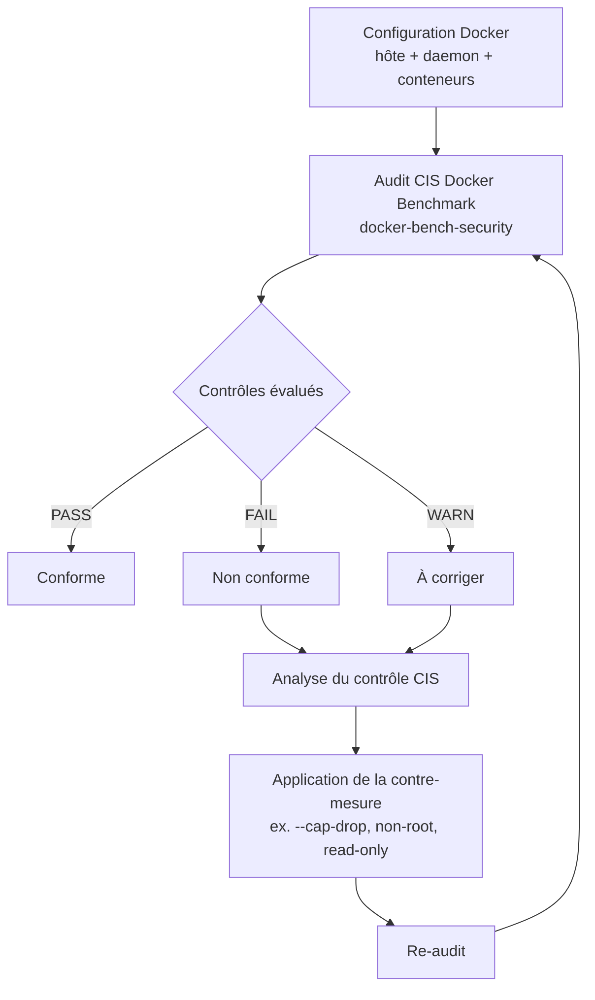
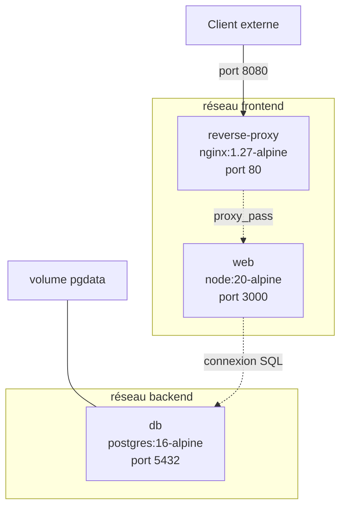
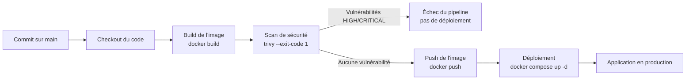

# Docker pour Linux — Mise en œuvre et déploiement de conteneurs virtuels — JOUR 3

## Sécurité, Bonnes Pratiques et Étude de Cas (30/09/2026)

**Fil conducteur :** Ce troisième et dernier jour conclut la *kill chain* des conteneurs amorcée au Jour 1. Après avoir compris la chaîne d'attaque (J1), maîtrisé la persistance, les réseaux et la supervision (J2), nous abordons ici la phase décisive : la **sécurisation** et l'**audit**. Nous verrons comment durcir chaque maillon de la chaîne — images, exécution, capabilities, ressources, réseau, secrets — puis comment auditer la configuration selon le CIS Docker Benchmark. La journée s'achève par une étude de cas complète : le déploiement d'une application multi-conteneurs sécurisée, surveillée et intégrée à un pipeline CI/CD. Le fil conducteur « comprendre pour durcir » aboutit ici à un déploiement de bout en bout, conforme aux bonnes pratiques de sécurité.

---

## Objectifs du Jour

- Appliquer les bonnes pratiques de sécurisation des conteneurs sous Linux : images fiables, exécution non-root, limitations de ressources, retrait des capabilities, système de fichiers en lecture seule, profils seccomp et AppArmor.
- Gérer les autorisations et les accès : groupes, UID/GID, réseaux isolés, gestion des secrets, interdiction du mode `--privileged`.
- Auditer la configuration Docker avec le CIS Docker Benchmark, `docker scout`, `trivy` et `docker-bench-security`.
- Déployer une application réelle multi-conteneurs (reverse proxy + application web + base de données) avec des réseaux personnalisés et des volumes partagés.
- Intégrer ce déploiement dans un pipeline CI/CD : build automatisé, scan de sécurité, gestion des secrets et déploiement.

---

## Planning du Jour

| Séquence | Horaires            | Thème                                                              | Durée   |
|----------|---------------------|--------------------------------------------------------------------|---------|
| S5       | 9h00-10h30          | Sécurité et bonnes pratiques : durcissement des conteneurs          | 1h30    |
| S5       | 10h30-12h00         | Audit de la configuration Docker (CIS, trivy, docker scout)         | 1h30    |
| —        | 12h00-13h00         | Pause déjeuner                                                     | 1h      |
| S6       | 13h00-14h30         | Étude de cas : déploiement complet de la stack (réseaux, volumes)   | 1h30    |
| S6       | 14h30-16h00         | Intégration CI/CD et déploiement sécurisé                           | 1h30    |

---

## S5 — Sécurité et bonnes pratiques (9h00-12h00)

### Objectifs

- Comprendre et appliquer les bonnes pratiques de sécurisation des conteneurs : images fiables, exécution non-root, limitations de ressources, retrait des capabilities, système de fichiers en lecture seule, profils seccomp et AppArmor.
- Gérer les autorisations et les accès : groupes, UID/GID, réseaux isolés, gestion des secrets, interdiction du mode `--privileged`.
- Auditer la configuration Docker avec le CIS Docker Benchmark, `docker scout`, `trivy` et `docker-bench-security`.

### Contenu Théorique

#### 1. Le modèle de menace des conteneurs

Un conteneur partage le noyau de l'hôte : cette architecture, source de légèreté et de performance, constitue aussi sa principale surface d'attaque. Un conteneur compromis peut, selon sa configuration, escalader ses privilèges vers l'hôte, accéder à des données sensibles, ou servir de point d'appui pour une latéralisation au sein du réseau.

| Vecteur d'attaque | Description | Contre-mesure structurelle |
|--------------------|-------------|----------------------------|
| Image compromise | Une image contient des vulnérabilités ou un code malveillant | Images officielles, scan (trivy, docker scout), signatures |
| Exécution en root | Le processus principal tourne avec l'UID 0 | Exécution non-root (USER, `--user`) |
| Capabilities excessives | Le conteneur dispose de capabilities Linux inutiles | `--cap-drop=ALL --cap-add` |
| Ressources illimitées | Un conteneur peut monopoliser CPU, mémoire, PIDs | Limites de ressources (cgroups) |
| Système de fichiers en écriture | Le conteneur peut modifier son propre système de fichiers | `--read-only` + tmpfs |
| Mode privilégié | `--privileged` donne un accès quasi total à l'hôte | Interdiction stricte |
| Secrets en clair | Mots de passe et clés exposés dans l'environnement ou l'image | Gestion des secrets, fichiers `.env` non versionnés |
| Réseau trop permissif | Latéralisation entre conteneurs | Réseaux personnalisés segmentés |

> **Concept clé** — La **surface d'attaque** d'un conteneur est l'ensemble des points par lesquels un attaquant peut interagir avec lui : l'image, le processus, les capabilities, le système de fichiers, le réseau, les secrets. Le durcissement consiste à réduire cette surface au strict nécessaire : moins un conteneur peut faire, moins un attaquant peut en tirer parti.

> **Pourquoi le durcissement est-il indispensable ?** — Un conteneur lancé avec `--privileged` et en root dispose, en cas de compromission, d'un accès quasi équivalent à celui de l'hôte (technique [T1610](https://attack.mitre.org/techniques/T1610)). Le durcissement ne protège pas seulement le conteneur : il protège l'hôte et l'ensemble du réseau. Chaque contrôle du CIS Docker Benchmark réduit un vecteur d'attaque précis.

#### 2. Sécuriser les images

**Les images officielles et vérifiées**

La première ligne de défense est l'image elle-même. Une image non officielle peut contenir des vulnérabilités non corrigées, des backdoors ou des dépendances obsolètes. Docker Hub distingue les images **officielles** (maintenues par les éditeurs et vérifiées par Docker) des images communautaires, dont la fiabilité est incertaine.

| Source d'image | Fiabilité | Usage recommandé |
|----------------|-----------|------------------|
| Image officielle (Docker Hub) | Élevée (maintenue, vérifiée) | Base de référence |
| Image vérifiée (éditeur) | Élevée (signée par l'éditeur) | Outils spécialisés |
| Image communautaire | Variable (non vérifiée) | À éviter en production |
| Image construite en interne | Maîtrisée (Dockerfile versionné) | Applications métier |

```bash
# Recherche d'images officielles sur Docker Hub
docker search --filter "is-official=true" nginx
# --filter "is-official=true" : ne liste que les images officielles
# Sortie attendue : nginx (officielle) et les autres images officielles correspondantes
# Note : nginxinc/nginx-unprivileged n'est pas une image officielle (éditeur vérifié)

# Téléchargement d'une image officielle avec un tag épinglé
docker pull nginx:1.27-alpine
# nginx:1.27-alpine : version précise épinglée (jamais latest en production)
# Pourquoi épingler ? Le tag latest est mobile : il rend les déploiements
#   non reproductibles et les rollbacks impossibles (contrôle CIS 4.1)
```

> **Bonnes pratiques** — Toujours épingler une version précise d'une image (`nginx:1.27-alpine`, `postgres:16-alpine`) et vérifier son origine. En production, utiliser un container registry privé (Harbor, GitLab Container Registry) comme source unique et contrôlée d'images, et signer les images avec Docker Content Trust (DCT) ou Notary pour garantir leur intégrité.

**Le scan de vulnérabilités**

Le scan d'images détecte les vulnérabilités connues (CVE) dans les dépendances et les paquets d'une image. Deux outils majeurs sont utilisés : **trivy** (Aqua Security, open source) et **docker scout** (plugin CLI Docker).

```bash
# Installation de trivy (outil open source de scan de vulnérabilités)
sudo apt install -y wget apt-transport-https gnupg
wget -qO - https://aquasecurity.github.io/trivy-repo/deb/public.key | \
  sudo gpg --dearmor -o /usr/share/keyrings/trivy.gpg
echo "deb [signed-by=/usr/share/keyrings/trivy.gpg] https://aquasecurity.github.io/trivy-repo/deb generic main" | \
  sudo tee -a /etc/apt/sources.list.d/trivy.list
sudo apt update && sudo apt install -y trivy
# wget -qO - : télécharge la clé GPG de trivy sans l'écrire sur disque
# gpg --dearmor : convertit la clé en format binaire pour APT
# signed-by : référence la clé pour vérifier l'authenticité des paquets
# generic : distribution officielle du dépôt trivy, indépendante du nom de code
#   Ubuntu (les dépôts par codename — jammy, noble — sont figés depuis trivy v0.72.0)

# Scan d'une image avec trivy
trivy image --severity HIGH,CRITICAL nginx:1.27-alpine
# image : analyse l'image locale
# --severity HIGH,CRITICAL : ne rapporte que les vulnérabilités HIGH et CRITICAL
# Sortie attendue : un tableau des CVE détectées avec leur gravité et leur statut
```

```bash
# Scan avec docker scout (plugin CLI Docker, à installer sur Docker Engine)
docker scout quickview nginx:1.27-alpine
# quickview : vue d'ensemble des vulnérabilités de l'image
# Sortie attendue : nombre de vulnérabilités par gravité (CRITICAL, HIGH, MEDIUM, LOW)

docker scout cves nginx:1.27-alpine
# cves : liste détaillée des CVE avec leur description et la version corrigée
# Usage : identifier précisément les paquets vulnérables et les mises à jour à appliquer
```

> **Concept clé** — Une **CVE** (Common Vulnerabilities and Exposures) est un identifiant public d'une vulnérabilité de sécurité. Le scan d'images compare les versions des paquets et dépendances d'une image à une base de données de CVE connues. Un scan régulier, intégré au pipeline CI/CD, détecte les vulnérabilités avant le déploiement — c'est la contre-mesure directe à la technique [T1190](https://attack.mitre.org/techniques/T1190) (exploitation d'une application exposée).

**Le build multi-stage**

Le **build multi-stage** (multi-stage build) est une technique de construction d'images qui sépare l'environnement de compilation de l'environnement d'exécution. On utilise plusieurs instructions `FROM` : les premières construisent et compilent l'application, la dernière ne copie que les artefacts nécessaires à l'exécution. Le résultat est une image finale minimale, sans outils de compilation ni sources, ce qui réduit à la fois la taille et la surface d'attaque.

```dockerfile
# Dockerfile multi-stage — application Node.js
# Étape 1 : environnement de build (contient npm, les sources, les dépendances)
FROM node:20-alpine AS build
# node:20-alpine : image de base pour la compilation
# AS build : nomme cette étape pour la référencer plus tard
WORKDIR /app
# WORKDIR : répertoire de travail dans l'image
COPY package*.json ./
# COPY : copie les fichiers de description des dépendances
RUN npm install --omit=dev
# npm install --omit=dev : installe uniquement les dépendances de production
#   (l'option --only=production est dépréciée depuis npm 9)
COPY . .
# COPY . . : copie le code source de l'application

# Étape 2 : environnement d'exécution (minimal, sans outils de build)
FROM node:20-alpine
# Nouvelle image de base : l'étape 1 est abandonnée
WORKDIR /app
ENV NODE_ENV=production
# ENV : variable d'environnement par défaut
COPY --from=build /app/node_modules ./node_modules
# --from=build : copie les dépendances depuis l'étape nommée build
COPY --from=build /app/package.json ./package.json
COPY --from=build /app/index.js ./index.js
# Seuls les artefacts nécessaires à l'exécution sont copiés
EXPOSE 3000
# EXPOSE : port documenté (informatif uniquement)
USER node
# USER node : exécution non-root (l'utilisateur node existe dans l'image node)
CMD ["node", "index.js"]
# CMD : commande par défaut au lancement du conteneur
```

> **Pourquoi le multi-stage réduit-il la surface d'attaque ?** — L'image finale ne contient ni compilateur, ni gestionnaire de paquets, ni code source : un attaquant qui compromet le conteneur ne dispose d'aucun outil pour compiler ou installer du code malveillant. La technique [T1059](https://attack.mitre.org/techniques/T1059) (interpréteur de commandes et de scripts) est ainsi fortement entravée. De plus, l'image est plus petite, donc plus rapide à télécharger et à analyser.

#### 3. L'exécution non-root

Par défaut, le processus principal d'un conteneur s'exécute avec l'UID 0 (root). Si le conteneur est compromis, l'attaquant dispose des privilèges root à l'intérieur du conteneur. L'exécution non-root consiste à faire tourner le processus avec un utilisateur sans privilèges, ce qui limite considérablement l'impact d'une compromission.

| Méthode | Description | Portée |
|---------|-------------|--------|
| Instruction `USER` dans le Dockerfile | Définit l'utilisateur d'exécution dans l'image | Systématique pour toutes les exécutions |
| Option `--user` au `docker run` | Spécifie l'UID/GID au lancement | Ponctuelle, par conteneur |
| Image non-root dédiée | Image préconfigurée pour un utilisateur non-root | Recommandée (ex. `nginxinc/nginx-unprivileged`) |

```dockerfile
# Dockerfile — exécution non-root avec USER
FROM nginx:1.27-alpine

# Création d'un utilisateur dédié (si l'image de base n'en fournit pas)
RUN addgroup -S appgroup && adduser -S appuser -G appgroup
# addgroup -S : crée un groupe système
# adduser -S : crée un utilisateur système
# -G appgroup : rattache l'utilisateur au groupe appgroup

# Copie du contenu web
COPY --chown=appuser:appgroup ./html /usr/share/nginx/html
# --chown : attribue la propriété des fichiers à l'utilisateur non-root

# Utilisateur d'exécution
USER appuser
# USER : le processus principal tourne sous l'utilisateur appuser (non-root)
# Pourquoi ? En cas de compromission, l'attaquant n'a pas les privilèges root
#   (contrôle CIS 4.1 : exécuter les conteneurs avec des utilisateurs non-root)
```

> **Piège (exécution non-root)** — Passer à un utilisateur non-root peut casser l'application si celle-ci doit écrire dans des répertoires appartenant à root (fichiers PID, caches, sockets). Pour nginx, l'image officielle `nginx` s'attend à écrire dans `/var/run` et `/var/cache/nginx`. Deux solutions : utiliser l'image `nginxinc/nginx-unprivileged` (préconfigurée pour non-root, écoute sur le port 8080) ou monter des `tmpfs` sur ces répertoires au lancement (`--tmpfs /var/run --tmpfs /var/cache/nginx`). Vérifiez toujours que l'application fonctionne réellement en non-root avant de valider le durcissement.

**Le mappage des utilisateurs (user namespace remapping)**

Le **mappage d'utilisateurs** (user namespace remapping) est une technique avancée qui fait correspondre l'UID 0 du conteneur à un UID non privilégié de l'hôte. Ainsi, même si le processus du conteneur croit être root, il est en réalité un utilisateur sans privilèges du point de vue de l'hôte. Cette isolation est configurée dans le daemon.

```json
{
  "userns-remap": "default"
}
```

| Paramètre | Effet |
|-----------|-------|
| `"userns-remap": "default"` | Active le mappage avec l'utilisateur `dockremap` créé automatiquement |
| `"userns-remap": "user:group"` | Active le mappage avec un utilisateur et un groupe spécifiques |

> **Bon à savoir** — Le mappage d'utilisateurs est une protection puissante mais contraignante : il peut entrer en conflit avec les volumes et bind mounts (les permissions des fichiers hôte doivent être adaptées au mappage). Il est recommandé en production pour les environnements multi-locataires, mais son activation doit être testée en lab avant déploiement.

#### 4. Les limites de ressources

Un conteneur sans limites peut consommer toute la mémoire, tout le CPU ou créer un nombre illimité de processus, provoquant un déni de service sur l'hôte. Les **cgroups** (control groups) du noyau Linux permettent de borner ces ressources.

| Ressource | Option `docker run` | Effet |
|-----------|---------------------|-------|
| Mémoire | `--memory=256m` | Limite la mémoire vive à 256 Mo |
| CPU | `--cpus=0.5` | Limite à 0,5 cœur CPU |
| Processus | `--pids-limit=100` | Limite le nombre de processus à 100 |
| Échange (swap) | `--memory-swap=512m` | Limite la mémoire + swap à 512 Mo |
| Fichiers ouverts | `--ulimit nofile=1024:2048` | Limite les descripteurs de fichiers |

```bash
# Lancement d'un conteneur avec des limites de ressources complètes
docker run -d --name app-limite \
  --memory=256m \
  --memory-swap=512m \
  --cpus=0.5 \
  --pids-limit=100 \
  --ulimit nofile=1024:2048 \
  nginx:1.27-alpine
# --memory=256m : limite la mémoire vive à 256 Mo
# --memory-swap=512m : limite mémoire + swap à 512 Mo (256 Mo RAM + 256 Mo swap)
# --cpus=0.5 : limite à 0,5 cœur CPU
# --pids-limit=100 : limite le nombre de processus à 100
# --ulimit nofile=1024:2048 : limite les descripteurs de fichiers (doux:dur)
# Pourquoi ces limites ? Un conteneur compromis ou défaillant ne peut pas
#   épuiser les ressources de l'hôte (déni de service) — contrôle CIS 5.22

# Vérification des limites appliquées
docker inspect app-limite --format 'Mémoire: {{.HostConfig.Memory}} | CPU: {{.HostConfig.NanoCpus}} | PIDs: {{.HostConfig.PidsLimit}}'
# HostConfig.Memory : limite mémoire en octets (268435456 = 256 Mo)
# HostConfig.NanoCpus : limite CPU en nanocœurs (500000000 = 0,5)
# HostConfig.PidsLimit : nombre maximal de processus (100)
```

> **Bonnes pratiques** — Définir des limites de ressources pour chaque conteneur, même en développement : cela révèle les fuites mémoire et les pics de consommation avant la mise en production. En Compose, les limites se déclarent sous `deploy.resources.limits`. La surveillance (Jour 2) vérifie ensuite que les limites sont respectées.

#### 5. Le retrait des capabilities Linux

Les **capabilities Linux** sont des privilèges granulaires du noyau, attribués aux processus. Docker attribue par défaut un ensemble de capabilities aux conteneurs (CHOWN, NET_BIND_SERVICE, SETUID, SETGID, etc.). Le principe du moindre privilège consiste à retirer toutes les capabilities inutiles avec `--cap-drop=ALL`, puis à n'en réintégrer que le strict nécessaire avec `--cap-add`.

```bash
# Conteneur durci : retrait de toutes les capabilities, réintégration du minimum
docker run -d --name web-durci \
  --cap-drop=ALL \
  --cap-add=NET_BIND_SERVICE \
  --cap-add=CHOWN \
  --cap-add=SETUID \
  --cap-add=SETGID \
  -p 8080:80 \
  nginx:1.27-alpine
# --cap-drop=ALL : retire toutes les capabilities Linux par défaut
# --cap-add=NET_BIND_SERVICE : permet de se lier au port 80 (<1024)
# --cap-add=CHOWN : autorise le master nginx (root) à changer le propriétaire
#   des répertoires temporaires vers l'utilisateur nginx au démarrage
# --cap-add=SETUID, --cap-add=SETGID : permettent au master nginx de lancer
#   les workers avec des UID/GID réduits
# Pourquoi --cap-drop=ALL ? Pour retirer toutes les capabilities Linux par défaut
#   et durcir le conteneur : un attaquant ne peut pas les exploiter (contrôle CIS 5.1)
```

> **Piège (capabilities et nginx)** — Avec `--cap-drop=ALL`, nginx peut refuser de démarrer : le master (root) doit exécuter un `chown()` vers l'utilisateur nginx (UID 101) au démarrage, ce qui exige la capability `CHOWN`, et lancer ses workers avec des UID réduits, ce qui exige `SETUID` et `SETGID`. Sans ces capabilities, le conteneur échoue avec une erreur de permission. La réintégration ciblée (plutôt que `--privileged`) est la bonne approche : on n'accorde que ce qui est strictement nécessaire.

> **Bon à savoir (exécution non-root de nginx)** — L'image officielle `nginx:1.27-alpine` ne définit pas d'instruction `USER` : le processus master tourne en root par défaut, seuls les workers passent sous l'utilisateur nginx (UID 101). Pour une exécution réellement non-root du master, lancer le conteneur avec `--user 101:101` (voir Lab 5.2).

> **Pourquoi éviter --privileged ?** — L'option `--privileged` donne au conteneur toutes les capabilities et un accès direct aux périphériques de l'hôte : c'est l'équivalent d'un accès root complet. Un conteneur privilégié compromis permet une escalade quasi immédiate vers l'hôte (technique [T1610](https://attack.mitre.org/techniques/T1610)). Le CIS Docker Benchmark (contrôle 5.2) interdit explicitement `--privileged` sauf cas exceptionnels documentés.

#### 6. Le système de fichiers en lecture seule et les profils de sécurité

**Le système de fichiers racine en lecture seule**

L'option `--read-only` monte le système de fichiers racine du conteneur en lecture seule : le conteneur ne peut plus modifier ses propres fichiers. Les répertoires d'écriture obligatoires (caches, fichiers PID, sockets) sont montés en `tmpfs` (mémoire).

```bash
# Conteneur avec système de fichiers racine en lecture seule
docker run -d --name web-readonly \
  --read-only \
  --tmpfs /var/run \
  --tmpfs /var/cache/nginx \
  --cap-drop=ALL \
  --cap-add=NET_BIND_SERVICE \
  --cap-add=CHOWN \
  --cap-add=SETUID \
  --cap-add=SETGID \
  -p 8081:80 \
  nginx:1.27-alpine
# --read-only : système de fichiers racine en lecture seule
# --tmpfs /var/run : répertoire du fichier PID en mémoire (écriture autorisée)
# --tmpfs /var/cache/nginx : cache nginx en mémoire
# --cap-drop=ALL : retrait de toutes les capabilities
# Pourquoi --read-only ? Un conteneur qui ne peut pas écrire sur son propre
#   système de fichiers ne peut pas y déposer de code malveillant persistant
#   (contrôle CIS 5.3 : ne pas monter de volumes sensibles en lecture-écriture)
```

> **Concept clé** — Le **système de fichiers en lecture seule** est une contre-mesure puissante contre la persistance : un attaquant qui compromet le conteneur ne peut pas y installer de binaire, de script ou de configuration malveillante durable. Combiné à l'exécution non-root et au retrait des capabilities, il forme le socle du durcissement d'un conteneur.

**Les profils seccomp et AppArmor**

**seccomp** (Secure Computing Mode) est un mécanisme du noyau Linux qui restreint les appels système (syscalls) qu'un processus peut exécuter. **AppArmor** est un module de sécurité Linux (LSM) qui applique des politiques d'accès aux fichiers, aux réseaux et aux capacités.

| Mécanisme | Rôle | Configuration |
|-----------|------|---------------|
| **seccomp** | Restreint les appels système | Profil JSON (Docker fournit un profil par défaut) |
| **AppArmor** | Politique d'accès aux ressources | Profil de politique (Docker fournit un profil par défaut) |

```bash
# Application d'un profil seccomp personnalisé
docker run -d --name web-seccomp \
  --security-opt seccomp=/chemin/vers/profil.json \
  nginx:1.27-alpine
# --security-opt seccomp=... : applique un profil seccomp personnalisé
# Le profil par défaut de Docker est déjà appliqué automatiquement
# Un profil personnalisé restreint davantage les appels système autorisés

# Application d'un profil AppArmor personnalisé
docker run -d --name web-apparmor \
  --security-opt apparmor=mon-profil \
  nginx:1.27-alpine
# --security-opt apparmor=... : applique un profil AppArmor nommé
# Le profil par défaut (docker-default) est appliqué automatiquement
```

> **Bon à savoir** — Docker applique par défaut un profil seccomp et un profil AppArmor à chaque conteneur. Ces profils bloquent les appels système dangereux (ex. `mount`, `ptrace` dans certains cas). Le durcissement avancé consiste à créer des profils plus restrictifs, adaptés à chaque application. Le CIS Docker Benchmark (contrôles 5.7, 5.9) recommande de configurer des profils seccomp et AppArmor personnalisés.

#### 7. La gestion des autorisations et des accès

**Les groupes et le socket Docker**

Le socket Docker (`/var/run/docker.sock`) est le point de contrôle du daemon : quiconque y a accès peut exécuter des commandes Docker, donc potentiellement compromettre l'hôte. L'accès au groupe `docker` équivaut à un accès root.

| Élément | Risque | Bonne pratique |
|---------|--------|----------------|
| Groupe `docker` | Accès complet au daemon | Limiter aux administrateurs ; jamais en production |
| Socket monté dans un conteneur | Escalade vers l'hôte | Ne jamais monter `/var/run/docker.sock` dans un conteneur |
| Daemon exposé sur TCP | Accès réseau au daemon | Désactiver ; utiliser le socket Unix + TLS si nécessaire |

```bash
# Vérification des membres du groupe docker
getent group docker
# Sortie attendue : docker:x:999:utilisateur1,utilisateur2
# Pourquoi vérifier ? Chaque membre du groupe docker peut exécuter des
#   commandes Docker, donc contrôler l'hôte (technique T1078 - Valid Accounts)

# Vérification que le daemon n'écoute pas sur un port TCP
docker info | grep -i "Server Version"
# Le daemon écoute par défaut sur le socket Unix /var/run/docker.sock
# Un daemon exposé sur TCP (ex. -H tcp://0.0.0.0:2375) est une faille critique
```

> **Piège (socket Docker)** — Monter `/var/run/docker.sock` dans un conteneur donne à ce conteneur un contrôle total du daemon : il peut créer des conteneurs privilégiés, monter le système de fichiers de l'hôte, exécuter des commandes arbitraires. C'est l'un des vecteurs d'escalade les plus dangereux (technique [T1610](https://attack.mitre.org/techniques/T1610)). Le CIS Docker Benchmark (contrôle 5.3) interdit ce montage sauf cas exceptionnels.

**Les UID/GID et le mappage des utilisateurs**

Chaque processus d'un conteneur a un UID (identifiant d'utilisateur) et un GID (identifiant de groupe). Par défaut, ces identifiants sont partagés avec l'hôte : un processus avec l'UID 0 dans le conteneur est l'UID 0 de l'hôte. Le mappage d'utilisateurs (user namespace remapping) isole ces identifiants.

```bash
# Lancement d'un conteneur avec un UID/GID spécifique
docker run -d --name web-uid \
  --user 101:101 \
  --cap-add=NET_BIND_SERVICE \
  --tmpfs /var/run:rw,uid=101,gid=101 \
  --tmpfs /var/cache/nginx:rw,uid=101,gid=101 \
  -p 8082:80 \
  nginx:1.27-alpine
# --user 101:101 : le processus principal tourne avec l'UID 101 (utilisateur nginx de l'image)
# --cap-add=NET_BIND_SERVICE : nécessaire pour se lier au port 80 (<1024) en non-root
# --tmpfs ...:rw,uid=101,gid=101 : répertoires d'écriture de nginx en mémoire,
#   appartenant à l'UID/GID 101 ; sans ces options, les tmpfs sont root:root
#   (mode 755) et nginx non-root ne peut pas y écrire (sortie immédiate du conteneur)
# Pourquoi les options uid/gid ? L'utilisateur 101 de l'image doit pouvoir écrire
#   dans /var/run et /var/cache/nginx malgré le conteneur non-root (CIS 4.1)
# Pourquoi l'UID 101 ? Un UID arbitraire (ex. 1000) exigerait une configuration nginx
#   adaptée (répertoires inscriptibles, directive user ajustée) ; l'UID 101 est celui
#   de l'image. En cas de compromission, l'attaquant n'a pas les privilèges root (CIS 4.1)

# Vérification de l'utilisateur d'exécution
docker exec web-uid id
# Sortie attendue : uid=101(nginx) gid=101(nginx) groups=101(nginx)
# Le processus principal du conteneur tourne bien sous l'UID 101 (non-root)
```

**Les réseaux isolés**

La segmentation réseau est la contre-mesure structurelle de la latéralisation : un conteneur compromis ne doit pas pouvoir atteindre librement les autres conteneurs. Les réseaux personnalisés (étudiés au Jour 2) permettent de séparer les zones.

| Zone | Conteneurs | Accès |
|------|-----------|-------|
| Réseau `frontend` | Reverse proxy, application web | Exposé à l'extérieur (ports publiés) |
| Réseau `backend` | Base de données | Isolé, accessible uniquement depuis le réseau interne |

```bash
# Nettoyage préalable : le réseau demo-net du Jour 2 occupe le sous-réseau
# 172.18.0.0/16 ; il doit être supprimé avant de créer frontend sur le même sous-réseau
docker network rm demo-net 2>/dev/null || true
# Correction : évite un conflit de sous-réseau si le réseau du Jour 2 est toujours présent

# Création de deux réseaux isolés
docker network create --driver bridge --subnet 172.18.0.0/16 frontend
docker network create --driver bridge --subnet 172.19.0.0/16 backend
# frontend : réseau exposé (172.18.0.0/16)
# backend : réseau interne isolé (172.19.0.0/16)
# Pourquoi deux réseaux ? La base de données n'est accessible que depuis
#   le réseau backend ; un conteneur web compromis ne peut pas l'atteindre
#   directement (contrôle CIS 4.5 : utiliser des réseaux personnalisés)
```

> **Bonnes pratiques** — Appliquer le principe du moindre privilège réseau : chaque conteneur n'est connecté qu'aux réseaux strictement nécessaires à sa fonction. La base de données n'est jamais exposée sur un réseau accessible depuis l'extérieur. Cette segmentation en zones est directement transposable en production.

**La gestion des secrets**

Un **secret** est une donnée sensible (mot de passe, clé API, certificat) qui ne doit jamais être exposée en clair. Les mauvaises pratiques — mots de passe en dur dans le Dockerfile, dans le Compose, dans les variables d'environnement — sont des vecteurs de compromission majeurs (technique [T1078](https://attack.mitre.org/techniques/T1078) : utilisation de comptes valides).

| Méthode | Risque | Recommandation |
|---------|--------|----------------|
| Mot de passe en dur dans le Dockerfile | Exposé dans l'image et son historique | Interdit |
| Variable d'environnement `-e` | Visible via `docker inspect` | À éviter pour les secrets |
| Fichier `.env` non versionné | Correct si non commité | Recommandé en développement |
| Fichier de secrets monté en volume | Correct si permissions strictes | Recommandé |
| Gestionnaire de secrets (Docker Secrets, Vault) | Sécurisé | Recommandé en production |

```bash
# Mauvaises pratiques à proscrire
docker run -d --name app-mauvais \
  -e DB_PASSWORD=monmotdepasse \
  -e API_KEY=clefsecrete \
  myapp:latest
# -e DB_PASSWORD=... : le secret est visible en clair dans la commande
#   et dans l'historique du shell ; il est aussi exposé via docker inspect
# Pourquoi l'éviter ? Un attaquant avec un accès en lecture au daemon
#   (docker inspect) récupère les secrets (technique T1078)

# Bonne pratique : fichier de secrets monté en volume avec permissions strictes
echo "monmotdepasse" > /chemin/vers/secret.txt
chmod 600 /chemin/vers/secret.txt
# chmod 600 : seul le propriétaire peut lire le fichier
docker run -d --name app-secret \
  -v /chemin/vers/secret.txt:/run/secrets/db_password:ro \
  myapp:latest
# -v ...:/run/secrets/db_password:ro : monte le fichier de secret en lecture seule
# Le secret n'apparaît ni dans la commande, ni dans docker inspect
```

> **Concept clé** — Un **secret** est une donnée dont la divulgation compromet la sécurité. La règle d'or : un secret ne doit jamais apparaître en clair dans un fichier versionné (Dockerfile, Compose, code source), ni dans une commande, ni dans une variable d'environnement inspectable. Il doit être injecté au moment de l'exécution, depuis un fichier protégé ou un gestionnaire de secrets.

#### 8. L'audit de la configuration Docker

**Le CIS Docker Benchmark**

Le **CIS Docker Benchmark** est un référentiel de bonnes pratiques de sécurité publié par le Center for Internet Security (CIS). Il définit des centaines de contrôles répartis en sections, chacun visant un aspect précis de la configuration Docker. Les sections principales :

| Section | Contenu | Exemples de contrôles |
|---------|---------|-----------------------|
| 1.x | Configuration de l'hôte | CIS 1.1 (répertoire dédié), CIS 1.13 (surveillance) |
| 2.x | Configuration du daemon | CIS 2.1 (ports), CIS 2.8 (journalisation) |
| 3.x | Fichiers de configuration | CIS 3.1 (permissions daemon.json) |
| 4.x | Exécution des conteneurs | CIS 4.1 (non-root), CIS 4.5 (réseaux), CIS 4.6 (pas de host) |
| 5.x | Capabilities et ressources | CIS 5.1 (cap-drop), CIS 5.2 (pas de privileged), CIS 5.22 (limites) |



**Fig 1** — Processus d'audit et de durcissement selon le CIS Docker Benchmark : évaluer, corriger, re-auditer

**`docker-bench-security` : l'audit automatisé**

**docker-bench-security** est un script open source (Docker) qui exécute automatiquement les contrôles du CIS Docker Benchmark et rapporte le statut de chacun (PASS, WARN, FAIL, INFO). Il s'exécute sur l'hôte à partir du dépôt officiel maintenu par Docker.

```bash
# Installation de docker-bench-security (dépôt officiel maintenu par Docker)
git clone --depth 1 https://github.com/docker/docker-bench-security.git
# git clone : récupère le script d'audit (version maintenue, compatible Docker 27+)
# --depth 1 : clone léger (un seul commit, sans historique)

cd docker-bench-security
sh docker-bench-security.sh
# sh docker-bench-security.sh : lance l'audit avec la CLI Docker de l'hôte
# Sortie attendue : une liste de contrôles avec leur statut (PASS, WARN, FAIL)
#   et des recommandations de correction pour chaque échec
```

> **Piège (privilèges de l'audit)** — docker-bench-security exige un accès étendu à l'hôte pour inspecter la configuration : c'est un outil d'audit à exécuter sur un hôte dédié ou en lab isolé, jamais sur un hôte de production partagé sans analyse de risque. Exécuté sur l'hôte, il dispose d'un accès privilégié au système (technique [T1610](https://attack.mitre.org/techniques/T1610) potentielle si le script est compromis).

**`trivy` : l'analyse des images et des configurations**

Au-delà du scan de vulnérabilités, trivy analyse aussi les fichiers de configuration (Dockerfile, Compose, Kubernetes) pour détecter les mauvaises pratiques de sécurité.

```bash
# Analyse des mauvaises pratiques dans un Dockerfile
trivy config --severity HIGH,CRITICAL ./Dockerfile
# config : analyse les fichiers de configuration (Dockerfile, Compose, etc.)
# --severity HIGH,CRITICAL : ne rapporte que les problèmes HIGH et CRITICAL
# Sortie attendue : les mauvaises pratiques détectées (ex. absence de USER,
#   apt-get sans nettoyage du cache)
# Nota : le tag latest n'est pas détecté par trivy config

# Analyse des fichiers de configuration d'un répertoire
trivy config --severity HIGH,CRITICAL ./mon-projet/
# Analyse tous les fichiers de configuration du répertoire
# Détecte les Dockerfile non durcis, les Compose avec secrets en clair, etc.
```

**`docker scout` : l'analyse intégrée à Docker**

```bash
# Vue d'ensemble de la sécurité d'une image
docker scout quickview nginx:1.27-alpine
# quickview : résumé des vulnérabilités par gravité

# Comparaison de deux versions d'une image
docker scout compare nginx:1.27-alpine nginx:1.26-alpine
# compare : compare les vulnérabilités de deux versions
# Usage : vérifier qu'une mise à jour réduit bien le nombre de vulnérabilités
```

**La sécurité du réseau et le TLS du daemon**

Le daemon Docker peut être exposé sur le réseau via TCP, mais cela doit être sécurisé par TLS (Transport Layer Security) pour chiffrer les communications et authentifier les clients. Par défaut, le daemon n'écoute que sur le socket Unix local, ce qui est la configuration la plus sûre.

| Configuration | Sécurité | Usage |
|---------------|----------|-------|
| Socket Unix (`/var/run/docker.sock`) | Élevée (local uniquement) | Défaut recommandé |
| TCP sans TLS (`-H tcp://0.0.0.0:2375`) | Nulle (trafic en clair, aucun contrôle) | Interdit |
| TCP avec TLS (`-H tcp://0.0.0.0:2376`) | Élevée (chiffré + authentification) | Accès distant maîtrisé |

> **Bonnes pratiques** — Ne jamais exposer le daemon Docker sur TCP sans TLS. La configuration par défaut (socket Unix local) est la plus sûre. Pour un accès distant, utiliser TLS avec des certificats clients, ou un orchestrateur (Docker Swarm, Kubernetes) qui gère l'authentification et le chiffrement.

### Mapping Sécurité

| Référence | ID | Description |
|-----------|----|-------------|
| Exploit Public-Facing Application | [T1190](https://attack.mitre.org/techniques/T1190) | Une application exposée avec des vulnérabilités connues peut être exploitée ; le scan d'images (trivy, docker scout) et le durcissement réduisent ce risque |
| Deploy Container | [T1610](https://attack.mitre.org/techniques/T1610) | Un conteneur privilégié ou mal configuré peut servir à escalader vers l'hôte ; l'exécution non-root, le cap-drop et l'interdiction de --privileged limitent ce vecteur |
| Command and Scripting Interpreter | [T1059](https://attack.mitre.org/techniques/T1059) | Un conteneur compromis peut exécuter des commandes ; le système de fichiers en lecture seule et le multi-stage réduisent les outils disponibles |
| Valid Accounts | [T1078](https://attack.mitre.org/techniques/T1078) | Des secrets exposés ou des comptes non maîtrisés permettent l'accès ; la gestion des secrets et le contrôle du groupe docker contrecarrent cette technique |
| Impair Defenses | [T1562](https://attack.mitre.org/techniques/T1562) | Un attaquant peut désactiver les protections (seccomp, AppArmor, audit) ; l'audit CIS et la surveillance détectent ces altérations |
| Indicator Removal | [T1070](https://attack.mitre.org/techniques/T1070) | Un attaquant peut effacer des traces ; la journalisation du daemon (CIS 2.8) et la conservation des journaux hors de l'hôte contrecarrent cette technique |
| CIS Docker Benchmark | CIS 4.1 | Exécuter les conteneurs avec des utilisateurs non-root |
| CIS Docker Benchmark | CIS 5.1 | Retirer les capabilities non nécessaires (--cap-drop=ALL) |
| CIS Docker Benchmark | CIS 5.2 | Ne pas utiliser --privileged |
| CIS Docker Benchmark | CIS 5.3 | Ne pas monter de volumes sensibles en lecture-écriture |
| CIS Docker Benchmark | CIS 5.22 | Limiter les ressources des conteneurs (mémoire, CPU, PIDs) |

> **Pourquoi l'audit est-il la conclusion de la kill chain ?** — La kill chain amorcée au Jour 1 (comprendre chaque maillon de la chaîne d'attaque) aboutit ici à l'audit : on vérifie que chaque maillon est effectivement durci. L'audit CIS Docker Benchmark transforme les bonnes pratiques en contrôles mesurables, et les techniques ATT&CK (T1190, T1610, T1059, T1078, T1562, T1070) fournissent le cadre d'analyse des menaces que ces contrôles neutralisent.

---

### Lab 5 — Implémentation de politiques de sécurité et audit des conteneurs

#### Environnement

| Élément | Valeur |
|---------|--------|
| Hôte (démonstration/lab) | **Ubuntu 22.04 LTS ou 24.04 LTS** — Docker Engine + Docker Compose (100 % Linux) |
| Réseau | 172.17.0.0/16 (bridge par défaut) ; réseaux personnalisés frontend (172.18.0.0/16) et backend (172.19.0.0/16) créés au cours du lab |
| Images utilisées | nginx:1.27-alpine, alpine:3.19, node:20-alpine |
| Outils d'audit | trivy, docker scout, docker-bench-security |
| Répertoire de travail | ~/docker-lab/jour3 (à créer) |
| Ports publiés | 8080, 8081, 8082, 8083 (libres sur l'hôte) |

#### Exercices (les exercices s'enchaînent pour former un lab complet)

**Exercice 5.1 — Préparation et scan des images**

Cet exercice installe les outils d'audit et analyse les images de référence.

```bash
# Création du répertoire de travail du Jour 3
mkdir -p ~/docker-lab/jour3 && cd ~/docker-lab/jour3

# Nettoyage des éventuels conteneurs d'exemple de la théorie (conflits de ports)
docker rm -f web-ref web-durci web-readonly web-uid web-seccomp web-apparmor 2>/dev/null || true
# rm -f : suppression forcée ; 2>/dev/null || true : ignore les conteneurs inexistants

# Installation de trivy (outil open source de scan de vulnérabilités)
sudo apt update
sudo apt install -y wget apt-transport-https gnupg
wget -qO - https://aquasecurity.github.io/trivy-repo/deb/public.key | \
  sudo gpg --dearmor -o /usr/share/keyrings/trivy.gpg
echo "deb [signed-by=/usr/share/keyrings/trivy.gpg] https://aquasecurity.github.io/trivy-repo/deb generic main" | \
  sudo tee -a /etc/apt/sources.list.d/trivy.list
sudo apt update && sudo apt install -y trivy
# wget -qO - : télécharge la clé GPG sans l'écrire sur disque
# gpg --dearmor : convertit la clé en format binaire pour APT
# signed-by : référence la clé pour vérifier l'authenticité des paquets
# generic : distribution officielle du dépôt trivy, indépendante du nom de code
#   Ubuntu (les dépôts par codename — jammy, noble — sont figés depuis trivy v0.72.0)

# Vérification de l'installation
trivy --version
# Sortie attendue : la version de trivy (ex. Version: 0.x.x)

# Installation du plugin docker scout (non inclus par défaut dans Docker Engine)
curl -sSfL https://raw.githubusercontent.com/docker/scout-cli/main/install.sh | sh -s --
# install.sh : script d'installation officiel du plugin docker scout
# Pourquoi ? docker scout n'est préinstallé que dans Docker Desktop ;
#   sur Docker Engine (Ubuntu), le plugin doit être installé manuellement
# Note : docker scout nécessite une authentification Docker Hub (docker login)
#   pour analyser les images ; si aucun compte n'est disponible, trivy suffit

# Téléchargement des images de référence
docker pull nginx:1.27-alpine
docker pull alpine:3.19
docker pull node:20-alpine
# pull : télécharge les images officielles épinglées

# Scan de l'image nginx avec trivy
trivy image --severity HIGH,CRITICAL nginx:1.27-alpine
# image : analyse l'image locale
# --severity HIGH,CRITICAL : ne rapporte que les vulnérabilités HIGH et CRITICAL
# Sortie attendue : un tableau des CVE détectées (ou "No vulnerabilities found")

# Scan avec docker scout
docker scout quickview nginx:1.27-alpine
# quickview : vue d'ensemble des vulnérabilités par gravité
# Sortie attendue : le nombre de vulnérabilités CRITICAL, HIGH, MEDIUM, LOW
```

- [ ] trivy installé et vérifié
- [ ] Images de référence téléchargées
- [ ] Analyse trivy et docker scout effectuée sur nginx

**Exercice 5.2 — Durcissement d'un conteneur nginx**

Cet exercice applique progressivement les mesures de durcissement à un conteneur nginx.

```bash
# Étape 1 : conteneur de référence (sans durcissement)
docker run -d --name web-ref -p 8080:80 nginx:1.27-alpine
# web-ref : conteneur de référence, sans aucune mesure de sécurité
# -p 8080:80 : publie le port 80 du conteneur sur le port 8080 de l'hôte

# Vérification du fonctionnement
curl http://localhost:8080
# Sortie attendue : la page d'accueil par défaut de nginx

# Étape 2 : conteneur durci (non-root, cap-drop, read-only, limites)
docker run -d --name web-durci \
  --user 101:101 \
  --read-only \
  --tmpfs /var/run:rw,uid=101,gid=101 \
  --tmpfs /var/cache/nginx:rw,uid=101,gid=101 \
  --cap-drop=ALL \
  --cap-add=NET_BIND_SERVICE \
  --memory=128m \
  --cpus=0.25 \
  --pids-limit=50 \
  -p 8081:80 \
  nginx:1.27-alpine
# --user 101:101 : exécution non-root du master (utilisateur nginx de l'image)
# --read-only : système de fichiers racine en lecture seule
# --tmpfs /var/run:rw,uid=101,gid=101 : répertoire du fichier PID en mémoire,
#   propriétaire UID/GID 101 (inscriptible par nginx non-root)
# --tmpfs /var/cache/nginx:rw,uid=101,gid=101 : cache nginx en mémoire,
#   propriétaire UID/GID 101
# --cap-drop=ALL : retire toutes les capabilities Linux
# --cap-add=NET_BIND_SERVICE : permet de se lier au port 80 (<1024)
# --memory=128m : limite la mémoire à 128 Mo
# --cpus=0.25 : limite à 0,25 de cœur CPU
# --pids-limit=50 : limite le nombre de processus à 50
# Pourquoi --cap-drop=ALL ? Pour retirer toutes les capabilities Linux par défaut
#   et durcir le conteneur : un attaquant ne peut pas les exploiter (CIS 5.1)
# Pourquoi --user 101:101 ? L'image nginx:1.27-alpine ne définit pas d'instruction
#   USER : sans cette option, le master tournerait en root (CIS 4.1)
# Pourquoi uid/gid sur les tmpfs ? L'option --user 101:101 exécute nginx non-root ;
#   les tmpfs par défaut sont root:root (755), ce qui empêche l'écriture et fait
#   sortir immédiatement le conteneur (Exited 1). Les options uid/gid rendent
#   les répertoires inscriptibles par l'utilisateur de l'image (CIS 4.1)

# Vérification du fonctionnement du conteneur durci
curl http://localhost:8081
# Sortie attendue : la page d'accueil de nginx (le durcissement ne casse pas le service)

# Vérification des limites appliquées
docker inspect web-durci --format 'Mémoire: {{.HostConfig.Memory}} | CPU: {{.HostConfig.NanoCpus}} | PIDs: {{.HostConfig.PidsLimit}}'
# HostConfig.Memory : 134217728 (128 Mo)
# HostConfig.NanoCpus : 250000000 (0,25)
# HostConfig.PidsLimit : 50

# Vérification du système de fichiers en lecture seule
docker exec web-durci touch /test-ecriture
# Sortie attendue : une erreur "Read-only file system"
# Pourquoi ? Le système de fichiers racine est en lecture seule (--read-only)

# Vérification de l'utilisateur d'exécution
docker exec web-durci id
# Sortie attendue : uid=101(nginx) gid=101(nginx) — le processus tourne en non-root
# Pourquoi ? L'option --user 101:101 force l'exécution non-root du master
```

- [ ] Conteneur de référence lancé et fonctionnel
- [ ] Conteneur durci lancé et fonctionnel
- [ ] Limites de ressources vérifiées (mémoire, CPU, PIDs)
- [ ] Écriture refusée (système de fichiers en lecture seule)
- [ ] Exécution non-root vérifiée (uid=101)

**Exercice 5.3 — Gestion des secrets et des autorisations**

Cet exercice illustre les bonnes pratiques de gestion des secrets et des accès.

```bash
# Mauvaises pratiques : secret en clair dans l'environnement
docker run -d --name app-mauvais \
  -e DB_PASSWORD=monmotdepasse \
  -e API_KEY=clefsecrete \
  alpine:3.19 sleep 3600
# -e DB_PASSWORD=... : le secret est visible en clair
# Pourquoi l'éviter ? docker inspect expose les variables d'environnement
#   à quiconque a accès au daemon (technique T1078)

# Vérification : le secret est visible via docker inspect
docker inspect app-mauvais --format '{{json .Config.Env}}'
# Sortie attendue : ["DB_PASSWORD=monmotdepasse", "API_KEY=clefsecrete", ...]
# Le secret est exposé en clair — c'est la preuve de la mauvaise pratique

# Bonne pratique : fichier de secret monté en volume avec permissions strictes
mkdir -p secrets
echo "motdepasse-securise" > secrets/db_password.txt
chmod 600 secrets/db_password.txt
# chmod 600 : seul le propriétaire peut lire le fichier

docker run -d --name app-secret \
  -v "$(pwd)/secrets/db_password.txt:/run/secrets/db_password:ro" \
  alpine:3.19 sleep 3600
# -v ...:/run/secrets/db_password:ro : monte le fichier de secret en lecture seule
# Le secret n'apparaît ni dans la commande, ni dans docker inspect

# Vérification : le secret n'est pas dans l'environnement
docker inspect app-secret --format '{{json .Config.Env}}'
# Sortie attendue : uniquement les variables par défaut de l'image
#   (ex. ["PATH=/usr/local/sbin:..."]) — aucun secret dans l'environnement

# Vérification de la lecture du secret depuis le conteneur
docker exec app-secret cat /run/secrets/db_password
# Sortie attendue : motdepasse-securise (le secret est accessible via le fichier)

# Vérification des membres du groupe docker
getent group docker
# Sortie attendue : docker:x:999:utilisateur
# Pourquoi vérifier ? Chaque membre du groupe docker contrôle le daemon

# Nettoyage du conteneur de la mauvaise pratique
docker rm -f app-mauvais
# rm -f : suppression forcée du conteneur de démonstration
```

- [ ] Secret en clair exposé via docker inspect (mauvaise pratique démontrée)
- [ ] Secret monté en fichier avec permissions strictes (bonne pratique)
- [ ] Secret absent de l'environnement inspectable
- [ ] Membres du groupe docker vérifiés

**Exercice 5.4 — Audit avec docker-bench-security**

Cet exercice lance l'audit CIS Docker Benchmark et analyse les résultats.

```bash
# Installation de docker-bench-security (dépôt officiel maintenu par Docker)
git clone --depth 1 https://github.com/docker/docker-bench-security.git
# git clone : récupère le script d'audit (version maintenue, compatible Docker 27+)
# --depth 1 : clone léger (un seul commit, sans historique)

cd docker-bench-security
sh docker-bench-security.sh
# sh docker-bench-security.sh : lance l'audit CIS Docker Benchmark avec la CLI hôte
# Sortie attendue : une liste de contrôles avec leur statut (PASS, WARN, FAIL)
#   et des recommandations de correction pour chaque échec

# Analyse ciblée : recherche des contrôles FAIL dans la sortie
# (la sortie de docker-bench-security est longue ; on peut la rediriger)
sh docker-bench-security.sh > audit.log 2>&1
# > audit.log 2>&1 : redirige la sortie vers un fichier pour analyse

# Recherche des contrôles en échec
grep -E "\[FAIL\]" audit.log
# grep [FAIL] : liste les contrôles non conformes
# Sortie attendue : les contrôles CIS en échec sur cet hôte de lab
# Exemple : [FAIL] 4.1 - Ensure that a user for the container has been created

# Recherche des contrôles conformes
grep -c "\[PASS\]" audit.log
# grep -c : compte le nombre de contrôles conformes
# Sortie attendue : le nombre de contrôles PASS
```

> **Piège (version)** — L'image officielle `docker/docker-bench-security` n'a pas été mise à jour depuis janvier 2019 : elle embarque une CLI Docker 18.06 (API 1.38), incompatible avec Docker Engine 27 ou plus récent (API minimale 1.44 requise). Utiliser le dépôt GitHub maintenu (`git clone` + `sh docker-bench-security.sh`) comme indiqué ci-dessus, ou exécuter le script directement depuis un poste disposant de Docker ≥ 27.

- [ ] Audit docker-bench-security lancé
- [ ] Contrôles FAIL identifiés
- [ ] Contrôles PASS comptés
- [ ] Résultats de l'audit analysés

**Exercice 5.5 — Analyse des configurations avec trivy**

Cet exercice analyse les fichiers de configuration pour détecter les mauvaises pratiques.

```bash
# Création d'un Dockerfile volontairement non durci pour l'analyse
cat <<'EOF' > Dockerfile.non-durci
FROM nginx:latest
RUN apt-get update && apt-get install -y curl
COPY html/ /usr/share/nginx/html/
EXPOSE 80
CMD ["nginx", "-g", "daemon off;"]
EOF
# FROM nginx:latest : tag latest (non épinglé) — mauvaise pratique
# RUN apt-get install : sans nettoyage du cache — mauvaise pratique
# Aucune instruction USER : exécution en root — mauvaise pratique

# Analyse du Dockerfile avec trivy config
trivy config --severity HIGH,CRITICAL Dockerfile.non-durci
# config : analyse les fichiers de configuration
# --severity HIGH,CRITICAL : ne rapporte que les problèmes HIGH et CRITICAL
# Sortie attendue : les mauvaises pratiques détectées (absence d'instruction USER,
#   apt-get sans --no-install-recommends ni nettoyage du cache)
# Nota : le tag latest n'est pas détecté par trivy config ; seul le scan
#   d'image (trivy image) ou une revue manuelle l'identifiera

# Création d'un Dockerfile durci pour comparaison
cat <<'EOF' > Dockerfile.durci
FROM nginx:1.27-alpine
RUN apk add --no-cache curl && rm -rf /var/cache/apk/*
COPY --chown=nginx:nginx html/ /usr/share/nginx/html/
EXPOSE 80
USER nginx
CMD ["nginx", "-g", "daemon off;"]
EOF
# FROM nginx:1.27-alpine : version épinglée
# RUN apk add --no-cache : installation sans cache
# COPY --chown=nginx:nginx : propriété attribuée à l'utilisateur non-root
# USER nginx : exécution non-root
# CMD : commande par défaut

# Analyse du Dockerfile durci
trivy config --severity HIGH,CRITICAL Dockerfile.durci
# Sortie attendue : moins de problèmes (ou aucun) par rapport au Dockerfile non durci
# Pourquoi ? Le durcissement (version épinglée, non-root, nettoyage) réduit
#   les mauvaises pratiques détectées par l'analyse
```

> **Piège (USER nginx et configuration)** — Le Dockerfile.durci est analysé statiquement par `trivy config` ; il n'est pas exécuté dans ce lab. À l'exécution, l'image officielle nginx avec `USER nginx` échoue au démarrage : le master ne peut pas écrire le fichier PID (`/var/run/nginx.pid`) ni les répertoires temporaires (`/var/cache/nginx`), tous deux détenus par root. Pour exécuter nginx en non-root, il faut fournir une configuration adaptée (PID et chemins temporaires dans un répertoire inscriptible, ex. `/tmp`) — c'est précisément ce que fait l'image `nginxinc/nginx-unprivileged`.

- [ ] Dockerfile non durci analysé (problèmes détectés)
- [ ] Dockerfile durci analysé (problèmes réduits)
- [ ] Comparaison des deux analyses effectuée

<details>
<summary>Solution détaillée du Lab 5</summary>

**Exercice 5.1 — Scan des images**

L'installation de trivy passe par le dépôt officiel d'Aqua Security : la clé GPG est convertie en format binaire (`--dearmor`) et référencée par `signed-by` pour garantir l'authenticité des paquets. Le scan `trivy image --severity HIGH,CRITICAL` compare les versions des paquets de l'image à la base de données des CVE connues. `docker scout quickview` donne une vue d'ensemble par gravité. Il est important de souligner qu'une image épinglée (nginx:1.27-alpine) n'est pas définitivement sûre : les CVE apparaissant au fil du temps, une image figée devient progressivement vulnérable (le scan de septembre 2026 relève 36 vulnérabilités HIGH/CRITICAL sur cette image). La reconstruction régulière des images est donc la première ligne de défense contre la technique [T1190](https://attack.mitre.org/techniques/T1190).

**Exercice 5.2 — Durcissement**

Le conteneur de référence (web-ref) tourne en root, avec toutes les capabilities par défaut et un système de fichiers en écriture. Le conteneur durci (web-durci) applique les contrôles CIS : `--user 101:101` (CIS 4.1), `--read-only` (CIS 5.3), `--cap-drop=ALL` (CIS 5.1), limites de ressources (CIS 5.22). Les `--tmpfs` sur `/var/run` et `/var/cache/nginx` permettent à nginx d'écrire ses fichiers d'exécution en mémoire malgré le système de fichiers en lecture seule. La capability `NET_BIND_SERVICE` est réintégrée car nginx en a strictement besoin pour se lier au port 80 (<1024) en non-root. La vérification `docker exec web-durci id` confirme l'exécution sous l'UID 101 (nginx), et `touch` échoue avec "Read-only file system", prouvant l'efficacité du durcissement.

**Exercice 5.3 — Secrets et autorisations**

La mauvaise pratique (`-e DB_PASSWORD=...`) expose le secret via `docker inspect` : la commande `--format '{{json .Config.Env}}'` le révèle en clair. La bonne pratique monte un fichier de secret en lecture seule (`-v ...:/run/secrets/db_password:ro`) avec des permissions strictes (`chmod 600`) : le secret n'apparaît ni dans l'environnement inspectable, ni dans la commande. La vérification du groupe docker (`getent group docker`) rappelle que chaque membre contrôle le daemon — un accès à maîtriser strictement (technique [T1078](https://attack.mitre.org/techniques/T1078)).

**Exercice 5.4 — Audit CIS**

docker-bench-security exécute les contrôles du CIS Docker Benchmark et rapporte leur statut. Sur un hôte de lab, les contrôles FAIL concernent généralement l'exécution en root des conteneurs (CIS 4.1), l'absence de limites de ressources (CIS 5.22) ou des configurations du daemon. L'analyse `grep [FAIL]` identifie les contrôles à corriger, et `grep -c [PASS]` quantifie la conformité. Le processus d'audit est itératif : corriger, re-auditer, jusqu'à la conformité.

**Exercice 5.5 — Analyse des configurations**

`trivy config` analyse le Dockerfile et détecte les mauvaises pratiques : absence d'instruction `USER` (exécution en root), `apt-get` sans nettoyage du cache. Le tag `latest` non épinglé n'est pas détecté par `trivy config` : seule une revue manuelle ou le scan d'image (`trivy image`) l'identifiera. Le Dockerfile durci corrige ces points : version épinglée, `USER nginx`, `--no-cache`. L'analyse comparative montre la réduction des problèmes détectés — c'est la preuve que le durcissement est mesurable.

</details>

### Bonnes pratiques / Contre-mesure

| Contrôle | Référence | Description |
|----------|-----------|-------------|
| Exécution non-root | CIS 4.1 | Ne pas lancer les conteneurs en root (USER, --user) |
| Capabilities | CIS 5.1 | Retirer les capabilities non nécessaires (--cap-drop=ALL) |
| Mode privilégié | CIS 5.2 | Ne pas utiliser --privileged |
| Système de fichiers | CIS 5.3 | Monter le système de fichiers en lecture seule (--read-only) |
| Limites de ressources | CIS 5.22 | Limiter la mémoire, le CPU et les PIDs de chaque conteneur |
| Images fiables | CIS 4.1 | Images officielles épinglées, scan trivy/docker scout |
| Secrets | — | Jamais de secrets en clair dans l'environnement ou les fichiers versionnés |
| Audit | CIS 1.x-5.x | Auditer régulièrement avec docker-bench-security |

> **Bonnes pratiques** — Le durcissement est une démarche itérative : auditer (docker-bench-security), corriger les contrôles en échec, re-auditer. Chaque conteneur doit être lancé avec le minimum de privilèges : non-root, cap-drop=ALL avec réintégration ciblée, read-only, limites de ressources. Le scan d'images (trivy, docker scout) doit être intégré au pipeline CI/CD pour détecter les vulnérabilités avant le déploiement.

> **Contre-mesure (secrets)** — Ne jamais écrire de secret en clair dans un Dockerfile, un Compose ou une commande. Utiliser des fichiers de secrets montés en lecture seule avec des permissions strictes, ou un gestionnaire de secrets (Docker Secrets, HashiCorp Vault). La technique [T1078](https://attack.mitre.org/techniques/T1078) (utilisation de comptes valides) est neutralisée quand les secrets ne sont jamais exposés.

### Exercices — Séquence S5

**Exercice 5.1 — Concepts de durcissement**

1. Expliquez la différence entre `--cap-drop=ALL` et `--privileged`. Pourquoi la première approche est-elle recommandée ?
2. Quels sont les trois répertoires que nginx doit pouvoir écrire, et comment les gérer avec un système de fichiers en lecture seule ?
3. Pourquoi le build multi-stage réduit-il la surface d'attaque d'une image ?

<details>
<summary>Solution</summary>

1. `--cap-drop=ALL` retire toutes les capabilities Linux par défaut, puis on réintègre uniquement celles qui sont strictement nécessaires (`--cap-add`). C'est le principe du moindre privilège : le conteneur ne peut faire que ce dont il a besoin. `--privileged` fait l'inverse : il donne au conteneur toutes les capabilities et un accès direct aux périphériques de l'hôte, soit un accès quasi root. Un conteneur privilégié compromis permet une escalade immédiate vers l'hôte (technique [T1610](https://attack.mitre.org/techniques/T1610)). Le CIS Docker Benchmark (contrôle 5.2) interdit `--privileged` sauf cas exceptionnels.

2. nginx doit écrire dans `/var/run` (fichier PID), `/var/cache/nginx` (cache) et éventuellement `/var/log/nginx` (journaux). Avec `--read-only`, ces répertoires sont en lecture seule. La solution consiste à monter des `tmpfs` sur ces répertoires : `--tmpfs /var/run --tmpfs /var/cache/nginx`. Les données sont stockées en mémoire (volatiles) mais l'écriture est autorisée. Pour les journaux, on peut les rediriger vers stdout (configuré par défaut dans l'image nginx) ou monter un volume.

3. Le build multi-stage sépare l'environnement de compilation de l'environnement d'exécution. L'image finale ne contient ni compilateur, ni gestionnaire de paquets, ni code source : un attaquant qui compromet le conteneur ne dispose d'aucun outil pour compiler ou installer du code malveillant. La technique [T1059](https://attack.mitre.org/techniques/T1059) (interpréteur de commandes et de scripts) est ainsi fortement entravée. De plus, l'image est plus petite, donc plus rapide à télécharger et à analyser.

</details>

**Exercice 5.2 — Audit et interprétation**

1. Quelle est la différence entre `trivy image` et `trivy config` ?
2. Que signifie un contrôle `[FAIL]` dans la sortie de docker-bench-security ? Quelle est la démarche à suivre ?
3. Pourquoi le tag `latest` est-il interdit en production ?

<details>
<summary>Solution</summary>

1. `trivy image` analyse une image Docker et détecte les vulnérabilités (CVE) dans ses paquets et dépendances. `trivy config` analyse les fichiers de configuration (Dockerfile, Compose, Kubernetes) et détecte les mauvaises pratiques de sécurité (absence d'instruction USER, apt-get sans nettoyage, secrets en clair). Nota : le tag `latest` n'est pas détecté par `trivy config` ; seul le scan d'image (`trivy image`) ou une revue manuelle l'identifiera. Le premier analyse le contenu, le second analyse la configuration.

2. Un contrôle `[FAIL]` signifie que la configuration ne respecte pas la recommandation du CIS Docker Benchmark. La démarche est : analyser le contrôle concerné (sa description dans le benchmark), identifier la contre-mesure à appliquer (ex. ajouter `--cap-drop=ALL` pour CIS 5.1, ajouter `USER` au Dockerfile pour CIS 4.1), appliquer la correction, puis relancer l'audit pour vérifier que le contrôle passe. L'audit est itératif.

3. Le tag `latest` est mobile : il pointe vers la dernière version publiée, sans garantie de stabilité ni de reproductibilité. Un déploiement avec `latest` ne peut pas être reproduit à l'identique (la version change au fil du temps), et un rollback est impossible (on ne sait pas quelle version était déployée). En production, on épingle toujours une version précise (`nginx:1.27-alpine`) et on teste la mise à jour dans un environnement de validation avant de la déployer.

</details>

### Ce qu'on a retenu

> - Le durcissement réduit la surface d'attaque d'un conteneur : non-root, cap-drop=ALL avec réintégration ciblée, read-only, limites de ressources
> - `--privileged` est interdit : il donne un accès quasi root à l'hôte (technique [T1610](https://attack.mitre.org/techniques/T1610))
> - Les images doivent être officielles, épinglées et analysées (trivy, docker scout) ; le build multi-stage réduit la surface d'attaque
> - Les secrets ne doivent jamais apparaître en clair : fichiers montés en lecture seule ou gestionnaire de secrets
> - L'audit CIS Docker Benchmark (docker-bench-security) transforme les bonnes pratiques en contrôles mesurables et itératifs

---

## S6 — Étude de cas : déploiement complet (13h00-16h00)

### Objectifs

- Déployer une application réelle multi-conteneurs : reverse proxy (Nginx) + application web (Node.js) + base de données (PostgreSQL)
- Mettre en œuvre des réseaux personnalisés segmentés et des volumes partagés.
- Intégrer le déploiement dans un pipeline CI/CD : build automatisé, scan de sécurité, gestion des secrets et déploiement.

### Contenu Théorique

#### 1. Architecture de l'application de référence

L'étude de cas déploie une application web complète : un **reverse proxy** Nginx qui expose l'application à l'extérieur, une **application web** Node.js qui fournit le service, et une **base de données** PostgreSQL qui persiste les données. Cette architecture en trois zones est représentative d'un déploiement de production.

| Service | Rôle | Réseau | Port exposé |
|---------|------|--------|-------------|
| **reverse-proxy** | Reverse proxy Nginx, expose l'application | frontend | 8080 (hôte) → 80 (conteneur) |
| **web** | Application Node.js (API REST) | frontend + backend | 3000 (interne) |
| **db** | Base de données PostgreSQL | backend | 5432 (interne) |



**Fig 2** — Topologie de la stack de l'étude de cas : reverse proxy, application web et base de données sur des réseaux segmentés

> **Concept clé** — Un **reverse proxy** est un serveur intermédiaire qui reçoit les requêtes des clients et les transmet à un ou plusieurs serveurs internes. Il offre plusieurs avantages : point d'entrée unique, terminaison TLS, équilibrage de charge, et surtout **masquage des services internes** — l'application web et la base de données ne sont jamais exposées directement à l'extérieur.

> **Pourquoi cette architecture en zones ?** — La segmentation en deux réseaux (frontend et backend) applique le principe du moindre privilège réseau : le reverse proxy est le seul service exposé à l'extérieur, l'application web n'est accessible que via le proxy, et la base de données n'est accessible que depuis le réseau backend. Un conteneur compromis ne peut pas atteindre librement les autres services (contrôle CIS 4.5).

#### 2. Le Dockerfile de l'application web

L'application Node.js est construite avec un Dockerfile multi-stage, comme étudié en S5 : l'étape de build installe les dépendances, l'étape d'exécution ne copie que les artefacts nécessaires et tourne en non-root.

```dockerfile
# Dockerfile — application web Node.js (multi-stage, non-root)
# Étape 1 : build (installation des dépendances)
FROM node:20-alpine AS build
# node:20-alpine : image de base pour la compilation
# AS build : nomme cette étape pour la référencer plus tard
WORKDIR /app
# WORKDIR : répertoire de travail dans l'image
COPY package*.json ./
# COPY : copie les fichiers de description des dépendances
RUN npm install --omit=dev
# npm install --omit=dev : installe uniquement les dépendances de production
#   (l'option --only=production est dépréciée depuis npm 9)
COPY . .
# COPY . . : copie le code source de l'application

# Étape 2 : exécution (image minimale, non-root)
FROM node:20-alpine
# Nouvelle image de base : l'étape de build est abandonnée
WORKDIR /app
ENV NODE_ENV=production
# ENV : variable d'environnement par défaut
COPY --from=build /app/node_modules ./node_modules
# --from=build : copie les dépendances depuis l'étape nommée build
COPY --from=build /app/package.json ./package.json
COPY --from=build /app/index.js ./index.js
# Seuls les artefacts nécessaires à l'exécution sont copiés
EXPOSE 3000
# EXPOSE : port documenté (informatif uniquement)
USER node
# USER node : exécution non-root (l'utilisateur node existe dans l'image node)
CMD ["node", "index.js"]
# CMD : commande par défaut au lancement du conteneur
```

> **Bonnes pratiques** — Le Dockerfile est commenté instruction par instruction pour la pédagogie, mais en production, les commentaires sont réduits et le Dockerfile est versionné dans le dépôt de code. Chaque modification du Dockerfile déclenche une reconstruction dans le pipeline CI/CD, avec un scan de sécurité (trivy) avant le déploiement.

#### 3. Le fichier Compose de la stack

Le fichier `compose.yaml` décrit l'ensemble de la stack : services, réseaux, volumes, healthchecks, limites de ressources et variables d'environnement. Il est le cœur du déploiement déclaratif.

```yaml
# compose.yaml — Stack de l'étude de cas (formation Docker)
name: demo-app

services:
  reverse-proxy:
    image: nginx:1.27-alpine
    # image : image officielle épinglée
    ports:
      - "8080:80"
    # ports : publie le port 80 du conteneur sur le port 8080 de l'hôte
    volumes:
      - ./nginx/nginx.conf:/etc/nginx/nginx.conf:ro
    # volumes : monte la configuration du reverse proxy en lecture seule
    networks:
      - frontend
    # networks : le reverse proxy est connecté au réseau frontend
    depends_on:
      - web
    # depends_on : le reverse proxy démarre après le service web
    restart: unless-stopped
    # restart : politique de redémarrage

  web:
    image: ghcr.io/demo-org/web:latest
    build:
      context: ./web
    # image : image construite et poussée par le pipeline CI/CD (S6)
    # build : construit l'image depuis le Dockerfile du répertoire ./web
    #   (utilisé en développement ; en production, l'image du registry est tirée)
    environment:
      DB_HOST: db
      DB_PORT: 5432
      DB_USER: demo
      DB_PASSWORD_FILE: /run/secrets/db_password
      DB_NAME: demo_app
    # environment : variables d'environnement (le mot de passe est référencé
    #   via un fichier de secret, jamais en clair)
    secrets:
      - db_password
    # secrets : monte le secret déclaré en bas de fichier
    networks:
      - frontend
      - backend
    # networks : l'application web est connectée aux deux réseaux
    depends_on:
      db:
        condition: service_healthy
    # depends_on avec condition : le service web démarre seulement quand
    #   la base de données est healthy
    healthcheck:
      test: ["CMD", "wget", "-qO-", "http://localhost:3000/health"]
      interval: 10s
      timeout: 5s
      retries: 3
    # healthcheck : vérifie la disponibilité de l'application
    restart: unless-stopped

  db:
    image: postgres:16-alpine
    # image : base de données PostgreSQL officielle épinglée
    environment:
      POSTGRES_USER: demo
      POSTGRES_PASSWORD_FILE: /run/secrets/db_password
      POSTGRES_DB: demo_app
    # environment : configuration de la base (mot de passe via fichier de secret)
    secrets:
      - db_password
    # secrets : monte le secret déclaré en bas de fichier
    volumes:
      - pgdata:/var/lib/postgresql/data
    # volumes : persistance des données de la base
    networks:
      - backend
    # networks : la base de données est connectée uniquement au réseau backend
    healthcheck:
      test: ["CMD-SHELL", "pg_isready -U demo -d demo_app"]
      interval: 10s
      timeout: 5s
      retries: 5
    # healthcheck : vérifie que PostgreSQL accepte les connexions
    restart: unless-stopped

volumes:
  pgdata:
  # pgdata : volume nommé pour la persistance des données de la base

secrets:
  db_password:
    file: ./secrets/db_password.txt
  # db_password : secret lu depuis le fichier local (jamais versionné)

networks:
  frontend:
  # frontend : réseau exposé (reverse proxy + application web)
  backend:
  # backend : réseau interne isolé (application web + base de données)
```

> **Concept clé** — Le fichier Compose est **déclaratif** : il décrit l'état désiré de l'application, et Compose se charge de l'atteindre. Les réseaux et volumes sont déclarés une fois et référencés par les services. La segmentation réseau (frontend/backend) et la gestion des secrets (fichier monté en lecture seule) sont intégrées directement dans la définition.

> **Piège (version)** — Depuis Docker Compose v2, la commande s'écrit `docker compose` (avec un espace) : Compose est intégré au CLI Docker en tant que plugin. L'ancien binaire autonome `docker-compose` (avec un tiret) est obsolète. Le fichier n'a plus besoin de déclarer une clé `version:` : la spécification Compose actuelle s'applique par défaut.

#### 4. La configuration du reverse proxy

Le reverse proxy Nginx reçoit les requêtes des clients et les transmet à l'application web. Sa configuration est montée en lecture seule dans le conteneur.

```text
# nginx/nginx.conf — Configuration du reverse proxy
events {}

http {
    upstream web_app {
        server web:3000;
        # upstream : définit le groupe de serveurs internes
        # web:3000 : le service web est résolu par le DNS interne du réseau
    }

    server {
        listen 80;
        # listen 80 : le reverse proxy écoute sur le port 80

        location / {
            proxy_pass http://web_app;
            # proxy_pass : transmet les requêtes au groupe upstream web_app
            proxy_set_header Host $host;
            proxy_set_header X-Real-IP $remote_addr;
            # proxy_set_header : transmet les en-têtes du client d'origine
        }
    }
}
```

> **Bon à savoir** — Le reverse proxy résout le nom `web` grâce au DNS interne du réseau Docker personnalisé (étudié au Jour 2). C'est la clé de l'architecture : l'application web n'est jamais exposée directement, seul le reverse proxy est accessible depuis l'extérieur. La base de données n'est accessible que depuis le réseau backend.

#### 5. L'intégration CI/CD

Le déploiement de l'application est intégré à un pipeline CI/CD : à chaque modification du code, le pipeline construit l'image, l'analyse, exécute les tests, puis déploie. Le pipeline est décrit en YAML (exemple GitHub Actions).

> **Bon à savoir (prérequis du pipeline)** — Ce pipeline suppose un runner GitHub Actions exécutant `ubuntu-latest` avec Docker préinstallé, ainsi qu'un accès authentifié au container registry `ghcr.io`. En lab, le déploiement s'effectue directement par `docker compose` sur l'hôte Ubuntu : le pipeline CI/CD est présenté ici comme un exemple d'intégration, dont l'exécution requiert un compte et des secrets GitHub (`REGISTRY_USERNAME`, `REGISTRY_PASSWORD`) non disponibles hors de l'environnement de démonstration.

```yaml
# .github/workflows/deploy.yml — Pipeline CI/CD (GitHub Actions)
name: Deploy demo-app

on:
  push:
    branches: [main]
  # on.push : déclenche le pipeline à chaque push sur la branche main

jobs:
  build-and-deploy:
    runs-on: ubuntu-latest
    # runs-on : l'environnement d'exécution est Ubuntu (cohérent avec la formation)

    steps:
      - name: Checkout du code
        uses: actions/checkout@v4
        # actions/checkout : récupère le code source du dépôt

      - name: Connexion au container registry
        run: echo "${{ secrets.REGISTRY_PASSWORD }}" | docker login ghcr.io -u "${{ secrets.REGISTRY_USERNAME }}" --password-stdin
        # docker login : authentification auprès du registry
        # secrets.REGISTRY_PASSWORD : secret injecté par GitHub Actions (jamais en clair)

      - name: Build de l'image
        run: docker build -t ghcr.io/demo-org/web:${{ github.sha }} -t ghcr.io/demo-org/web:latest ./web
        # docker build : construit l'image depuis le Dockerfile
        # github.sha : identifiant du commit (tag unique et reproductible)
        # Correction : double tag (sha + latest) pour que le fichier Compose,
        #   qui référence ghcr.io/demo-org/web:latest, trouve l'image localement
        #   lors du docker compose up -d (sans --build)

      - name: Installation de trivy
        run: |
          sudo apt-get update
          sudo apt-get install -y wget apt-transport-https gnupg
          wget -qO - https://aquasecurity.github.io/trivy-repo/deb/public.key | sudo gpg --dearmor -o /usr/share/keyrings/trivy.gpg
          echo "deb [signed-by=/usr/share/keyrings/trivy.gpg] https://aquasecurity.github.io/trivy-repo/deb generic main" | sudo tee /etc/apt/sources.list.d/trivy.list
          sudo apt-get update && sudo apt-get install -y trivy
        # Installation de l'outil d'analyse depuis le dépôt officiel (distribution generic)

      - name: Scan de sécurité (trivy)
        run: trivy image --severity HIGH,CRITICAL --exit-code 1 ghcr.io/demo-org/web:${{ github.sha }}
        # trivy image : analyse l'image construite
        # --exit-code 1 : fait échouer le pipeline si des vulnérabilités HIGH/CRITICAL
        #   sont détectées (blocage du déploiement)

      - name: Push de l'image
        run: |
          docker push ghcr.io/demo-org/web:${{ github.sha }}
          docker push ghcr.io/demo-org/web:latest
        # docker push : publie l'image dans le container registry
        # Correction : push du tag latest en plus du tag sha, pour que l'image
        #   soit disponible dans le registry sous le tag référencé par Compose

      - name: Création du fichier de secret
        run: |
          mkdir -p secrets
          echo "${{ secrets.DB_PASSWORD }}" > secrets/db_password.txt
          chmod 600 secrets/db_password.txt
        # Correction : le compose.yaml référence ./secrets/db_password.txt
        #   (section secrets) ; sans cette étape, docker compose up -d échoue
        #   sur le runner avec "no such file or directory".
        # Le secret DB_PASSWORD est injecté par GitHub Actions au moment de
        #   l'exécution, jamais écrit en clair dans le pipeline.

      - name: Déploiement
        run: |
          docker compose -f compose.yaml up -d
        # docker compose up -d : déploie la stack
        # Pas de --build : l'image ghcr.io/demo-org/web:latest construite et analysée
        #   est utilisée telle quelle (cohérence build → scan → déploiement)
        # Le fichier de secret créé à l'étape précédente est monté par Compose
```

> **Concept clé** — Un **pipeline CI/CD** (Continuous Integration / Continuous Deployment) automatise la chaîne : à chaque modification du code, le pipeline construit l'image, l'analyse, exécute les tests et la déploie. La sécurité est intégrée au pipeline : le scan trivy avec `--exit-code 1` bloque le déploiement si des vulnérabilités critiques sont détectées. Les secrets (mots de passe du registry) sont injectés par le système CI/CD, jamais écrits en clair.



**Fig 3** — Pipeline CI/CD : commit → build → scan de sécurité → push → déploiement Docker

> **Bonnes pratiques** — Le scan de sécurité est un **garde-fou** du pipeline : il bloque le déploiement d'une image vulnérable. Le tag de l'image est l'identifiant du commit (`github.sha`), ce qui rend chaque déploiement traçable et reproductible. Les secrets sont gérés par le système CI/CD (GitHub Secrets, variables GitLab CI), jamais écrits en clair dans le pipeline.

### Mapping Sécurité

| Référence | ID | Description |
|-----------|----|-------------|
| Exploit Public-Facing Application | [T1190](https://attack.mitre.org/techniques/T1190) | Le reverse proxy est le seul service exposé ; le scan trivy dans le pipeline bloque les images vulnérables avant le déploiement |
| Deploy Container | [T1610](https://attack.mitre.org/techniques/T1610) | Le déploiement sécurisé (non-root, cap-drop, read-only, réseaux segmentés) limite l'impact d'un conteneur compromis |
| Command and Scripting Interpreter | [T1059](https://attack.mitre.org/techniques/T1059) | Les conteneurs durcis (multi-stage, non-root) réduisent les outils disponibles pour exécuter du code malveillant |
| Valid Accounts | [T1078](https://attack.mitre.org/techniques/T1078) | Les secrets sont gérés par le pipeline et montés en fichiers ; jamais exposés en clair |
| Impair Defenses | [T1562](https://attack.mitre.org/techniques/T1562) | Les healthchecks et la surveillance détectent les altérations des services |
| Indicator Removal | [T1070](https://attack.mitre.org/techniques/T1070) | La journalisation du daemon et les journaux des services sont conservés pour l'analyse |
| CIS Docker Benchmark | CIS 4.1 | Exécuter les conteneurs avec des utilisateurs non-root |
| CIS Docker Benchmark | CIS 4.5 | Utiliser des réseaux bridge personnalisés (segmentation frontend/backend) |
| CIS Docker Benchmark | CIS 5.1 | Retirer les capabilities non nécessaires (--cap-drop=ALL) |
| CIS Docker Benchmark | CIS 5.22 | Limiter les ressources des conteneurs (mémoire, CPU, PIDs) |

> **Pourquoi l'étude de cas conclut-elle la formation ?** — L'étude de cas synthétise l'ensemble des acquis : la persistance (volumes), les réseaux (segmentation), la surveillance (healthchecks), la sécurité (non-root, cap-drop, secrets) et le DevOps (pipeline CI/CD). Elle démontre que la kill chain des conteneurs, comprise au Jour 1, aboutit ici à un déploiement sécurisé de bout en bout, où chaque maillon est durci et audité.

---

### Lab 6 — Déploiement complet d'une application multi-conteneurs sécurisée et surveillée

#### Environnement

| Élément | Valeur |
|---------|--------|
| Hôte (démonstration/lab) | **Ubuntu 22.04 LTS ou 24.04 LTS** — Docker Engine + Docker Compose (100 % Linux) |
| Réseau | Réseaux personnalisés frontend et backend créés par Compose (attribution des sous-réseaux 172.18.0.0/16 et 172.19.0.0/16 non déterministe) |
| Images utilisées | nginx:1.27-alpine, node:20-alpine, postgres:16-alpine |
| Répertoire de travail | ~/docker-lab/jour3 (créé au Lab 5) |
| Ports publiés | 8080 (reverse proxy), 3000 (application web, interne) |
| Outils | Docker Compose v2, trivy, docker scout |

#### Exercices (les exercices s'enchaînent pour former un lab complet)

**Exercice 6.1 — Création de la structure du projet**

Cet exercice crée l'arborescence du projet et le code de l'application web.

```bash
# Nettoyage des éventuels conteneurs et réseaux du Lab 5 (ports 8080/8081 occupés)
docker rm -f web-ref web-durci web-readonly web-uid web-seccomp web-apparmor 2>/dev/null || true
docker network rm frontend backend demo-net 2>/dev/null || true
# rm -f : suppression forcée ; 2>/dev/null || true : ignore les éléments inexistants
# Correction : ajout de demo-net (réseau du Jour 2, même sous-réseau 172.18.0.0/16)
#   pour éviter un conflit de sous-réseau lors de la création du réseau frontend par Compose

# Création de la structure du projet
mkdir -p ~/docker-lab/jour3/demo-app/{web,nginx}
cd ~/docker-lab/jour3/demo-app
# mkdir -p : crée les répertoires et leurs parents
# demo-app : racine du projet ; web : application Node.js ; nginx : reverse proxy

# Création du fichier package.json de l'application web
cat <<'EOF' > web/package.json
{
  "name": "demo-web",
  "version": "1.0.0",
  "description": "Application web de démonstration - Formation Docker",
  "main": "index.js",
  "dependencies": {
    "express": "^4.19.0",
    "pg": "^8.11.0"
  }
}
EOF
# express : framework web Node.js
# pg : client PostgreSQL pour Node.js
# 'EOF' entre guillemets : le contenu est écrit littéralement (pas d'interpolation)

# Création du code de l'application web
cat <<'EOF' > web/index.js
const express = require('express');
const { Pool } = require('pg');
const fs = require('fs');

const app = express();
const port = 3000;

// Lecture du mot de passe depuis le fichier de secret
const dbPassword = fs.readFileSync(process.env.DB_PASSWORD_FILE, 'utf8').trim();
// fs.readFileSync : lit le fichier de secret monté en volume
// process.env.DB_PASSWORD_FILE : chemin du fichier (défini dans Compose)
// Pourquoi lire depuis un fichier ? Le secret n'apparaît jamais en clair
//   dans l'environnement inspectable (docker inspect)

// Configuration de la connexion à la base de données
const pool = new Pool({
  host: process.env.DB_HOST,
  port: process.env.DB_PORT,
  user: process.env.DB_USER,
  password: dbPassword,
  database: process.env.DB_NAME,
});
// pool : pool de connexions PostgreSQL
// Les paramètres proviennent des variables d'environnement définies dans Compose

// Route de santé (utilisée par le healthcheck)
app.get('/health', (req, res) => {
  res.status(200).json({ status: 'ok' });
});
// /health : endpoint de vérification de santé pour le healthcheck Docker

// Route principale : interroge la base de données
app.get('/', async (req, res) => {
  try {
    const result = await pool.query('SELECT NOW() AS now');
    res.json({
      message: 'Application web de démonstration - connexion à la base OK',
      time: result.rows[0].now,
    });
  } catch (err) {
    res.status(500).json({ error: 'Erreur de connexion à la base de données' });
  }
});
// pool.query : exécute une requête SQL
// SELECT NOW() : renvoie l'heure courante de la base de données
// La route prouve que l'application web communique avec la base de données

// Démarrage du serveur
app.listen(port, () => {
  console.log(`Application web démarrée sur le port ${port}`);
});
// app.listen : démarre le serveur HTTP sur le port 3000
EOF
# cat <<'EOF' : crée le fichier index.js
# Le code est volontairement simple pour la pédagogie
```

- [ ] Structure du projet créée (web, nginx)
- [ ] package.json créé
- [ ] index.js créé (application Express + PostgreSQL)

**Exercice 6.2 — Création du Dockerfile et de la configuration du reverse proxy**

Cet exercice crée le Dockerfile multi-stage de l'application web et la configuration du reverse proxy.

```bash
# Création du Dockerfile multi-stage
cat <<'EOF' > web/Dockerfile
# Étape 1 : build (installation des dépendances)
FROM node:20-alpine AS build
WORKDIR /app
COPY package*.json ./
RUN npm install --omit=dev
COPY . .

# Étape 2 : exécution (image minimale, non-root)
FROM node:20-alpine
WORKDIR /app
ENV NODE_ENV=production
COPY --from=build /app/node_modules ./node_modules
COPY --from=build /app/package.json ./package.json
COPY --from=build /app/index.js ./index.js
EXPOSE 3000
USER node
CMD ["node", "index.js"]
EOF
# FROM node:20-alpine AS build : étape de compilation
# npm install --omit=dev : installation des dépendances de production uniquement
#   (l'option --only=production est dépréciée depuis npm 9)
# COPY --from=build : copie les artefacts depuis l'étape de build
# USER node : exécution non-root (contrôle CIS 4.1)
# CMD ["node", "index.js"] : commande par défaut

# Création du fichier .dockerignore
cat <<'EOF' > web/.dockerignore
node_modules
npm-debug.log
.env
EOF
# node_modules : exclu du contexte de build (les dépendances sont installées dans l'image)
# .env : exclu du contexte de build (ne jamais envoyer de secrets au daemon)
# .dockerignore : réduit la taille du contexte de build et évite d'envoyer
#   les dépendances locales et les secrets au daemon

# Création de la configuration du reverse proxy
mkdir -p nginx
cat <<'EOF' > nginx/nginx.conf
events {}

http {
    upstream web_app {
        server web:3000;
    }

    server {
        listen 80;

        location / {
            proxy_pass http://web_app;
            proxy_set_header Host $host;
            proxy_set_header X-Real-IP $remote_addr;
        }
    }
}
EOF
# upstream web_app : groupe de serveurs internes
# server web:3000 : le service web est résolu par le DNS interne du réseau
# proxy_pass : transmet les requêtes au groupe upstream
# proxy_set_header : transmet les en-têtes du client d'origine
```

- [ ] Dockerfile multi-stage créé
- [ ] .dockerignore créé
- [ ] Configuration du reverse proxy créée

**Exercice 6.3 — Création du fichier Compose et du secret**

Cet exercice crée le fichier `compose.yaml` et le fichier de secret.

```bash
# Création du fichier de secret (jamais versionné)
mkdir -p secrets
echo "motdepasse-securise-demo" > secrets/db_password.txt
chmod 600 secrets/db_password.txt
# chmod 600 : seul le propriétaire peut lire le fichier
# Le fichier secrets/ est à ajouter au .gitignore (jamais commité)

# Création du fichier .gitignore
cat <<'EOF' > .gitignore
secrets/
.env
EOF
# secrets/ : le répertoire des secrets est exclu du versionnement
# .env : les éventuels fichiers d'environnement locaux sont exclus du versionnement

# Création du fichier compose.yaml
cat <<'EOF' > compose.yaml
name: demo-app

services:
  reverse-proxy:
    image: nginx:1.27-alpine
    ports:
      - "8080:80"
    volumes:
      - ./nginx/nginx.conf:/etc/nginx/nginx.conf:ro
    networks:
      - frontend
    depends_on:
      - web
    restart: unless-stopped

  web:
    image: ghcr.io/demo-org/web:latest
    build:
      context: ./web
    environment:
      DB_HOST: db
      DB_PORT: 5432
      DB_USER: demo
      DB_PASSWORD_FILE: /run/secrets/db_password
      DB_NAME: demo_app
    secrets:
      - db_password
    networks:
      - frontend
      - backend
    depends_on:
      db:
        condition: service_healthy
    healthcheck:
      test: ["CMD", "wget", "-qO-", "http://localhost:3000/health"]
      interval: 10s
      timeout: 5s
      retries: 3
    restart: unless-stopped

  db:
    image: postgres:16-alpine
    environment:
      POSTGRES_USER: demo
      POSTGRES_PASSWORD_FILE: /run/secrets/db_password
      POSTGRES_DB: demo_app
    secrets:
      - db_password
    volumes:
      - pgdata:/var/lib/postgresql/data
    networks:
      - backend
    healthcheck:
      test: ["CMD-SHELL", "pg_isready -U demo -d demo_app"]
      interval: 10s
      timeout: 5s
      retries: 5
    restart: unless-stopped

volumes:
  pgdata:

secrets:
  db_password:
    file: ./secrets/db_password.txt

networks:
  frontend:
  backend:
EOF
# reverse-proxy : nginx exposé sur le port 8080, connecté au réseau frontend
# web : application Node.js construite depuis ./web, connectée aux deux réseaux
# db : PostgreSQL connecté uniquement au réseau backend
# image : l'image ghcr.io/demo-org/web:latest est construite localement en lab
#   (build) ; en production, elle est tirée depuis le registry (pipeline CI/CD)
# secrets : le secret db_password est monté depuis le fichier local
# pgdata : volume nommé pour la persistance des données de la base
# healthcheck : vérifie la disponibilité de chaque service
# depends_on avec condition : le service web démarre seulement quand db est healthy

# Validation de la configuration
docker compose config
# config : affiche la configuration résolue — vérifie la syntaxe YAML
# Sortie attendue : la configuration complète avec les valeurs par défaut
```

- [ ] Fichier de secret créé avec permissions strictes
- [ ] .gitignore créé (secrets exclus)
- [ ] compose.yaml créé et validé par docker compose config

**Exercice 6.4 — Déploiement de la stack**

Cet exercice déploie la stack complète et vérifie son fonctionnement.

```bash
# Démarrage de la stack
docker compose up -d --build
# up -d : démarre les services en arrière-plan
# --build : construit les images avant de démarrer les services
# Sortie attendue : les 3 services démarrent (db attendu healthy avant web)

# Vérification de l'état des services
docker compose ps
# Sortie attendue : reverse-proxy, web et db en état Up (db et web doivent être Healthy)

# Vérification de l'accès via le reverse proxy
curl http://localhost:8080
# Sortie attendue : un JSON avec le message "Application web de démonstration - connexion à la base OK"
#   et l'heure courante de la base de données
# Pourquoi ? Le reverse proxy transmet la requête à l'application web,
#   qui interroge la base de données

# Vérification de la route de santé
curl http://localhost:8080/health
# Sortie attendue : {"status":"ok"}
# Le healthcheck vérifie cette route pour déterminer l'état du service web

# Consultation des journaux de la stack
docker compose logs --tail 20
# logs --tail 20 : affiche les 20 dernières lignes de chaque service
# Sortie attendue : les journaux de démarrage de chaque service

# Vérification des réseaux créés par Compose
docker network ls | grep demo
# Sortie attendue : demo-app_frontend et demo-app_backend
# Pourquoi le préfixe ? Compose préfixe les ressources par le nom du projet

# Vérification des volumes créés par Compose
docker volume ls | grep demo
# Sortie attendue : demo-app_pgdata (le secret est monté via la section secrets,
#   il ne crée pas de volume nommé)

# Vérification de la persistance : écriture d'une donnée dans la base
docker compose exec db psql -U demo -d demo_app -c "CREATE TABLE IF NOT EXISTS test (id serial PRIMARY KEY, val text); INSERT INTO test (val) VALUES ('persistance');"
# compose exec db : exécute une commande dans le conteneur de la base
# psql -U demo -d demo_app : client PostgreSQL
# CREATE TABLE + INSERT : crée une table et insère une donnée
# Pourquoi ? Pour vérifier que les données persistent dans le volume pgdata
```

- [ ] Stack démarrée : 3 services en état Up
- [ ] Accès via le reverse proxy vérifié (curl localhost:8080)
- [ ] Route de santé vérifiée (/health)
- [ ] Réseaux et volumes préfixés demo-app_ vérifiés
- [ ] Persistance des données vérifiée (table créée dans la base)

**Exercice 6.5 — Vérification de la persistance et de la segmentation réseau**

Cet exercice vérifie la persistance des données et l'isolation des réseaux.

```bash
# Arrêt et suppression de la stack (les volumes sont conservés)
docker compose down
# down : arrête les conteneurs et supprime les réseaux
# Les volumes nommés (pgdata) sont conservés par défaut

# Redémarrage de la stack
docker compose up -d
# up -d : redémarre les services (les images sont déjà construites)

# Vérification que la donnée insérée a persisté
docker compose exec db psql -U demo -d demo_app -c "SELECT * FROM test;"
# Sortie attendue : la ligne insérée à l'exercice 6.4 est toujours présente
# Pourquoi ? Les données sont stockées dans le volume pgdata, indépendant
#   du cycle de vie des conteneurs (persistance démontrée au Jour 2)

# Vérification de la segmentation réseau : la base n'est pas accessible
#   depuis le réseau frontend
docker run --rm --network demo-app_frontend alpine:3.19 \
  sh -c "wget -qO- --timeout=3 http://db:5432 2>&1 || echo 'Base inaccessible depuis frontend'"
# --network demo-app_frontend : conteneur de test connecté au réseau frontend
# wget http://db:5432 : tente d'atteindre la base depuis le réseau frontend
# Sortie attendue : une erreur de connexion (la base n'est pas sur ce réseau)
# Pourquoi ? La base n'est connectée qu'au réseau backend (segmentation CIS 4.5)

# Vérification que la base est accessible depuis le réseau backend
docker run --rm --network demo-app_backend alpine:3.19 \
  sh -c "wget -qO- --timeout=3 http://db:5432 2>&1 || echo 'Base joignable depuis backend (réponse non HTTP attendue)'"
# --network demo-app_backend : conteneur de test connecté au réseau backend
# La base répond (connexion refusée car PostgreSQL n'accepte pas HTTP,
#   mais le nom db est résolu et le port est joignable)
# Pourquoi ? La base est bien sur le réseau backend, la résolution DNS fonctionne
```

- [ ] Stack arrêtée puis redémarrée
- [ ] Donnée persistée vérifiée (SELECT sur la table test)
- [ ] Segmentation réseau vérifiée (base inaccessible depuis frontend)
- [ ] Base accessible depuis le réseau backend

**Exercice 6.6 — Scan de sécurité et audit de la stack**

Cet exercice analyse les images construites et audite la configuration.

```bash
# Scan de l'image de l'application web avec trivy
trivy image --severity HIGH,CRITICAL ghcr.io/demo-org/web:latest
# image : analyse l'image construite par Compose
# ghcr.io/demo-org/web:latest : nom de l'image défini par la clé image du service web
# --severity HIGH,CRITICAL : ne rapporte que les vulnérabilités HIGH et CRITICAL
# Sortie attendue : le tableau des CVE détectées (ou "No vulnerabilities found")

# Scan avec docker scout
docker scout quickview ghcr.io/demo-org/web:latest
# quickview : vue d'ensemble des vulnérabilités par gravité

# Analyse des configurations avec trivy config
trivy config --severity HIGH,CRITICAL .
# config : analyse les fichiers de configuration du répertoire courant
# Sortie attendue : les mauvaises pratiques détectées dans le Dockerfile
#   et le compose.yaml (si présentes)

# Vérification de l'exécution non-root de l'application web
docker compose exec web id
# Sortie attendue : uid=1000(node) gid=1000(node) — exécution non-root
# Pourquoi ? Le Dockerfile définit USER node (contrôle CIS 4.1)

# Vérification des limites de ressources (si définies dans Compose)
docker inspect demo-app-web-1 --format 'Mémoire: {{.HostConfig.Memory}} | CPU: {{.HostConfig.NanoCpus}}'
# Sortie attendue : 0 | 0 si aucune limite n'est définie dans le compose.yaml
# Pourquoi ? Le compose.yaml de ce lab ne définit pas de limites ;
#   en production, ajouter deploy.resources.limits (contrôle CIS 5.22)
```

- [ ] Image de l'application web analysée (trivy et docker scout)
- [ ] Configurations analysées (trivy config)
- [ ] Exécution non-root vérifiée (uid=1000)
- [ ] Limites de ressources inspectées

<details>
<summary>Solution détaillée du Lab 6</summary>

**Exercice 6.1 — Structure du projet**

L'application web est une API Express minimale qui interroge une base PostgreSQL. Le code lit le mot de passe depuis un fichier de secret (`fs.readFileSync(process.env.DB_PASSWORD_FILE)`), jamais depuis une variable d'environnement inspectable. La route `/health` sert au healthcheck Docker, la route `/` prouve la connexion à la base en exécutant `SELECT NOW()`.

**Exercice 6.2 — Dockerfile et reverse proxy**

Le Dockerfile multi-stage sépare la compilation (installation des dépendances avec `npm install --omit=dev`) de l'exécution (image minimale avec `USER node`). Le `.dockerignore` exclut `node_modules` et `.env` du contexte de build. La configuration du reverse proxy définit un groupe `upstream web_app` pointant vers `web:3000` : le nom `web` est résolu par le DNS interne du réseau Docker personnalisé.

**Exercice 6.3 — Compose et secret**

Le fichier `compose.yaml` décrit les trois services. Le secret `db_password` est déclaré dans la section `secrets` (lu depuis `./secrets/db_password.txt`) et monté dans les services `web` et `db`. PostgreSQL lit le mot de passe via `POSTGRES_PASSWORD_FILE` (variable qui pointe vers le fichier de secret), et l'application web via `DB_PASSWORD_FILE`. Le fichier `secrets/` est exclu du versionnement par `.gitignore`. `docker compose config` valide la syntaxe et montre la configuration résolue.

**Exercice 6.4 — Déploiement**

`docker compose up -d --build` construit l'image de l'application web (tag `ghcr.io/demo-org/web:latest`), crée les réseaux `demo-app_frontend` et `demo-app_backend`, le volume `demo-app_pgdata`, puis démarre les services dans l'ordre des dépendances : `db` d'abord (avec son healthcheck `pg_isready`), `web` seulement quand `db` est healthy, puis `reverse-proxy`. La requête `curl http://localhost:8080` traverse le reverse proxy, atteint l'application web, qui interroge la base : le JSON renvoyé prouve la chaîne complète de communication.

**Exercice 6.5 — Persistance et segmentation**

`docker compose down` arrête les conteneurs et supprime les réseaux, mais conserve les volumes nommés. Après redémarrage, la table `test` et sa donnée sont toujours présentes : c'est la preuve de la persistance via le volume `pgdata`. La segmentation réseau est vérifiée par deux conteneurs de test : depuis le réseau `frontend`, le nom `db` n'est pas résolu (la base n'est pas sur ce réseau) ; depuis le réseau `backend`, la base est joignable. Cette isolation est la contre-mesure structurelle de la latéralisation (contrôle CIS 4.5).

**Exercice 6.6 — Scan et audit**

`trivy image` et `docker scout quickview` analysent l'image construite : les vulnérabilités HIGH/CRITICAL bloquent le déploiement en production (intégré au pipeline). `trivy config` analyse les fichiers de configuration. `docker compose exec web id` confirme l'exécution non-root (uid=1000). L'inspection des limites montre qu'aucune limite n'est définie dans ce compose.yaml pédagogique : en production, on ajouterait `deploy.resources.limits` (contrôle CIS 5.22).

</details>

### Bonnes pratiques / Contre-mesure

| Contrôle | Référence | Description |
|----------|-----------|-------------|
| Exécution non-root | CIS 4.1 | USER node dans le Dockerfile ; vérifié par docker compose exec web id |
| Réseaux segmentés | CIS 4.5 | Réseaux frontend et backend ; la base n'est accessible que depuis backend |
| Capabilities | CIS 5.1 | Retirer les capabilities non nécessaires (--cap-drop=ALL) |
| Limites de ressources | CIS 5.22 | Définir deploy.resources.limits dans Compose |
| Secrets | — | Fichier de secret monté en lecture seule, jamais en clair |
| Scan de sécurité | — | trivy et docker scout intégrés au pipeline CI/CD |
| Healthchecks | — | Vérifier la disponibilité fonctionnelle de chaque service |

> **Bonnes pratiques** — Le déploiement sécurisé combine toutes les couches étudiées : images fiables et analysées, exécution non-root, réseaux segmentés, secrets protégés, healthchecks, limites de ressources. Le pipeline CI/CD automatise le build, le scan et le déploiement, avec un garde-fou (trivy --exit-code 1) qui bloque les images vulnérables. Chaque déploiement est traçable grâce au tag de l'image (identifiant du commit).

> **Contre-mesure (latéralisation)** — La segmentation réseau est la contre-mesure structurelle de la latéralisation : la base de données n'est accessible que depuis le réseau backend. Un conteneur web compromis ne peut pas atteindre directement la base. Cette architecture en zones, démontrée dans le lab, est directement transposable en production.

### Exercices — Séquence S6

**Exercice 6.1 — Architecture et sécurité**

1. Pourquoi le reverse proxy est-il le seul service exposé à l'extérieur ? Quels avantages de sécurité apporte-t-il ?
2. Comment le secret du mot de passe est-il protégé dans cette stack ? Pourquoi ne pas utiliser une variable d'environnement ?
3. Que se passe-t-il si le service `db` n'est pas healthy au démarrage de la stack ?

<details>
<summary>Solution</summary>

1. Le reverse proxy est le seul service exposé car il masque les services internes : l'application web et la base de données ne sont jamais accessibles directement depuis l'extérieur. Un attaquant ne peut interagir qu'avec le reverse proxy, ce qui réduit la surface d'attaque exposée (technique [T1190](https://attack.mitre.org/techniques/T1190)). Le reverse proxy offre aussi un point d'entrée unique pour la terminaison TLS, l'équilibrage de charge et la journalisation des accès.

2. Le mot de passe est stocké dans un fichier de secret déclaré dans la section `secrets` du compose.yaml (`./secrets/db_password.txt`) et monté en lecture seule dans les services `web` et `db` (`/run/secrets/db_password`). L'application le lit via `fs.readFileSync(process.env.DB_PASSWORD_FILE)`. Une variable d'environnement (`-e DB_PASSWORD=...`) serait visible en clair via `docker inspect` par quiconque a accès au daemon (technique [T1078](https://attack.mitre.org/techniques/T1078)). Le fichier de secret, avec des permissions strictes (`chmod 600`) et un montage en lecture seule, n'apparaît jamais en clair.

3. Le service `web` a un `depends_on` avec condition `service_healthy` : il ne démarre que lorsque le healthcheck de `db` (`pg_isready`) réussit. Si la base n'est pas healthy, le service `web` attend. Cela évite que l'application web démarre alors que la base n'est pas prête, ce qui provoquerait des erreurs de connexion au démarrage. Le healthcheck de `web` vérifie ensuite la disponibilité de l'application via la route `/health`.

</details>

**Exercice 6.2 — Pipeline CI/CD**

1. Quel est le rôle du scan trivy avec `--exit-code 1` dans le pipeline ?
2. Pourquoi le tag de l'image est-il l'identifiant du commit (`github.sha`) ?
3. Comment les secrets sont-ils gérés dans le pipeline GitHub Actions ?

<details>
<summary>Solution</summary>

1. `trivy image --severity HIGH,CRITICAL --exit-code 1` analyse l'image construite et fait échouer le pipeline (code de sortie 1) si des vulnérabilités HIGH ou CRITICAL sont détectées. C'est un garde-fou : une image vulnérable n'est jamais poussée ni déployée. Le scan est intégré au pipeline pour être systématique à chaque build, et non pas ponctuel.

2. Le tag de l'image est l'identifiant du commit (`github.sha`) car il rend chaque image unique et traçable : on sait exactement quel code a produit quelle image. Cela permet un rollback précis (re-déployer une image antérieure) et une traçabilité complète (audit, incident). Un tag `latest` serait mobile et non reproductible.

3. Les secrets sont gérés par le système CI/CD : GitHub Actions fournit un stockage de secrets (`Settings → Secrets and variables → Actions`). Dans le pipeline, on les référence par `${{ secrets.REGISTRY_PASSWORD }}` et `${{ secrets.REGISTRY_USERNAME }}`. Ils sont injectés au moment de l'exécution, jamais écrits en clair dans le fichier du pipeline. Le fichier `.env` local et le répertoire `secrets/` sont exclus du versionnement par `.gitignore`.

</details>

### Ce qu'on a retenu

> - L'architecture en zones (reverse proxy + application web + base de données) avec des réseaux segmentés est la contre-mesure structurelle de la latéralisation
> - Le Dockerfile multi-stage et l'exécution non-root (USER node) réduisent la surface d'attaque de l'image
> - Les secrets sont montés en fichiers en lecture seule, jamais exposés en clair dans l'environnement
> - Le pipeline CI/CD automatise le build, le scan de sécurité (trivy --exit-code 1) et le déploiement, avec un tag d'image traçable (identifiant du commit)
> - Les healthchecks et la persistance des volumes garantissent la disponibilité et la continuité du service

---

## Synthèse

### Couverture Jour 3

| Séquence | Thème | Modules |
|----------|-------|---------|
| S5 | Sécurité et bonnes pratiques : durcissement, autorisations, audit CIS | M5 |
| S6 | Étude de cas : déploiement complet multi-conteneurs + CI/CD | M6 |

### Mémo — Commandes Essentielles

```bash
# Durcissement des conteneurs
docker run --cap-drop=ALL --cap-add=NET_BIND_SERVICE image   # Retirer les capabilities, réintégrer le minimum
docker run --read-only --tmpfs /var/run image                # Système de fichiers en lecture seule + tmpfs
docker run --memory=256m --cpus=0.5 --pids-limit=100 image   # Limites de ressources
docker run --user 101:101 image                            # Exécution avec un UID/GID spécifique (ex. UID nginx)
docker run --security-opt seccomp=profil.json image          # Profil seccomp personnalisé
docker run --security-opt apparmor=profil image              # Profil AppArmor personnalisé

# Scan et audit
trivy image --severity HIGH,CRITICAL image                   # Scan des vulnérabilités d'une image
trivy config --severity HIGH,CRITICAL ./Dockerfile           # Analyse des mauvaises pratiques de configuration
docker scout quickview image                                 # Vue d'ensemble des vulnérabilités
docker scout cves image                                      # Liste détaillée des CVE
git clone https://github.com/docker/docker-bench-security.git && sh docker-bench-security.sh   # Audit CIS Docker Benchmark

# Gestion des secrets
chmod 600 secret.txt                                         # Permissions strictes sur un fichier de secret
docker run -v secret.txt:/run/secrets/secret:ro image        # Monter un secret en lecture seule

# Docker Compose (stack complète)
docker compose up -d --build                                 # Démarrage avec construction des images
docker compose ps                                            # État des services
docker compose logs --tail 20                                # Journaux des services
docker compose exec web id                                   # Vérifier l'utilisateur d'exécution
docker compose down                                          # Arrêt et suppression (volumes conservés)
docker compose config                                        # Valider la configuration

# Vérifications de sécurité
docker inspect conteneur --format '{{.HostConfig.Memory}}'   # Limite mémoire
docker inspect conteneur --format '{{.HostConfig.NanoCpus}}' # Limite CPU
docker exec conteneur id                                     # Utilisateur d'exécution
getent group docker                                          # Membres du groupe docker
```

---

## Ressources Complémentaires

### Outils Utilisés

| Outil | Version | Usage |
|-------|---------|-------|
| Docker Engine | 29.x (Community Edition) | Moteur de conteneurs (client, daemon, containerd) |
| Docker Compose | v2.x (plugin `docker compose`) | Orchestration multi-conteneurs déclarative |
| trivy | 0.x (Aqua Security) | Scan des vulnérabilités des images et des configurations |
| docker scout | Plugin CLI (installation manuelle sur Docker Engine) | Analyse des vulnérabilités des images |
| docker-bench-security | 1.6.x (dépôt GitHub maintenu) | Audit CIS Docker Benchmark |
| Nginx | 1.27-alpine | Reverse proxy de la stack |
| Node.js | 20-alpine | Application web de la stack |
| PostgreSQL | 16-alpine | Base de données de la stack |
| GitHub Actions | — | Pipeline CI/CD (exemple) |
| Ubuntu LTS | 22.04 / 24.04 | Système d'exploitation hôte |

### Références

| Document | Lien |
|----------|------|
| CIS Docker Benchmark | https://www.cisecurity.org/benchmark/docker |
| MITRE ATT&CK — Container Techniques | https://attack.mitre.org/matrices/enterprise/containers/ |
| trivy (Aqua Security) | https://aquasecurity.github.io/trivy/ |
| docker scout | https://docs.docker.com/scout/ |
| docker-bench-security | https://github.com/docker/docker-bench-security |
| Documentation Docker — Sécurité | https://docs.docker.com/engine/security/ |
| Documentation Docker — Capabilities | https://docs.docker.com/engine/reference/run/#runtime-privilege-and-linux-capabilities |
| Documentation Docker — seccomp | https://docs.docker.com/engine/security/seccomp/ |
| Documentation Docker — AppArmor | https://docs.docker.com/engine/security/apparmor/ |
| Documentation Docker — Secrets | https://docs.docker.com/engine/swarm/secrets/ |
| Documentation Docker Compose | https://docs.docker.com/compose/ |
| GitHub Actions | https://docs.github.com/actions |
| OWASP Docker Security Cheat Sheet | https://cheatsheetseries.owasp.org/cheatsheets/Docker_Security_Cheat_Sheet.html |
| NIST — Application Container Security Guide | https://csrc.nist.gov/publications/detail/sp/800-190/final |
